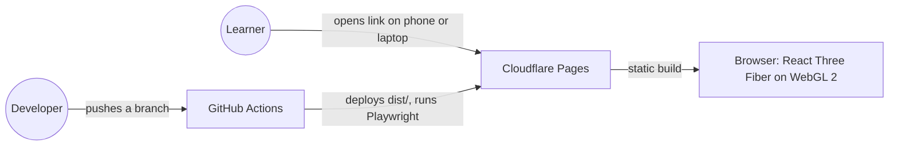
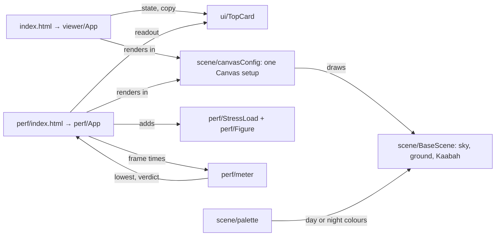
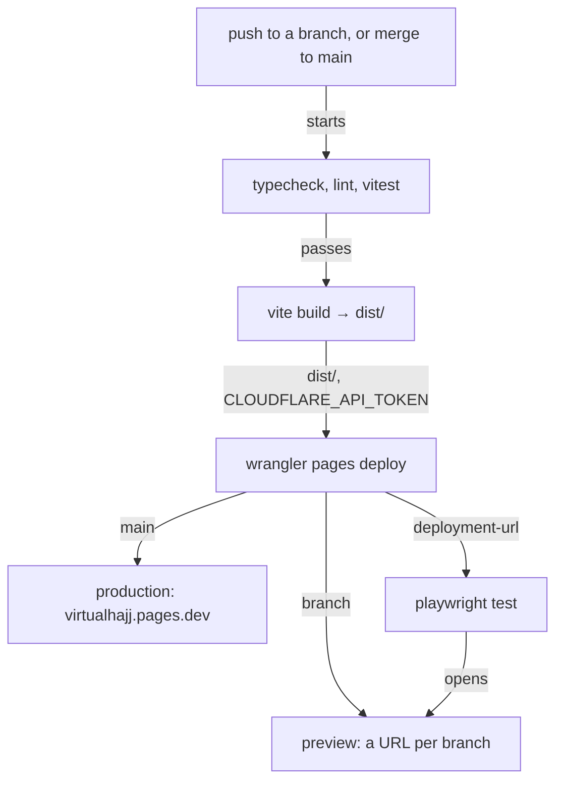

# VirtualHajj · architecture

**Status:** Active · **Updated:** 2026-10-21 by /ship walking-skeleton

## Context

A static site. There is no server and no database: the browser draws every scene.

## Components

Both pages share the canvas setup and the base scene, so `/perf` measures what `/` draws (D22). Each HTML file carries its first card as plain markup, so it shows before the JavaScript arrives. On `/`, a plain script before the bundle shows the no-WebGL 2 message when the browser is too old to run the bundle. The UI uses the design system in `docs/design/design-system/`; the scene colours live in `src/scene/palette.ts`, outside it (D25).

| Part                        | What it does                                                                                    |
| --------------------------- | ----------------------------------------------------------------------------------------------- |
| `src/viewer/viewerState.ts` | Pure reducer: `loading → ready \| no-webgl`, and `→ stopped` when the browser drops the 3D view |
| `src/scene/orbitStep.ts`    | Pure keyboard orbit: arrow keys turn, `+` and `-` zoom, inside the camera limits                |
| `src/perf/meter.ts`         | Pure meter: frames counted in fixed one-second slots from the first frame, verdict at 5:00 |

## Deployment

`.github/workflows/ci.yml` runs one job, `ci`. Fork PRs stop after the build, because they get no secrets (D30). Roll back from Cloudflare Pages › virtualhajj › Deployments, or `git revert` and merge.
