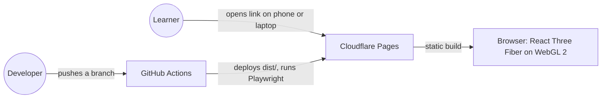
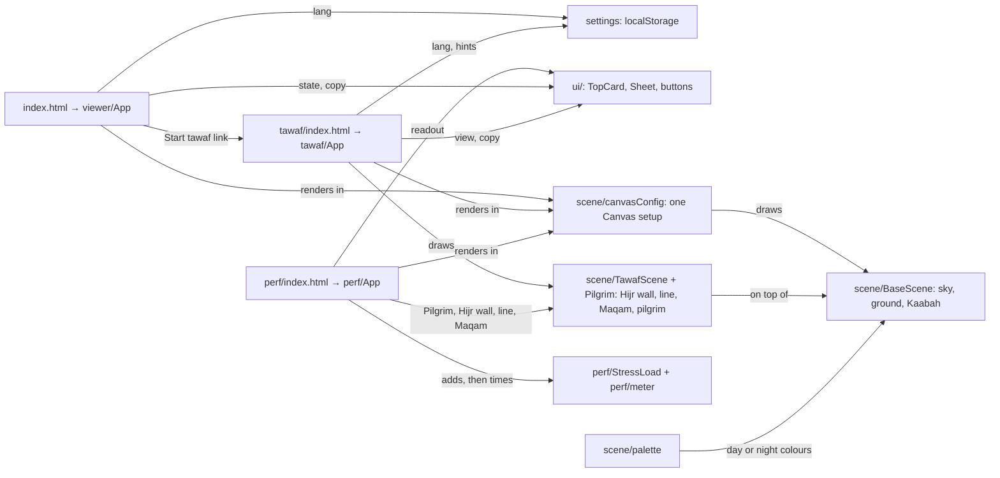
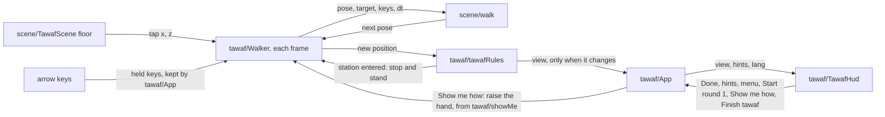
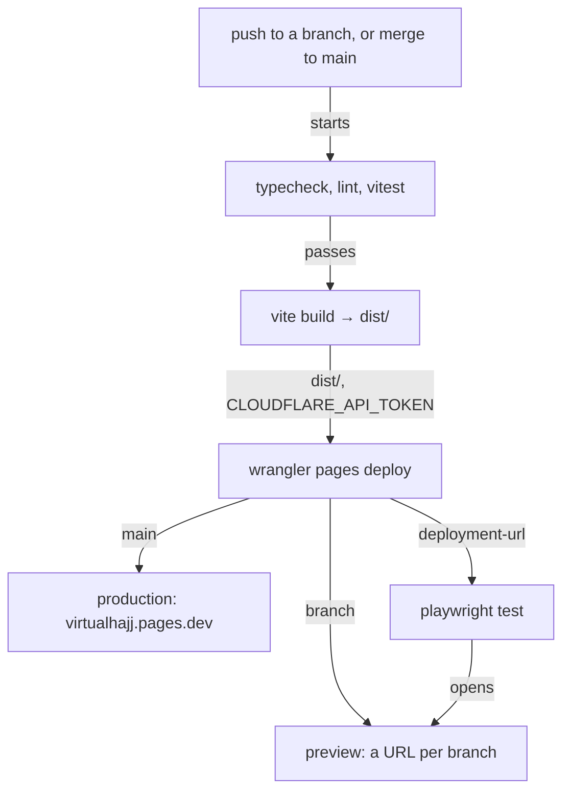

# VirtualHajj · architecture

**Status:** Active · **Updated:** 2026-10-22 by /ship tawaf-stations

## Context

A static site. There is no server and no database: the browser draws every scene.

## Components

All three pages share the canvas setup and the base scene, and `/perf` draws the tawaf parts too, so `/perf` measures what `/` and `/tawaf` draw (D22, D42). Each HTML file carries its first card as plain markup, so it shows before the JavaScript arrives. On `/` and `/tawaf`, a plain script before the bundle picks the language. It also shows the no-WebGL 2 message when the browser is too old to run the bundle. The UI uses the design system in `docs/design/design-system/`; the scene colours live in `src/scene/palette.ts`, outside it (D25).

Inside `/tawaf`, the walk runs in refs, outside React:

React renders only when the HUD's view changes, so the page does not re-render 60 times a second. At a station, the rules hold the walk, the `Walker` stands the pilgrim for istilam or the two rakaat, and the HUD shows the station sheet until the learner presses on. With `?e2e=1`, `Walker` adds `window.vh.walkTo` and `window.vh.position`, so the e2e tests walk the pilgrim (D43).

| Part                        | What it does                                                                                    |
| --------------------------- | ----------------------------------------------------------------------------------------------- |
| `src/viewer/viewerState.ts` | Pure reducer: `loading → ready \| no-webgl`, and `→ stopped` when the browser drops the 3D view |
| `src/scene/orbitStep.ts`    | Pure keyboard orbit: arrow keys turn, `+` and `-` zoom, inside the camera limits                |
| `src/perf/meter.ts`         | Pure meter: frames counted in fixed one-second slots from the first frame, verdict at 5:00 |
| `src/tawaf/tawafRules.ts`   | Pure tawaf rules: counts rounds from the Hajar Aswad line, voids a round on a mistake, and handles Done (D32, D33). Raises the istilam and rakaat stations, and names the part of each round (D45 to D48) |
| `src/tawaf/showMe.ts`       | Pure curve for Show me how: the right hand rises, holds and falls, and cuts with reduced motion (D49) |
| `src/scene/walk.ts`         | Pure walk step: towards a tap or by the arrow keys, kept out of the Kaabah, off the Hijr wall and the Maqam's base, and inside the edge |
| `src/settings.ts`           | Picks the language and the hints from `localStorage` and the browser, and saves changes (D34, D35) |

## Deployment

`.github/workflows/ci.yml` runs one job, `ci`. Fork PRs stop after the build, because they get no secrets (D30). Roll back from Cloudflare Pages › virtualhajj › Deployments, or `git revert` and merge.
