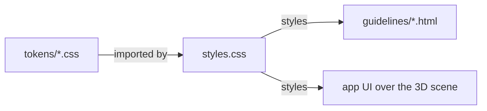

# VirtualHajj design system

The UI layer of a third-person 3D Hajj game: the walking HUD, station sheets and game screens drawn over the scene. Why each value is what it is: `docs/design/system-brief.md`. Decisions D15 and D16 in `DECISIONS.md`.

It commits to:

- Cream and clear sky by day, night blue by dark, one vivid orange accent that means "act here now".
- AAA text: 7:1 for all reading text, 3:1 for controls. Light accent fills carry a burnt-orange edge.
- Readex Pro for Latin and Arabic, Amiri for doa, 18px body, nothing under 15px, 48px touch targets.
- Tier 2 motion with a settling ease and no bounce; reduced motion stops movement and keeps fades.
- A clear lower middle for the character, controls in the corners, one instruction at a time.
- No score, timer, streak, leaderboard, shadow, blur or emoji.

Load `styles.css`. Light and dark follow the device; set `data-theme="light"` or `data-theme="dark"` on any element to force one.
