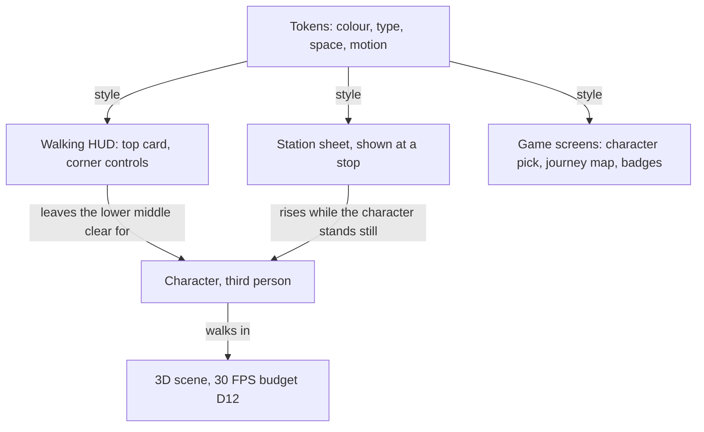

# Design system brief

**Status:** Approved · **Updated:** 2026-10-21 by /design-system
**Shape doc:** docs/specs/virtual-hajj/shape.md

VirtualHajj is a 3D game. The learner picks a male or female character and walks the Hajj as that person, seen from behind. This system covers everything drawn on top of the scene: the walking HUD, the station sheet and the game screens. D12 sets the budget for the scene and the character.



## Brief

| Question        | Answer                                                                                     | From                  |
| --------------- | ------------------------------------------------------------------------------------------ | --------------------- |
| Who             | First-time pilgrims, many of them older, students, and children from 10                     | shape, D6             |
| Where           | Phone and laptop browser; instructors show it on a projector                                | D2, shape › Not doing |
| What it is      | A 3D game: the learner becomes a character and walks each rite in third person              | user                  |
| Character       | Male or female; the pick sets the rules taught (ihram clothing, raml, idtiba', shaving)      | user                  |
| Camera          | Third person, behind and above the character                                                | assumed               |
| Movement        | Tap where to walk by default; an on-screen joystick in settings; arrow keys and click on a laptop | user            |
| Game parts      | Journey map, completion marks, badges. No score.                                            | user                  |
| Density         | One rite, one step at a time                                                                | shape                 |
| Must feel       | Warm, patient, guiding                                                                      | user                  |
| Must never feel | Clinical, rushed, preachy                                                                   | user                  |
| References      | See below                                                                                   | user                  |
| Locked          | Nothing: no logo, colours or fonts                                                          | user                  |
| Motion ceiling  | Tier 2, for the UI layer                                                                    | user                  |
| Contrast        | AAA: 7:1 for all reading text, 3:1 for controls                                             | user                  |
| Scripts         | Malay and English, left to right; Arabic for doa and names from `tawaf` on                   | D4, user              |
| Dark mode       | Light and dark, each designed; the default follows the device setting                       | craft floor           |
| Oldest device   | Samsung Galaxy A35 in Chrome; a browser with no WebGL 2 gets the plain message page          | D12, walking-skeleton |

| Reference         | What it gives                                                                        |
| ----------------- | ------------------------------------------------------------------------------------ |
| Monument Valley   | Sparse UI over a 3D world                                                            |
| Journey           | The goal stays in view, so the place does the guiding; warm light; almost no words   |
| AC Discovery Tour | Guided stations in a real place: stop, learn, walk on                                |
| Sky               | Rewards that feel like gifts, not trophies; nothing competitive                      |

## Trace

```
3D character in third person                   → keep the lower middle of the screen clear; the instruction moves to a top card
Journey: the goal stays in view                → the next target glows in the scene in accent; an edge arrow points to it when off screen
AC Discovery Tour: guided stations             → at a station the character stops, and a station sheet rises from the bottom
Sky: rewards as gifts                          → a badge arrives as a quiet tier 2 reveal; no confetti, no leaderboard
gamified, but "never rushed"                   → no timer, no streak, no score
journey map, completion marks, badges          → three game primitives, built at pause C
male or female character                       → a character pick screen; the pick sets the rules taught
tap to walk, joystick in settings              → a tap ring on the floor; a 128px joystick at bottom left, off by default
Journey and Sky: faceless, stylised figures    → simple figures with no face detail: lighter on phones, and no detailed human faces
white ihram on white marble                    → a ground shadow and a darker rim keep the character visible on the floor
older pilgrims and children 10+ (shape, D6)    → 18px body, 15px floor, 48px touch targets
projector in class (shape)                     → AAA text; the instruction steps up to 35px on wide screens
"warm, patient, guiding"                       → warm cream neutrals, a settling ease, 480ms step changes
bright and game-like, chosen over sand and teal → cream and clear sky by day, night blue by dark, one vivid orange accent
vivid orange is too pale for 7:1 on cream      → orange is a fill with ink text and a burnt-orange edge; burnt orange carries accent text and focus
"never clinical, rushed, preachy"              → no alarm red, no bounce; mistakes in clay, with words
Monument Valley: small text vs older eyes      → sparse means few words, not small words
Monument Valley: sparse UI                     → flat colour planes; tone separates surfaces, not shadow
AAA text over a moving 3D scene                → text only on opaque panels, never on the scene
Galaxy A35 at 30 FPS (D12)                     → no backdrop blur; animate transform and opacity only
Arabic from tawaf                              → Readex Pro for Latin and Arabic UI text, Amiri for doa
Arabic inside Malay and English screens        → right-to-left blocks only; the page layout never mirrors
Malay and English (D4)                         → no fixed-width controls; size for the longer Malay string
scene signals: green sa'i lights, gold kiswah  → one accent, a vivid orange: neither green nor gold; no success green
motion ceiling: tier 2                         → step and reward choreography tokens; no tier 3 tokens
content follows Tabung Haji courses (D1)       → nothing from Tabung Haji's logo or colours; the app is not theirs
```

## Phone layout zones

```
+---------------------------+
| [Hints: on]          [=]  |  top bar: hints switch, menu
| +-----------------------+ |
| | Round 3 of 7  ###.... | |  top card: progress and one instruction
| | Keep the Kaabah on    | |
| | your left.            | |
| +-----------------------+ |
|                           |
|    3D scene, next target  |
|    glowing in accent      |
|                           |
|        (character)        |  lower middle: always clear
|                           |
| (joystick)    [Show me]   |  bottom corners: controls only
+---------------------------+
```

At a station the character stands still, so the station sheet may cover the lower half.

## Tokens

### Colour

| Token          | Light: day           | Dark: night blue         | Use                                                              |
| -------------- | -------------------- | ------------------------ | ---------------------------------------------------------------- |
| `surface`      | `#FFF8EE`            | `#172231`                | Panels and pages                                                 |
| `sunken`       | `#FCEBD3`            | `#223044`                | Inset areas, switch tracks, the doa block                        |
| `ink`          | `#2A1F14`            | `#F7EFE3`                | All main text; the fill of a selected item                       |
| `ink-muted`    | `#4D3D2C`            | `#D0C8BE`                | Secondary text, transliteration                                  |
| `line`         | `#8C7259`            | `#7F8A99`                | Control borders, dividers                                        |
| `accent`       | `#FF9A3D`            | `#FFA552`                | "Act here now" fills: the primary button, the next target, switch on |
| `accent-ink`   | `#7A3300`            | `#FFB673`                | Accent as text and icons, the edge of a light accent fill, focus ring |
| `accent-hover` | `#FFB066`            | `#FFB873`                | Hover and press on an accent fill                                |
| `on-accent`    | `#2A1F14`            | `#172231`                | Text on an accent fill                                           |
| `mistake`      | `#8A1F4A`            | `#FFB0BF`                | Mistake text and icon, always with words                         |
| `scrim`        | `#2A1F14` at 50%     | `#000000` at 55%         | Behind the menu and the badge sheet                              |
| `map-area`     | `#F0D3AA`            | `#2E405A`                | Place shapes on the journey map                                  |

Measured contrast, WCAG 2 formula:

| Pair                        | Light | Dark | Floor |
| --------------------------- | ----- | ---- | ----- |
| `ink` on `surface`          | 15.3  | 14.1 | 7     |
| `ink` on `sunken`           | 13.8  | 11.7 | 7     |
| `ink-muted` on `surface`    | 9.9   | 9.7  | 7     |
| `ink-muted` on `sunken`     | 8.9   | 8.1  | 7     |
| `accent-ink` on `surface`   | 8.7   | 9.3  | 7     |
| `accent-ink` on `sunken`    | 7.8   | 7.7  | 7     |
| `on-accent` on `accent`     | 7.6   | 8.2  | 7     |
| `on-accent` on `accent-hover` | 8.9 | 9.4  | 7     |
| `mistake` on `surface`      | 8.4   | 9.3  | 7     |
| `mistake` on `sunken`       | 7.6   | 7.8  | 7     |
| `ink` on `map-area`         | 11.2  | 9.2  | 7     |
| `line` on `surface`         | 4.3   | 4.6  | 3     |
| `accent` on `surface`       | 2.0   | 8.2  | 3     |

Light `accent` on `surface` is 2.0, under the 3:1 floor for controls. So every light accent fill carries a 1.5px `accent-ink` edge (8.7). In the scene, the glowing line is `accent` at 55% with an `accent-ink` core.

A selected item (language, character, done mark) is filled with `ink`. The accent stays for "act here". A correct step shows a check icon and words in `ink`. Green stays with the sa'i lights in the scene.

### Type

Scale ratio 1.25 from an 18px body. `caption` is 15px, not 14.4px, because 15px is the floor for older eyes.

| Token         | Size / line (px)                  | Weight | Font       | Use                                       |
| ------------- | --------------------------------- | ------ | ---------- | ----------------------------------------- |
| `caption`     | 15 / 22                           | 400    | Readex Pro | Small labels; nothing is smaller          |
| `body`        | 18 / 28                           | 400    | Readex Pro | Explanations, mistake detail              |
| `label`       | 18 / 24                           | 600    | Readex Pro | Buttons, switches                         |
| `lead`        | 22 / 30                           | 500    | Readex Pro | Progress ("Round 3 of 7"), panel headings |
| `instruction` | 28 / 34; 35 / 42 from 1024px wide | 600    | Readex Pro | The one instruction on screen             |
| `title`       | 35 / 42; 44 / 52 from 1024px wide | 600    | Readex Pro | Rite titles, the journey map, badges      |
| `doa`         | 28 / 56                           | 400    | Amiri      | Arabic doa and talbiyah, with harakat     |

| Font                         | Covers        | woff2 size                 | Loads                    |
| ---------------------------- | ------------- | -------------------------- | ------------------------ |
| Readex Pro, variable 160–700 | Latin, Arabic | 31 kB Latin + 23 kB Arabic | At start                 |
| Amiri 400                    | Arabic        | 109 kB                     | When the first doa shows |

Sizes are from the Google Fonts subsets, measured on 2026-10-21.

### Space and shape

| Token            | Value                                                     |
| ---------------- | --------------------------------------------------------- |
| Space scale      | 4, 8, 12, 16, 24, 32, 48, 64 px (`space-1` to `space-16`) |
| `target`         | 48 × 48 px minimum touch target                           |
| `joystick`       | 128px pad, 56px knob                                      |
| `radius-control` | 6px                                                       |
| `radius-inner`   | 4px: a part inside a control, such as a switch thumb, a language option or a status tag |
| `radius-mark`    | 2px: progress marks                                       |
| `radius-panel`   | 12px; top corners only when docked at the bottom          |
| Elevation        | None. No shadows, no blur.                                |

### Motion, tier 2

| Token         | Value                            | Use                                        |
| ------------- | -------------------------------- | ------------------------------------------ |
| `dur-press`   | 120ms                            | Press feedback                             |
| `dur-micro`   | 180ms                            | Hover, focus, switch                       |
| `dur-panel`   | 320ms                            | A panel or the station sheet enters or leaves |
| `dur-step`    | 480ms                            | One instruction gives way to the next      |
| `dur-reward`  | 800ms                            | A badge or a completion mark is revealed   |
| `stagger`     | 60ms                             | Progress marks, map stops, list items      |
| `ease-settle` | `cubic-bezier(0.22, 1, 0.36, 1)` | Enter: a quick start and a long, soft stop |
| `ease-leave`  | `cubic-bezier(0.55, 0, 1, 0.45)` | Exit                                       |

UI elements move `move` (12px) or less, with no overshoot or bounce. Camera moves use `ease-settle`. With `prefers-reduced-motion: reduce`, transforms stop, opacity fades stay at `dur-micro`, and the camera cuts instead of gliding.

## Rules

- Put text only on an opaque `surface` or `sunken` panel. The scene is never a text background.
- Keep the lower middle of the screen clear while the character walks. Put controls in the bottom corners only.
- Show one instruction at a time, in the top card.
- At a station, stop the character before the station sheet rises.
- Never show a score, a timer, a streak or a leaderboard.
- Draw characters as simple, stylised figures with no face detail.
- Put Arabic in its own block with `dir="rtl"` and `lang="ar"`. Keep the page layout left to right.
- Use Lucide icons: MIT licence, one import per icon, round stroke caps that suit "warm". Draw rite symbols (Kaabah, Hajar Aswad, jamarat) and badge art as SVG in the same 2px stroke.

## Pause B builds

- A button, primary and quiet.
- An input: the hints on/off switch, which is the product's real input.
- One composed element: the walking HUD for tawaf round 3 on a phone, with the top card, the character, the joystick and "Show me". It shows in Malay and English, in light and dark, and as a station sheet at the Hajar Aswad line.

## Glossary

- **AAA, AA** — WCAG contrast levels: 7:1 and 4.5:1 for body text.
- **WCAG** — the web accessibility guidelines that set the contrast rules.
- **HUD** — heads-up display: the game UI drawn over the scene.
- **Third person** — the camera follows behind the character, so the learner sees their own figure.
- **Station** — a stop in a rite, such as the Hajar Aswad line, where the character stands still and the app explains.
- **Raml** — walking briskly in the first three rounds of tawaf, for men.
- **Idtiba'** — wearing the ihram cloth under the right arm and over the left shoulder, for men in tawaf.
- **Readex Pro** — a free font with Latin and Arabic, which extends Lexend, a font designed for easy reading.
- **Amiri** — a free classical Naskh Arabic font with full harakat support.
- **Naskh** — the common book style of Arabic script.
- **Harakat** — the small vowel marks above and below Arabic letters.
- **Doa** — a supplication.
- **Talbiyah** — the phrase pilgrims repeat in ihram, "Labbaik Allahumma labbaik".
- **Kiswah** — the black cloth that covers the Kaabah, with a gold band of writing.
- **Lucide** — a free set of line icons.
- **Easing** — the speed curve of a movement.
- **woff2** — the compressed file format for web fonts.
- **Tier 2** — craft's motion tier for choreography, such as staged transitions between steps.
