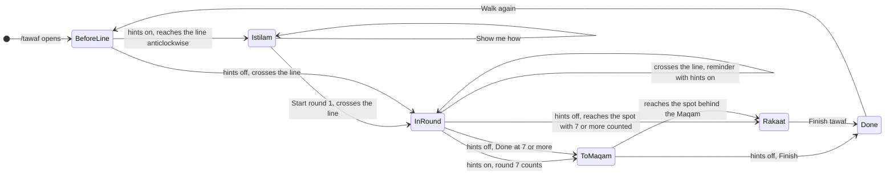

# tawaf-stations

**Version:** v1 · **Status:** Draft · **Type:** Feature · **Project type:** Web UI

**Shape doc:** docs/specs/virtual-hajj/shape.md
**Depends on:** tawaf

The tawaf page now teaches what a pilgrim does and says at three stations of the tawaf. These are istilam at the Hajar Aswad line, the doa from the Rukun Yamani, and two rakaat behind the Maqam Ibrahim. The slice reuses the pilgrim, the step checks and the HUD that `tawaf` built.

## Problem

Tabung Haji courses teach istilam, the Rukun Yamani doa and the two rakaat in talks and slides. The tawaf page checks the seven rounds, but it says nothing about these three. So a learner can walk a correct tawaf in the app, and still not know what to say at the line or where to pray after round 7. In Makkah, the crowd gives no time to stop and think.

## Slice test

| Check                         | Result                                                                                                                                                      |
| ----------------------------- | ----------------------------------------------------------------------------------------------------------------------------------------------------------- |
| Cuts every layer it needs     | yes — the Maqam Ibrahim in the scene, the pilgrim's istilam gesture, the station rules, the sheets and the top card in two languages with Arabic, `/perf`   |
| One e2e test walks it         | yes — Playwright walks to the line, presses Start round 1, walks seven rounds, walks behind the Maqam Ibrahim, presses Finish tawaf and reads the done card |
| Worth shipping alone          | yes — a learner practises the tawaf as the course teaches it, from the first istilam to the two rakaat                                                      |
| Fits (≤5 scenarios, ≤2 areas) | yes, at the limit — 5 scenarios, 2 areas: the tawaf page and `/perf`. The hints-off scenario carries seven rows                                             |

**Path:** full — a new scene part, new rules, Arabic text and a figure gesture.

## User story

As a first-time pilgrim, I want the app to show me each station of the tawaf, so that I do each one right in Makkah.

## Flow


With hints on, the pilgrim stops at the line for the istilam sheet, and the doa shows from the Rukun Yamani in each round. After the rounds, the learner walks behind the Maqam Ibrahim, and the rakaat sheet leads to the done card.

## States



The rounds and their mistakes work as in `tawaf`, inside InRound. Two stops are new: the istilam sheet before round 1, and the rakaat sheet after the rounds.

## Rules

The station rules follow the Shafi'i rulings, as Tabung Haji courses teach them (D1). Istilam, the doa and the two rakaat are sunnah, so leaving one out does not void the tawaf. The app never counts one as a mistake.

| Station                                    | Hints on                                                                                                                 | Hints off                                                                                                                  |
| ------------------------------------------ | ------------------------------------------------------------------------------------------------------------------------ | -------------------------------------------------------------------------------------------------------------------------- |
| The Hajar Aswad line, before round 1       | The pilgrim stops before the line and faces the Hajar Aswad. The istilam sheet rises, with Show me how and Start round 1 | Nothing new. Round 1 starts at the crossing, as in `tawaf`                                                                 |
| Each later crossing, to the end of round 7 | The top card reminds the learner of istilam, and the walk goes on                                                        | Nothing                                                                                                                    |
| The Rukun Yamani to the line, each round   | The top card shows the doa in Arabic, its reading and its meaning, and the walk goes on                                  | Nothing                                                                                                                    |
| After the rounds                           | When round 7 counts, the top card says to walk behind the Maqam Ibrahim, and the spot glows                              | Done at seven says "Seven rounds count." Done over seven is listed, as in `tawaf`. Nothing guides the learner to the Maqam |
| The spot behind the Maqam Ibrahim          | After the rounds, the pilgrim stops there and faces the Kaabah. The rakaat sheet rises. Finish tawaf opens the done card | The same. With 7 or more counted and no Done, arrival acts as Done. Under 7, the spot does nothing                         |
| The rakaat left out                        | —                                                                                                                        | After the rounds, Finish takes the Done corner. It opens the done card, which notes that the rakaat were not prayed        |

- Istilam comes eight times: at the start of each round, and once more when round 7 ends at the line (O2).
- The spot is within 3 m of a point 3 m behind the Maqam Ibrahim, on the line from the Kaabah through the Maqam (O6).
- Only an anticlockwise approach raises the istilam sheet. A clockwise approach before round 1 starts nothing, as D32 says.
- While a station sheet shows, taps and the arrow keys do not move the pilgrim.
- After the rounds, the direction and Hijr Ismail checks stop. The pilgrim may walk to the Maqam Ibrahim by any path.
- The pilgrim walks round the Maqam Ibrahim, and never through it.
- Switching hints off closes the istilam sheet, and the walk goes on. The rakaat sheet stays, because it shows with hints off too.
- Walk again and Start tawaf again put the pilgrim before the line, so the istilam sheet rises again.
- The Arabic shows in Amiri when the font loads. Until then, or if the font fails, it shows in Readex Pro, which also has Arabic.

## Acceptance criteria

```gherkin
Scenario Outline: The learner does istilam at the Hajar Aswad line, with hints on
  Given <learner> opens https://virtualhajj.pages.dev/tawaf in <language>, with hints on
  When the pilgrim walks anticlockwise to the Hajar Aswad line
  Then the pilgrim stops before the line and faces the Hajar Aswad
  And the station sheet rises with "<title>", "بِسْمِ اللهِ وَاللهُ أَكْبَرُ" and "Bismillāhi wallāhu akbar"
  And a tap on the floor does not move the pilgrim
  When <learner> presses "<start>"
  Then the sheet leaves, and the pilgrim turns so that the Kaabah is on its left
  And the top card says "<round 1>" when the pilgrim crosses the line
  And at each later crossing, to the end of round 7, the top card says "<reminder>", and the pilgrim does not stop

  Examples:
    | learner | language | title                | start           | round 1               | reminder                                                                        |
    | Aisha   | English  | The Hajar Aswad line | Start round 1   | Round 1 of 7          | Raise your right hand to the Hajar Aswad, and say: Bismillāhi wallāhu akbar.    |
    | Omar    | Malay    | Garisan Hajar Aswad  | Mula pusingan 1 | Pusingan 1 daripada 7 | Angkat tangan kanan ke arah Hajar Aswad, dan sebut: Bismillāhi wallāhu akbar. |

Scenario: The doa shows from the Rukun Yamani to the Hajar Aswad line, and the pilgrim does not stop
  Given Aisha is in round 2 of 7 on https://virtualhajj.pages.dev/tawaf, in English, with hints on
  When the pilgrim passes the Rukun Yamani
  Then the top card shows "رَبَّنَا آتِنَا فِي الدُّنْيَا حَسَنَةً وَفِي الْآخِرَةِ حَسَنَةً وَقِنَا عَذَابَ النَّارِ"
  And the top card shows its reading, "Rabbanā ātinā fid-dunyā ḥasanah, wa fil-ākhirati ḥasanah, wa qinā ʿadhāban-nār"
  And the top card shows its meaning, "Our Lord, give us good in this world and good in the Hereafter, and protect us from the punishment of the Fire."
  And the pilgrim walks on
  And the istilam reminder takes the doa's place when the pilgrim crosses the line

Scenario: After seven rounds, the learner prays two rakaat behind the Maqam Ibrahim
  Given Omar has walked six clean rounds on https://virtualhajj.pages.dev/tawaf, in English, with hints on
  When round 7 counts at the Hajar Aswad line
  Then the top card reminds Omar of the last istilam, and says "Walk to the glowing spot behind the Maqam Ibrahim."
  And the spot behind the Maqam Ibrahim glows
  And a walk back clockwise to the spot names no mistake
  When the pilgrim reaches the spot
  Then the pilgrim stops and faces the Kaabah, with the Maqam Ibrahim in front
  And the station sheet rises with "Two rakaat behind the Maqam Ibrahim"
  And the sheet says to read al-Kafirun in the first rakaat and al-Ikhlas in the second, after al-Fatihah in each
  When Omar presses "Finish tawaf"
  Then the done card says "Tawaf done. Seven rounds." and "No mistakes on the way."

Scenario Outline: With hints off, the learner does the stations alone
  Given Aisha has hints off on https://virtualhajj.pages.dev/tawaf, in English
  When she <action>
  Then <result>

  Examples:
    | action                                                                             | result                                                                                                              |
    | walks to the Hajar Aswad line and crosses it                                       | no station sheet rises, and round 1 starts at the crossing                                                          |
    | walks from the Rukun Yamani to the line in round 2                                 | no doa shows                                                                                                        |
    | taps "Done" after 7 clean rounds, then walks to the spot behind the Maqam Ibrahim | the app says "Seven rounds count.", and the rakaat sheet rises at the spot                                          |
    | walks 7 clean rounds, then goes straight to the spot behind the Maqam Ibrahim     | the rakaat sheet rises, as if she had tapped "Done" at 7                                                            |
    | walks across the spot behind the Maqam Ibrahim in round 3                          | nothing shows, and round 3 goes on                                                                                  |
    | walks 8 clean rounds, then goes to the spot behind the Maqam Ibrahim               | the rakaat sheet rises, and the done card later lists "You walked eight rounds. Tawaf has seven."                   |
    | taps "Done" after 7 clean rounds, then taps "Finish"                               | the done card says "Tawaf done. Seven rounds." and lists "You did not pray the two rakaat behind the Maqam Ibrahim." |

Scenario: Show me how shows istilam on the pilgrim
  Given the istilam sheet shows for Aisha at the Hajar Aswad line, before round 1
  When she presses "Show me how"
  Then the sheet lowers out of the way
  And the pilgrim raises its right hand towards the Hajar Aswad, then lowers it
  And the sheet rises again, with "Start round 1"
```

Pause 2 sets every string in both languages. The Arabic, the readings and the Malay are Claude's drafts until you check them (O10).

## Scope

**In:**

- The istilam sheet at the Hajar Aswad line before round 1, with Show me how and Start round 1. Hints on only.
- An istilam reminder in the top card at each later crossing, to the end of round 7: eight istilam in all. Hints on only.
- The doa in the top card from the Rukun Yamani to the line, in each round. Hints on only.
- The Maqam Ibrahim on the mataf, built in code (D31), and the spot behind it. The pilgrim walks round it. `/perf` draws it too (D42).
- After the rounds: the walk to the spot, the rakaat sheet, Finish tawaf, then the done card. With hints off: Done or arrival at 7 or more, and Finish to leave out the rakaat.
- The done card's note when the rakaat were not prayed.
- The pilgrim's istilam gesture, for Show me how.
- Arabic in Amiri with harakat, its reading, and its meaning in English and Malay.
- Every new string in English and Malay, in `src/copy.ts`.
- The `tawaf` e2e tests changed for the new stop at the line and the new end, and one e2e test that walks this slice.

**Out:**

- A doa for each round from the Tabung Haji books → not doing (O4).
- Touching the Rukun Yamani → not doing (O11).
- The niat for the tawaf prayer → not doing (O12).
- The walking HUD's Show me button → not doing (O9). The design system keeps it.
- A prayer animation for the two rakaat → not doing (O9). The sheet's words teach them.
- Zamzam, the doa at the Multazam, and the last istilam before sa'i → not in the shape. `umrah` joins tawaf to sa'i, so it is the place to decide them.
- The man or woman pick, idtiba', raml and the joystick → `tawaf-character`.
- The mosque round the mataf → `masjidil-haram`.
- Crowds → not doing (shape).

## Decisions to record

Drafted at pause 1. `/build` appends them to `DECISIONS.md` exactly as below.

```markdown
## D45 · 2026-10-22 · Istilam: a station sheet before round 1, then a reminder at each crossing

Why: istilam is sunnah at the start of each round. The user chose eight in all, with one more when round 7 ends, and checks the count against the Tabung Haji book (O2, O10). One stop teaches the words and the gesture, and seven stops would break a walk of about 3 minutes. With hints off nothing shows, because nothing checks a sunnah.
Rejected: a sheet at every crossing (seven stops in one tawaf), a sheet before round 1 only (rounds 2 to 7 never practise it), seven istilam (the user chose eight), the sheet with hints off (it gives the answer away on the learner's own test).
Source: docs/specs/tawaf-stations.md
Status: active

## D46 · 2026-10-22 · The Rukun Yamani doa shows in the top card while the pilgrim walks

Why: pilgrims say "Rabbanā ātinā…" as they walk from the Rukun Yamani to the Hajar Aswad, so nobody stops. The top card shows it in each round, with hints on.
Rejected: a stop at the Rukun Yamani in round 1 (pilgrims do not stop there), a doa for each round from the Tabung Haji books (any doa is fine in the rest of the round, and it adds seven Arabic texts to check), a line on touching the Rukun Yamani (most pilgrims can't reach it in the crowd, and it adds one more ruling to check).
Source: docs/specs/tawaf-stations.md
Status: active

## D47 · 2026-10-22 · After the rounds, the learner prays two rakaat behind the Maqam Ibrahim before the done card

Why: two rakaat behind the Maqam Ibrahim follow every tawaf, as a sunnah in the Shafi'i rulings (D1). The spot counts within 3 m of a point 3 m behind the Maqam, on the line from the Kaabah through it. The sheet teaches al-Kafirun in the first rakaat and al-Ikhlas in the second, after al-Fatihah.
Rejected: the done card first, with a button to the rakaat (it puts the rakaat after the end), anywhere behind the Maqam up to 10 m (too loose to teach the place), the niat in Arabic on the sheet (one more Arabic text to check), one line with no surahs (it leaves out the sunnah surahs).
Source: docs/specs/tawaf-stations.md
Status: active

## D48 · 2026-10-22 · With hints off, the learner ends the rounds and goes to the Maqam Ibrahim alone

Why: hints off is the learner's own test (D33). Done at seven says "Seven rounds count.", and nothing guides the learner after it. A pilgrim in Makkah has no Done to press, so arrival behind the Maqam with seven or more counted acts as Done. Under seven, the spot does nothing, because learners walk across it in the rounds. Finish ends without the rakaat, and the done card notes them as a sunnah left out, not a mistake.
Rejected: the done card at Done (a hints-off learner never practises the rakaat), a top card that says to walk to the Maqam (that is a hint), a spot that does nothing until Done (a learner who goes straight to pray, as in Makkah, gets no answer), "Not done yet" at the spot under seven (it trips a learner who walks across the spot in round 3).
Source: docs/specs/tawaf-stations.md
Status: active

## D49 · 2026-10-22 · Show me how shows istilam on the pilgrim, and the walking HUD has no Show me

Why: words describe a gesture badly, so the pilgrim raises its right hand to the Hajar Aswad when the learner asks. On the walk, the glowing target and the edge arrow already show the way (tawaf O19). This closes the hand-off in tawaf O20.
Rejected: a Show me button in the walking HUD (it repeats the glow and the edge arrow), no demo (words alone describe a gesture badly), a demo of the two rakaat (a prayer animation is a lot of figure work, and learners already know how to pray).
Source: docs/specs/tawaf-stations.md
Status: active
```

## Open items

| ID  | What                                                                                      | Type     | Raised at | Owner | Status   | Answer                                                                                                                                                                                  |
| --- | ----------------------------------------------------------------------------------------- | -------- | --------- | ----- | -------- | --------------------------------------------------------------------------------------------------------------------------------------------------------------------------------------- |
| O1  | How often does the istilam sheet rise at the Hajar Aswad line?                            | question | spec p1   | user  | Resolved | Once, before round 1. At each later crossing, the top card reminds the learner, and the walk goes on. D45. 2026-10-22                                                                   |
| O2  | Is there one more istilam when round 7 ends, so eight in all?                             | question | spec p1   | user  | Resolved | Yes, eight. Claude was not sure of the count, so the check against the Tabung Haji book is part of O10. D45. 2026-10-22                                                                 |
| O3  | How does the doa between the Rukun Yamani and the Hajar Aswad show?                       | question | spec p1   | user  | Resolved | In the top card, in each round, while the pilgrim walks. No stop. D46. 2026-10-22                                                                                                       |
| O4  | Tabung Haji books give a doa for each round. Is that in this slice?                       | question | spec p1   | user  | Resolved | No. Only the Rukun Yamani doa. D46. 2026-10-22                                                                                                                                          |
| O5  | With hints on, what happens when round 7 counts?                                          | question | spec p1   | user  | Resolved | The top card says to walk behind the Maqam Ibrahim, and a spot glows. There the pilgrim stops, the rakaat sheet rises, and its button opens the done card. D47. 2026-10-22              |
| O6  | Where does the app count the pilgrim as behind the Maqam Ibrahim?                         | question | spec p1   | user  | Resolved | Within 3 m of a spot 3 m behind the Maqam, on the line from the Kaabah through it. With hints on, the spot glows. D47. 2026-10-22                                                       |
| O7  | With hints off, do the istilam sheet and the doa still show?                              | question | spec p1   | user  | Resolved | No. Nothing checks them, because both are sunnah. D45, D46. 2026-10-22                                                                                                                  |
| O8  | With hints off, how do the two rakaat work after Done at 7?                               | question | spec p1   | user  | Resolved | Done at 7 says "Seven rounds count." The learner walks behind the Maqam alone, and the sheet rises there. Finish ends without the rakaat, and the done card notes them. D48. 2026-10-22 |
| O9  | What do Show me how and the walking HUD's Show me do?                                     | question | spec p1   | user  | Resolved | Show me how on the istilam sheet only: the pilgrim raises its right hand to the Hajar Aswad. The walking HUD's Show me is dropped. This closes tawaf O20. D49. 2026-10-22               |
| O10 | Who writes the Arabic, its reading, and its meaning in English and Malay?                 | question | spec p1   | user  | Resolved | Claude drafts them, with the Malay copy. You check them against the Tabung Haji book in the pause 2 preview, as in tawaf O23. Approval of pause 2 means they stand. 2026-10-22          |
| O11 | At the Rukun Yamani, does the app also teach touching the corner?                         | question | spec p1   | user  | Resolved | No, the doa only. D46. 2026-10-22                                                                                                                                                       |
| O12 | What does the rakaat sheet teach?                                                         | question | spec p1   | user  | Resolved | Two rakaat that face the Kaabah, with the Maqam in front. After al-Fatihah, al-Kafirun in the first and al-Ikhlas in the second. No niat. D47. 2026-10-22                               |
| O13 | With hints off, the pilgrim reaches the spot behind the Maqam with no Done. What happens? | question | spec p1   | user  | Resolved | Arrival acts as Done at 7 or more: the sheet rises, and over 7 is listed. Under 7, nothing happens, because learners walk across the spot in the rounds. D48. 2026-10-22                |

_Never delete this section or its rows. See references/ledger.md._

## Glossary

- **Tawaf** — seven anticlockwise rounds of the Kaabah, starting at the Hajar Aswad.
- **Hajar Aswad** — the Black Stone in one corner of the Kaabah; each round of tawaf starts and ends in line with it.
- **Hajar Aswad line** — a line on the floor from the Hajar Aswad corner, where the app counts each round.
- **Istilam** — saluting the Hajar Aswad with the right hand at the start of each round.
- **Rukun Yamani** — the Kaabah corner before the Hajar Aswad corner, in the direction of tawaf.
- **Maqam Ibrahim** — the station of Ibrahim, a small enclosure on the mataf in front of the Kaabah's door side.
- **Mataf** — the open floor round the Kaabah where tawaf is walked.
- **Multazam** — the wall of the Kaabah between the Hajar Aswad and the door, where pilgrims make doa.
- **Zamzam** — the well in the Masjidil Haram; pilgrims drink its water after tawaf.
- **Rakaat** — units of the prayer; two are prayed behind the Maqam Ibrahim after tawaf.
- **Al-Fatihah, al-Kafirun, al-Ikhlas** — chapters 1, 109 and 112 of the Quran.
- **Niat** — the intention for a prayer or a rite, made in the heart.
- **Doa** — a supplication.
- **Sunnah** — a recommended act; leaving it out does not void the rite.
- **Shafi'i** — one of the four Sunni schools of Islamic law, the one followed in Malaysia.
- **Tabung Haji** — Malaysia's pilgrims' fund, which runs the national Hajj courses.
- **Harakat** — the small vowel marks above and below Arabic letters.
- **Amiri** — a free classical Arabic font, used for doa.
- **Readex Pro** — the app's font for Latin and Arabic text.
- **Station sheet** — the design system's panel that rises from the bottom while the pilgrim stands still at a station.
- **Top card** — the HUD panel at the top of the screen that holds the one instruction.
- **HUD** — heads-up display: the game UI drawn over the scene.
- **e2e** — end to end: one test that walks the whole slice as a user would.
- **Scenario Outline** — one Gherkin scenario run once for each row of its Examples table.
