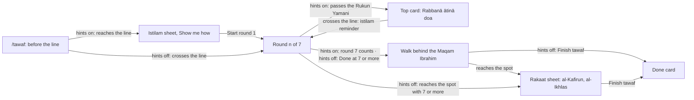
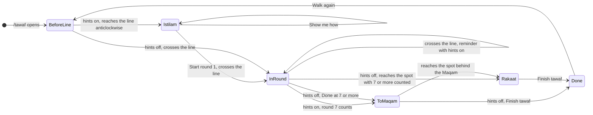
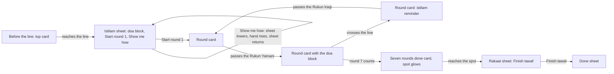
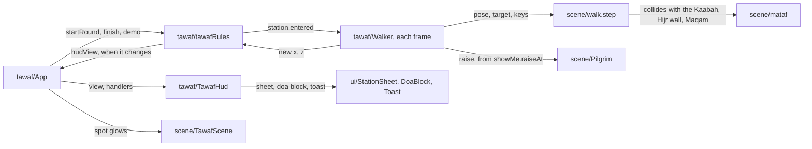
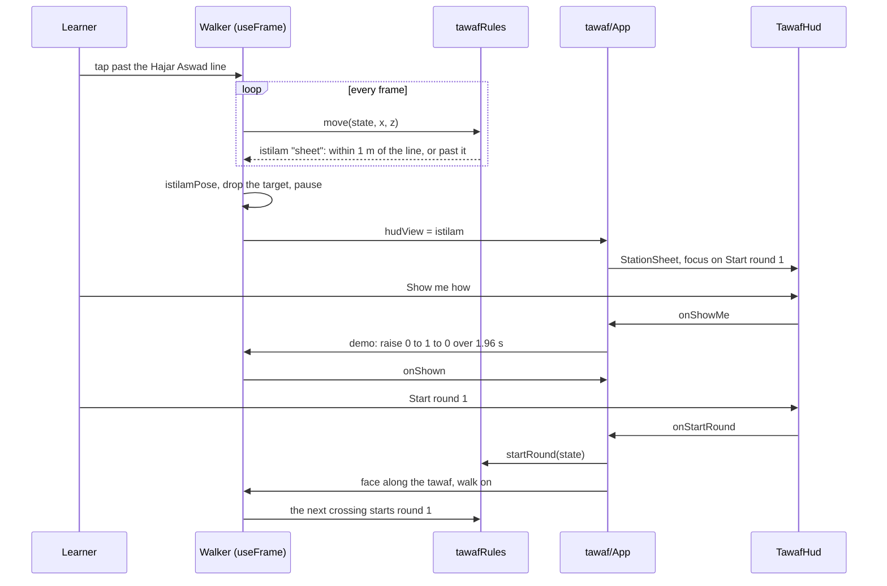

# tawaf-stations

**Version:** v1 · **Status:** Refined · **Type:** Feature · **Project type:** Web UI

**Shape doc:** docs/specs/virtual-hajj/shape.md
**Depends on:** tawaf

The tawaf page now teaches what a pilgrim does and says at three stations of the tawaf. These are istilam at the Hajar Aswad line, the doa from the Rukun Yamani, and two rakaat behind the Maqam Ibrahim. The slice reuses the pilgrim, the step checks and the HUD that `tawaf` built.

## Problem

Tabung Haji courses teach istilam, the Rukun Yamani doa and the two rakaat in talks and slides. The tawaf page checks the seven rounds, but it says nothing about these three. So a learner can walk a correct tawaf in the app, and still not know what to say at the line or where to pray after round 7. In Makkah, the crowd gives no time to stop and think.

## Slice test

| Check                         | Result                                                                                                                                                      |
| ----------------------------- | ----------------------------------------------------------------------------------------------------------------------------------------------------------- |
| Cuts every layer it needs     | yes — the Maqam Ibrahim in the scene, the pilgrim's istilam gesture, the station rules, the sheets and the top card in two languages with Arabic, `/perf`   |
| One e2e test walks it         | yes — Playwright walks to the line, presses Start round 1, walks seven rounds, walks behind the Maqam Ibrahim, presses Finish tawaf and reads the done card |
| Worth shipping alone          | yes — a learner practises the tawaf as the course teaches it, from the first istilam to the two rakaat                                                      |
| Fits (≤5 scenarios, ≤2 areas) | yes, at the limit — 5 scenarios, 2 areas: the tawaf page and `/perf`. The hints-off scenario carries seven rows                                             |

**Path:** full — a new scene part, new rules, Arabic text and a figure gesture.

## User story

As a first-time pilgrim, I want the app to show me each station of the tawaf, so that I do each one right in Makkah.

## Flow



With hints on, the pilgrim stops at the line for the istilam sheet, and the doa shows from the Rukun Yamani in each round. After the rounds, the learner walks behind the Maqam Ibrahim, and the rakaat sheet leads to the done card.

## States



The rounds and their mistakes work as in `tawaf`, inside InRound. Two stops are new: the istilam sheet before round 1, and the rakaat sheet after the rounds.

## Rules

The station rules follow the Shafi'i rulings, as Tabung Haji courses teach them (D1). Istilam, the doa and the two rakaat are sunnah, so leaving one out does not void the tawaf. The app never counts one as a mistake.

| Station                                  | Hints on                                                                                                                 | Hints off                                                                                                                  |
| ---------------------------------------- | ------------------------------------------------------------------------------------------------------------------------ | -------------------------------------------------------------------------------------------------------------------------- |
| The Hajar Aswad line, before round 1     | The pilgrim stops before the line and faces the Hajar Aswad. The istilam sheet rises, with Show me how and Start round 1 | Nothing new. Round 1 starts at the crossing, as in `tawaf`                                                                 |
| Each crossing that starts rounds 2 to 7  | The top card reminds the learner of istilam, and the walk goes on                                                        | Nothing                                                                                                                    |
| The Rukun Yamani to the line, each round | The top card shows the doa in Arabic, its reading and its meaning, and the walk goes on                                  | Nothing                                                                                                                    |
| After the rounds                         | When round 7 counts, the top card says to walk behind the Maqam Ibrahim, and the spot glows                              | Done at seven says "Seven rounds count." Done over seven is listed, as in `tawaf`. Nothing guides the learner to the Maqam |
| The spot behind the Maqam Ibrahim        | After the rounds, the pilgrim stops there and faces the Kaabah. The rakaat sheet rises. Finish tawaf opens the done card | The same. With 7 or more counted and no Done, arrival acts as Done. Under 7, the spot does nothing                         |
| The rakaat left out                      | —                                                                                                                        | After the rounds, Finish tawaf takes the Done corner. It opens the done card, which notes that the rakaat were not prayed  |

- Istilam comes seven times, once at the start of each round (O2). Each time, the pilgrim points the right hand at the Hajar Aswad, says "Bismillāhi wallāhu akbar", and kisses the hand (O17).
- The spot is within 3 m of a point 3 m behind the Maqam Ibrahim, on the line from the Kaabah through the Maqam (O6).
- Only an anticlockwise approach raises the istilam sheet. A clockwise approach before round 1 starts nothing, as D32 says.
- While a station sheet shows, taps and the arrow keys do not move the pilgrim.
- After the rounds, the direction and Hijr Ismail checks stop. The pilgrim may walk to the Maqam Ibrahim by any path.
- The pilgrim walks round the Maqam Ibrahim, and never through it.
- Switching hints off closes the istilam sheet, and the walk goes on. The rakaat sheet stays, because it shows with hints off too.
- Walk again and Start tawaf again put the pilgrim before the line, so the istilam sheet rises again.
- The Arabic shows in Amiri when the font loads. Until then, or if the font fails, it shows in Readex Pro, which also has Arabic.

## Acceptance criteria

```gherkin
Scenario Outline: The learner does istilam at the Hajar Aswad line, with hints on
  Given <learner> opens https://virtualhajj.pages.dev/tawaf in <language>, with hints on
  When the pilgrim walks anticlockwise to the Hajar Aswad line
  Then the pilgrim stops before the line and faces the Hajar Aswad
  And the station sheet rises with "<title>", "بِسْمِ اللهِ وَاللهُ أَكْبَرُ" and "Bismillāhi wallāhu akbar"
  And a tap on the floor does not move the pilgrim
  When <learner> presses "<start>"
  Then the sheet leaves, and the pilgrim turns so that the Kaabah is on its left
  And the top card says "<round 1>" when the pilgrim crosses the line
  And at each crossing that starts rounds 2 to 7, the top card says "<reminder>", "Bismillāhi wallāhu akbar" and to kiss the hand, and the pilgrim does not stop

  Examples:
    | learner | language | title                | start           | round 1               | reminder                                                                        |
    | Aisha   | English  | The Hajar Aswad line | Start round 1   | Round 1 of 7          | Raise your right hand to the Hajar Aswad.  |
    | Omar    | Malay    | Garisan Hajar Aswad  | Mula pusingan 1 | Pusingan 1 daripada 7 | Angkat tangan kanan ke arah Hajar Aswad.   |

Scenario: The doa shows from the Rukun Yamani to the Hajar Aswad line, and the pilgrim does not stop
  Given Aisha is in round 2 of 7 on https://virtualhajj.pages.dev/tawaf, in English, with hints on
  When the pilgrim passes the Rukun Yamani
  Then the top card shows "رَبَّنَا آتِنَا فِي الدُّنْيَا حَسَنَةً وَفِي الْآخِرَةِ حَسَنَةً وَقِنَا عَذَابَ النَّارِ"
  And the top card shows its reading, "Rabbanā ātinā fid-dunyā ḥasanah, wa fil-ākhirati ḥasanah, wa qinā ʿadhāban-nār"
  And the top card shows its meaning, "Our Lord, give us good in this world and good in the Hereafter, and protect us from the punishment of the Fire."
  And the pilgrim walks on
  And the istilam reminder takes the doa's place when the pilgrim crosses the line

Scenario: After seven rounds, the learner prays two rakaat behind the Maqam Ibrahim
  Given Omar has walked six clean rounds on https://virtualhajj.pages.dev/tawaf, in English, with hints on
  When round 7 counts at the Hajar Aswad line
  Then the top card says "Seven rounds done" and "Walk to the glowing spot behind the Maqam Ibrahim."
  And the spot behind the Maqam Ibrahim glows
  And a walk back clockwise to the spot names no mistake
  When the pilgrim reaches the spot
  Then the pilgrim stops and faces the Kaabah, with the Maqam Ibrahim in front
  And the station sheet rises with "Two rakaat behind the Maqam Ibrahim"
  And the sheet says to read al-Kafirun in the first rakaat and al-Ikhlas in the second, after al-Fatihah in each
  When Omar presses "Finish tawaf"
  Then the done card says "Tawaf done. Seven rounds." and "No mistakes on the way."

Scenario Outline: With hints off, the learner does the stations alone
  Given Aisha has hints off on https://virtualhajj.pages.dev/tawaf, in English
  When she <action>
  Then <result>

  Examples:
    | action                                                                             | result                                                                                                              |
    | walks to the Hajar Aswad line and crosses it                                       | no station sheet rises, and round 1 starts at the crossing                                                          |
    | walks from the Rukun Yamani to the line in round 2                                 | no doa shows                                                                                                        |
    | taps "Done" after 7 clean rounds, then walks to the spot behind the Maqam Ibrahim | the app says "Seven rounds count.", and the rakaat sheet rises at the spot                                          |
    | walks 7 clean rounds, then goes straight to the spot behind the Maqam Ibrahim     | the rakaat sheet rises, as if she had tapped "Done" at 7                                                            |
    | walks across the spot behind the Maqam Ibrahim in round 3                          | nothing shows, and round 3 goes on                                                                                  |
    | walks 8 clean rounds, then goes to the spot behind the Maqam Ibrahim               | the rakaat sheet rises, and the done card later lists "You walked eight rounds. Tawaf has seven."                   |
    | taps "Done" after 7 clean rounds, then taps "Finish tawaf"                         | the done card says "Tawaf done. Seven rounds." and "You did not pray the two rakaat behind the Maqam Ibrahim. They are sunnah, so your tawaf still counts." |

Scenario: Show me how shows istilam on the pilgrim
  Given the istilam sheet shows for Aisha at the Hajar Aswad line, before round 1
  When she presses "Show me how"
  Then the sheet lowers out of the way
  And the pilgrim raises its right hand towards the Hajar Aswad, then lowers it
  And the sheet rises again, with "Start round 1"
```

Interface › Screens and copy holds every string in both languages. The Arabic, the readings and the Malay are Claude's drafts until you check them (O10).

## Scope

**In:**

- The istilam sheet at the Hajar Aswad line before round 1, with Show me how and Start round 1. Hints on only.
- An istilam reminder in the top card at each crossing that starts rounds 2 to 7: seven istilam in all, each with the kiss of the hand. Hints on only.
- The doa in the top card from the Rukun Yamani to the line, in each round. Hints on only.
- The Maqam Ibrahim on the mataf, built in code (D31), and the spot behind it. The pilgrim walks round it. `/perf` draws it too (D42).
- After the rounds: the walk to the spot, the rakaat sheet, Finish tawaf, then the done card. With hints off: Done or arrival at 7 or more, and Finish tawaf to leave out the rakaat.
- The done card's note when the rakaat were not prayed.
- The pilgrim's istilam gesture, for Show me how.
- Arabic in Amiri with harakat, its reading, and its meaning in English and Malay.
- Every new string in English and Malay, in `src/copy.ts`.
- The `tawaf` e2e tests changed for the new stop at the line and the new end, and one e2e test that walks this slice.

**Out:**

- A doa for each round from the Tabung Haji books → not doing (O4).
- Touching the Rukun Yamani → not doing (O11).
- The niat for the tawaf prayer → not doing (O12).
- The walking HUD's Show me button → not doing (O9). The design system keeps it.
- A prayer animation for the two rakaat → not doing (O9). The sheet's words teach them.
- Zamzam, the doa at the Multazam, and the last istilam before sa'i → not in the shape. `umrah` joins tawaf to sa'i, so it is the place to decide them.
- The man or woman pick, idtiba', raml and the joystick → `tawaf-character`.
- The mosque round the mataf → `masjidil-haram`.
- Crowds → not doing (shape).

## Interface

Composed from the VirtualHajj design system (D15, D16): the tokens in `docs/design/design-system/`, and the parts its Claude Design canvas draws (https://claude.ai/artifact/EWyrXLHtQcxsn2gNoMvXLL). The station sheet comes from the canvas's Station board, and the toast and the edge arrow from its Controls board. Nothing new went into the system. The Maqam Ibrahim's colours go into the scene palette, outside it (D25).



The top card changes with the part of the round, and the two station sheets stop the pilgrim. With hints off, the cards and the istilam sheet do not show. A toast and Finish tawaf take their place after Done.

```
+---------------------------+      +---------------------------+
| [Hints [=] On]       [≡]  |      | [Hints [=] On]       [≡]  |
|   Kaabah corner, above    |      | +-----------------------+ |
| +-----------------------+ |      | | Round 3 of 7  ■■▣□□□□ | |
| | Station · Start of    | |      | | Say this doa as you   | |
| | tawaf                 | |      | | walk.                 | |
| | The Hajar Aswad line  | |      | | +-------------------+ | |
| | (Arabic name)         | |      | | | (Arabic doa)      | | |  Amiri, right to left
| | Every round starts... | |      | | | Rabbanā ātinā ... | | |
| | +-------------------+ | |      | | | Our Lord, give us | | |
| | | (Arabic doa)      | | |      | | +-------------------+ | |
| | | Bismillāhi ...    | | |      | +-----------------------+ |
| | +-------------------+ | |      |        (pilgrim)          |
| | Then kiss your hand, | |      |                           |
| | [Start round 1] Show  | |      | [Tap the floor to walk]   |
| +-----------------------+ |      +---------------------------+
+---------------------------+       the doa card, while walking
 the istilam sheet, standing still
```

### Screens and copy

| Screen                          | English                                                                                                                                                                                                                                                                                                                                                                                                                                           | Malay                                                                                                                                                                                                                                                                                                                                                                                       |
| ------------------------------- | ------------------------------------------------------------------------------------------------------------------------------------------------------------------------------------------------------------------------------------------------------------------------------------------------------------------------------------------------------------------------------------------------------------------------------------------------- | ------------------------------------------------------------------------------------------------------------------------------------------------------------------------------------------------------------------------------------------------------------------------------------------------------------------------------------------------------------------------------------------- |
| Istilam sheet                   | "Station · Start of tawaf" · "The Hajar Aswad line", with "الحجر الأسود" · "Every round starts and ends here. Face the Hajar Aswad, raise your right hand towards it, and say:" · doa block "بِسْمِ اللهِ وَاللهُ أَكْبَرُ", "Bismillāhi wallāhu akbar", "In the name of Allah, and Allah is the Greatest." · "Then kiss your right hand, turn so the Kaabah is on your left, and start round 1." · primary "Start round 1" · quiet "Show me how" | "Stesen · Permulaan tawaf" · "Garisan Hajar Aswad" · "Setiap pusingan bermula dan tamat di sini. Hadap Hajar Aswad, angkat tangan kanan ke arahnya, dan sebut:" · "Dengan nama Allah, dan Allah Maha Besar." · "Kemudian kucup tangan kanan anda, pusing supaya Kaabah di sebelah kiri anda, dan mulakan pusingan 1." · "Mula pusingan 1" · "Tunjukkan cara"                                |
| Istilam reminder, rounds 2 to 7 | "Round 4 of 7" · "Raise your right hand to the Hajar Aswad." · "Say “Bismillāhi wallāhu akbar”, and kiss your hand. Then walk on, with the Kaabah on your left."                                                                                                                                                                                                                                                                                  | "Pusingan 4 daripada 7" · "Angkat tangan kanan ke arah Hajar Aswad." · "Sebut “Bismillāhi wallāhu akbar”, dan kucup tangan anda. Kemudian teruskan, dengan Kaabah di sebelah kiri anda."                                                                                                                                                                                                    |
| Doa card                        | "Round 3 of 7" · "Say this doa as you walk." · doa block "رَبَّنَا آتِنَا فِي الدُّنْيَا حَسَنَةً وَفِي الْآخِرَةِ حَسَنَةً وَقِنَا عَذَابَ النَّارِ", "Rabbanā ātinā fid-dunyā ḥasanah, wa fil-ākhirati ḥasanah, wa qinā ʿadhāban-nār", "Our Lord, give us good in this world and good in the Hereafter, and protect us from the punishment of the Fire."                                                                                        | "Pusingan 3 daripada 7" · "Baca doa ini sambil berjalan." · "Wahai Tuhan kami, berilah kami kebaikan di dunia dan kebaikan di akhirat, dan peliharalah kami daripada azab neraka."                                                                                                                                                                                                          |
| After the rounds                | "Seven rounds done", all seven marks filled · "Walk to the glowing spot behind the Maqam Ibrahim." · "Pray two rakaat there, facing the Kaabah."                                                                                                                                                                                                                                                                                                  | "Tujuh pusingan selesai" · "Berjalan ke tempat yang bercahaya di belakang Maqam Ibrahim." · "Solat dua rakaat di situ, menghadap Kaabah."                                                                                                                                                                                                                                                   |
| Edge arrow                      | "Maqam Ibrahim", spoken "Turn to the Maqam Ibrahim"                                                                                                                                                                                                                                                                                                                                                                                               | "Maqam Ibrahim", "Pusing ke Maqam Ibrahim"                                                                                                                                                                                                                                                                                                                                                  |
| Rakaat sheet                    | "Station · After tawaf" · "Two rakaat behind the Maqam Ibrahim", with "مقام إبراهيم" · "Face the Kaabah, with the Maqam Ibrahim in front of you, and pray two rakaat." · "In the first rakaat, read al-Kafirun after al-Fatihah." · "In the second rakaat, read al-Ikhlas after al-Fatihah." · "When the crowd is too dense here, you may pray anywhere in the Masjidil Haram." · primary "Finish tawaf"                                          | "Stesen · Selepas tawaf" · "Dua rakaat di belakang Maqam Ibrahim" · "Hadap Kaabah, dengan Maqam Ibrahim di hadapan anda, dan solat dua rakaat." · "Dalam rakaat pertama, baca surah al-Kafirun selepas al-Fatihah." · "Dalam rakaat kedua, baca surah al-Ikhlas selepas al-Fatihah." · "Jika terlalu sesak di sini, anda boleh solat di mana-mana dalam Masjidil Haram." · "Tamatkan tawaf" |
| Hints off, after Done           | Toast with a check, "Seven rounds count.", or with the mistake icon, "You walked eight rounds. Tawaf has seven." · primary "Finish tawaf" in the Done corner                                                                                                                                                                                                                                                                                      | "Tujuh pusingan dikira." · "Anda berjalan lapan pusingan. Tawaf ada tujuh." · "Tamatkan tawaf"                                                                                                                                                                                                                                                                                              |
| Done sheet                      | Below the list, with an info icon: "You did not pray the two rakaat behind the Maqam Ibrahim. They are sunnah, so your tawaf still counts."                                                                                                                                                                                                                                                                                                       | "Anda tidak solat dua rakaat di belakang Maqam Ibrahim. Ia sunat, jadi tawaf anda tetap sah."                                                                                                                                                                                                                                                                                               |

When the top card changes, with hints on:

- The istilam reminder shows from the crossing until the pilgrim passes the Rukun Iraqi corner, a quarter round. Round 1 has no reminder, because the sheet taught istilam just before it.
- The doa shows from the Rukun Yamani corner until the crossing.
- A mistake card or the not-done-yet card takes the place of any part, as in `tawaf`.

The Arabic names sit beside the titles in Readex Pro. The doa use Amiri with harakat, in their own right-to-left block. Each string lives in `src/copy.ts`, and the Arabic and its reading sit once in `arabic`, for both languages.

### Scene

| Element             | How it looks                                                                                                                                                                                                                       |
| ------------------- | ---------------------------------------------------------------------------------------------------------------------------------------------------------------------------------------------------------------------------------- |
| Maqam Ibrahim       | 10.5 m out from the door face, in front of the door: an eight-sided marble base 1.8 m across and 0.4 m high, a gold cage 1.3 m high, a dome and a small spire. Stylised and built in code (D31). It takes taps, as the Kaabah does |
| The spot behind it  | 3 m further out, on the line from the Kaabah through the Maqam. An `accent` disc 2 m across at 55%, with an `accent-ink` edge, as the line glows. It glows only after the rounds, with hints on. With hints off, nothing marks it  |
| Istilam             | The pilgrim stops 0.6 m before the line and faces the Hajar Aswad corner. Show me how raises its right hand forward, a little above the shoulder                                                                                   |
| Camera at a station | The camera turns towards the Kaabah only as far as the Kaabah is. A pilgrim who faces the Kaabah at a station gets a camera straight behind it. On the walk, it still turns 35° or 62° (D50)                                       |

New scene palette entries, outside the UI system (D25):

| Name        | Day       | Night     |
| ----------- | --------- | --------- |
| `maqamGold` | `#C9A24A` | `#C9A24A` |
| `maqamBase` | `#F7F3EA` | `#5A6880` |

**Motion tier:** 2 (O14).

- A station sheet rises 12px and fades in over `dur-panel` with `ease-settle`, with no scrim. It leaves with `ease-leave`.
- A new part of the round changes the top card as a new round does: the lines rise 12px and fade in over `dur-step`.
- The toast rises 12px and fades in over `dur-step`.
- Show me how: the sheet leaves over `dur-panel`. The hand rises over `dur-step` with `ease-settle`, holds for 1 s, and falls over `dur-step` with `ease-leave`. Then the sheet rises again, and focus goes back to Show me how.
- With reduced motion, the sheets and the toast only fade. The hand cuts to raised, holds for 1.5 s, and cuts back.
- Nothing moves on its own. The spot does not pulse.

**Components used:** from the system's canvas: station sheet, doa block, toast, edge arrow, top card with progress marks, caption chip, done sheet, primary button, quiet button. Lucide `check`, `circle-alert`, `info`, `arrow-left`, `arrow-right`. Tokens: `surface`, `sunken`, `ink`, `ink-muted`, `accent`, `accent-ink`, `mistake`; `caption`, `body`, `label`, `lead`, `instruction`, `doa`; `space-1` to `space-6`, `target`, `radius-control`; `dur-panel`, `dur-step`, `ease-settle`, `ease-leave`, `move`.

**Preview:** the real components, in the repo. Run `pnpm dev`, open `http://localhost:5173/preview/`, and pick a state under "Stations, hints on", "Stations, hints off" or "Done". The language choice and the hints switch work.

| Built for `/build` to keep                                                                        | Path                                                                                    |
| ------------------------------------------------------------------------------------------------- | --------------------------------------------------------------------------------------- |
| Every new string, both languages, and the shared Arabic                                           | `src/copy.ts`                                                                           |
| The new views: `istilam`, `to-maqam`, `rakaat`, the round's `part`, and `prayed` on the done view | `src/tawaf/hudView.ts`                                                                  |
| The HUD that draws them                                                                           | `src/tawaf/TawafHud.tsx`                                                                |
| Station sheet, doa block, toast, the `info` icon                                                  | `src/ui/StationSheet.tsx`, `src/ui/DoaBlock.tsx`, `src/ui/Toast.tsx`, `src/ui/Icon.tsx` |
| The Maqam Ibrahim, the spot, the camera turn                                                      | `src/scene/TawafScene.tsx`, `src/scene/mataf.ts`, `src/scene/palette.ts`                |
| The raised hand, as `raise` on the pose                                                           | `src/scene/Pilgrim.tsx`                                                                 |
| The styles                                                                                        | `src/styles/app.css`                                                                    |
| The preview states                                                                                | `src/preview/`                                                                          |

**Checks:** the drift check passed over 11 files. It found no token file named `tokens*.css`, so each of the 22 `--vh-` names in the new code was checked by hand against `docs/design/design-system/tokens/`; all exist. The states were checked in headless Firefox on this machine, where WebGL draws: phone in English and Malay, light and dark, and laptop. The generic-model test passes: the sheet is the system's Station board, and the spot glows in the line's own way. The reference test passes against AC Discovery Tour: the pilgrim stops, the sheet teaches, and Start round 1 walks on. One miss: on a phone, the doa card covers the Kaabah for a quarter round (O15).

## Technical plan

### Approach

The stations live in the pure rules module, as the rounds do. `tawafRules.move` also tracks the stop for istilam before round 1, the part of each round, the end of the rounds, and arrival behind the Maqam Ibrahim. A station pauses the `Walker`, as the menu does, and the `Walker` puts the pilgrim in its station pose. `App` adds four handlers: Start round 1, Show me how, Finish tawaf and the turn to the spot. `walk.ts` keeps the pilgrim out of the Maqam's base, and `/perf` draws the Maqam (D42).

Relies on: D1, D15, D16, D22, D25, D26, D31, D32, D33, D34, D35, D38, D41, D42, D43, D44, D45, D46, D47, D48, D49, D50



The `Walker` moves the pilgrim and feeds each spot to `tawafRules`. When the rules enter a station, the `Walker` stops the pilgrim, and the HUD shows the sheet. `App` sends the learner's presses back to the rules.



The pilgrim stops at the line, the sheet takes focus, and Show me how plays the hand. Start round 1 lets the walk go on, and the next crossing starts round 1.

No new data crosses a trust boundary. The two `localStorage` keys and the `?e2e=1` hook stay as `tawaf` left them.

### Rules, as code

`TawafState` gains these fields. Each one is set by a pure function, and `tawafRules.test.ts` tests each one.

| Field         | Values                                | Set by                                                                                                                                                                                                                                                                        |
| ------------- | ------------------------------------- | ----------------------------------------------------------------------------------------------------------------------------------------------------------------------------------------------------------------------------------------------------------------------------- |
| `istilam`     | `"due"`, `"sheet"`, `"done"`          | `move` sets `"sheet"`: hints on, before round 1, on an anticlockwise approach within 1 m of the line along the pilgrim's circle, or on a crossing. That crossing does not start round 1. `startRound` sets `"done"`. `setHints(s, false)` sets `"done"` while the sheet shows |
| `firstStart`  | the crossing index of round 1's start | `move`, when round 1 starts. The istilam reminder shows after every later round start, and never after this one                                                                                                                                                               |
| `afterRounds` | `true` once the rounds end            | `move`, when 7 count with hints on. `pressDone` with 7 or more counted: it also lists "over" for more than 7, as now                                                                                                                                                          |
| `rakaat`      | `true` while the rakaat sheet shows   | `move`, within 3 m of `maqamSpot` once `afterRounds`. With hints off and 7 or more counted, arrival calls `pressDone` first. Under 7, nothing                                                                                                                                 |
| `prayed`      | `true` or `false` on the done view    | `finish(s)`: `done: true`, `prayed: s.rakaat`                                                                                                                                                                                                                                 |

- After the rounds, `move` stops the direction and Hijr Ismail checks. A crossing of the line counts nothing more.
- `hudView(s, offScreen)` gives `before-line` with `lineOffScreen`, `istilam` with `demo`, and `round` with its `part`. It also gives `to-maqam` with `spotOffScreen` and `over`, then `rakaat`, then `done` with `prayed`.
- The part is set by the offset past the line, `(angle − lineAngle) mod 2π`. The part is `istilam` below the Rukun Iraqi's offset, for any round start but the first. It is `doa` above the Rukun Yamani's offset. Otherwise it is `walk`.
- `setHints(s, true)` with 7 or more counted ends the rounds through `pressDone`, as now. The menu stays open, because no sheet takes its place. The `tawaf` fix `cf3f62a` closed the menu only to make room for the done sheet.

### Changes

| File                                                  | What changes                                                                                                                                                                                                                                                                                                                                                                              | Why                                       |
| ----------------------------------------------------- | ----------------------------------------------------------------------------------------------------------------------------------------------------------------------------------------------------------------------------------------------------------------------------------------------------------------------------------------------------------------------------------------- | ----------------------------------------- |
| `src/tawaf/tawafRules.ts` + `.test.ts`                | The fields and rules in **Rules, as code**. New `startRound(s)` and `finish(s)`. `pressDone` and `setHints` end the rounds instead of the tawaf                                                                                                                                                                                                                                           | Rules, scenarios 1–4                      |
| `src/scene/mataf.ts`                                  | `rukunIraqi`, and the Rukun Iraqi and Rukun Yamani offsets past the line. `stopBefore = 1`. `istilamPose(x, z)`: the pilgrim's spot, or 0.6 m before the line if one frame carried it past, facing the Hajar Aswad corner. `inSpot(x, z)`                                                                                                                                                 | Scenarios 1, 3, 4                         |
| `src/scene/walk.ts` + `.test.ts`                      | `collide` (`walk.ts:38`) pushes the pilgrim out of the Maqam's base, 0.9 m plus the 0.4 m body, so it slides round it                                                                                                                                                                                                                                                                     | The pilgrim never walks through the Maqam |
| `src/tawaf/showMe.ts` + `.test.ts` (new)              | `raiseAt(t, reduced)`: 0 to 1 over 0.48 s on the settle curve, 1 for 1 s, then 1 to 0 over 0.48 s. With reduced motion, 1 for 1.5 s, then 0. `showMeLength(reduced)`                                                                                                                                                                                                                      | Scenario 5                                |
| `src/tawaf/Walker.tsx`                                | A station pauses it, as the menu does (`Walker.tsx:92`). On entering a station, it sets the pose: `istilamPose` at the line, or facing the Maqam at the spot, and drops the target. During a demo it sets `pose.raise` from `raiseAt`, and calls `onShown` at the end. `lineSide` (`Walker.tsx:72`) becomes one camera test for the line before round 1 and for the spot after the rounds | Scenarios 1, 3, 5                         |
| `src/tawaf/App.tsx`                                   | `paused` (`App.tsx:80`) also covers a station sheet. `onStartRound` calls `startRound` and turns the pilgrim along the tawaf. `onShowMe` sets the demo until `onShown`. `onFinish` calls `finish`. `onTurnToSpot` faces `maqamSpot`, as `turnToLine` (`App.tsx:131`) faces the line. It passes `spot` to `TawafScene`. `onHints` no longer closes the menu                                | Scenarios 1, 3, 4, 5                      |
| `src/tawaf/TawafHud.tsx`                              | The four handlers become required. After a demo, Show me how carries `data-autofocus`                                                                                                                                                                                                                                                                                                     | Floors: focus goes back to Show me how    |
| `src/ui/StationSheet.tsx`                             | Focus goes to the button with `data-autofocus`, else the first button                                                                                                                                                                                                                                                                                                                     | Floors                                    |
| `src/perf/App.tsx:143`                                | Adds `<MaqamIbrahim />`, and names it in the scene's label                                                                                                                                                                                                                                                                                                                                | D22, D42                                  |
| `e2e/tawaf.ts`                                        | `walkToLine` reads the hints switch. With hints on, it presses Start round 1 on the sheet, then walks past the line. New `walkToSpot`                                                                                                                                                                                                                                                     | Test plan                                 |
| `e2e/tawaf.spec.ts`                                   | The tests in **Test plan**. Tests that ended on the done sheet now walk to the spot and press Finish tawaf first                                                                                                                                                                                                                                                                          | Scenarios 1–5                             |
| `DECISIONS.md`                                        | D45 to D50, and D40's Status set to `superseded by D50`                                                                                                                                                                                                                                                                                                                                   | `/build` step 1                           |
| `docs/ARCHITECTURE.md`, `OVERVIEW.md`, `CHANGELOG.md` | The stations, the slice row, the entry                                                                                                                                                                                                                                                                                                                                                    | `/ship`                                   |

Reusing: `useLeaving`, `Sheet`, `PrimaryButton`, `QuietButton`, `ProgressMarks`, `onCircle`, `facingAnticlockwise`, `onLine`, the `?e2e=1` hook, `walkArc` and `openTawaf` in `e2e/tawaf.ts`, and every pause 2 file in `src/ui/`, `src/tawaf/`, `src/scene/` and `src/copy.ts`.

No new dependency.

### Earn-it

| Added                              | Triggered by                                                                                                     |
| ---------------------------------- | ---------------------------------------------------------------------------------------------------------------- |
| `src/tawaf/showMe.ts`              | Scenario 5: the hand rises, holds and falls, and cuts with reduced motion. The curve is tested without a browser |
| The Maqam in `collide`             | Scenario 3: the pilgrim walks round it. The e2e laps at 16 m cross its place                                     |
| The station pose in the `Walker`   | Scenario 1: the pilgrim stops facing the Hajar Aswad, even when one frame carries it past the line               |
| `data-autofocus` on `StationSheet` | The keyboard floor: focus goes back to Show me how after the demo                                                |
| D50's camera turn                  | Scenarios 1 and 3: at a station, the camera shows the Kaabah, not the floor                                      |

### Non-functionals

|                      |                                                                                                                                                                                                                   |
| -------------------- | ----------------------------------------------------------------------------------------------------------------------------------------------------------------------------------------------------------------- |
| **Load**             | A few visitors a day, from static files on Cloudflare's CDN. The Maqam and the spot add about 460 triangles and 6 draw calls. Amiri, 109 kB, loads with the first doa, once a visit.                              |
| **Breaks first**     | The phone's graphics chip, as in `tawaf`. The Maqam is 0.2% of the 200,000 triangles that `/perf` draws, and `/perf` draws it too (D42).                                                                          |
| **Security surface** | No new input. Taps, keys, the two `localStorage` values and `?e2e=1` stay as `tawaf` left them. No new secrets, cookies or outside requests: the Amiri request was already in `fonts.css`.                        |
| **Proof it works**   | The `ci` run on `main` passes `e2e/tawaf.spec.ts` › "walks seven rounds with hints on" against https://virtualhajj.pages.dev after the production deploy. It now ends with Finish tawaf behind the Maqam Ibrahim. |
| **Rollout**          | No flag: the stations are part of `/tawaf`. Roll back with Cloudflare Pages › virtualhajj › Deployments › Rollback, or `git revert` and merge.                                                                    |

### Test plan

| Scenario               | Test                                                                                                                                                                                                                                                                                                                                                                                                                        | Command                 |
| ---------------------- | --------------------------------------------------------------------------------------------------------------------------------------------------------------------------------------------------------------------------------------------------------------------------------------------------------------------------------------------------------------------------------------------------------------------------- | ----------------------- |
| 1. Istilam at the line | `tawafRules.test.ts`: the sheet on an approach within 1 m, and on a one-frame crossing; no sheet on a clockwise approach or with hints off; round 1 starts at the next crossing after `startRound`; the reminder after each later round start, until the Rukun Iraqi; no reminder in round 1; hints off closes the sheet. `e2e/tawaf.spec.ts` › "walks seven rounds with hints on" and › "starts in Malay on a Malay phone" | `pnpm test`, `pnpm e2e` |
| 2. The doa             | `tawafRules.test.ts`: the `doa` part from the Rukun Yamani to the line, in each round. `e2e/tawaf.spec.ts` › "walks seven rounds with hints on" reads the doa and its meaning in round 2                                                                                                                                                                                                                                    | `pnpm test`, `pnpm e2e` |
| 3. Two rakaat          | `tawafRules.test.ts`: seven rounds lead to `to-maqam`; no direction check after them; the spot raises the sheet; `finish` gives `prayed: true`. `walk.test.ts`: the pilgrim walks round the Maqam, never through it. `e2e/tawaf.spec.ts` › "walks seven rounds with hints on"                                                                                                                                               | `pnpm test`, `pnpm e2e` |
| 4. Hints off           | `tawafRules.test.ts`: one test for each Examples row. `e2e/tawaf.spec.ts` › "counts with hints off" ends with the toast, Finish tawaf and the done sheet's note. New › "with hints off, the spot behind the Maqam acts as Done at seven"                                                                                                                                                                                    | `pnpm test`, `pnpm e2e` |
| 5. Show me how         | `showMe.test.ts`: the curve and its reduced form. New `e2e/tawaf.spec.ts` › "Show me how lowers the sheet and brings it back": the sheet leaves and returns, and focus is on Show me how                                                                                                                                                                                                                                    | `pnpm test`, `pnpm e2e` |
| D22                    | `e2e/perf.spec.ts` › "draws the full load" still reads at least 200,000 triangles in 100 draw calls. The A35 run is skipped (O19)                                                                                                                                                                                                                                                                                           | `pnpm e2e`              |

**E2E:** `e2e/tawaf.spec.ts` › "walks seven rounds with hints on" walks the slice. It opens `/`, presses Start tawaf, then opens `/tawaf/?e2e=1` (tawaf O33). It walks to the line, reads the istilam sheet and presses Start round 1. Then it walks seven laps, and reads the reminder and the doa in round 2. Last, it walks to the spot, reads the rakaat sheet, presses Finish tawaf, and ends on "Tawaf done. Seven rounds." and "No mistakes on the way."

Locally, run the walking tests in headless Firefox, because Chromium on this machine drops every WebGL context. CI judges the Chromium run.

### Chunks

Single chunk. The rules, the `Walker`, `App` and the e2e helpers all change for the same stations, and `copy.ts` and `hudView.ts` are shared. `/build` works in this order:

1. `DECISIONS.md`: D45 to D50, and D40's Status.
2. `tawafRules`, `mataf` and `showMe`, with their tests.
3. The Maqam in `collide`, with its test.
4. The `Walker`, `App`, `TawafHud` and `StationSheet` wiring.
5. `e2e/tawaf.ts` and `e2e/tawaf.spec.ts`.
6. `/perf` draws the Maqam.

### Risks

| Risk                                                                                                | Mitigation                                                                                                                                                                           |
| --------------------------------------------------------------------------------------------------- | ------------------------------------------------------------------------------------------------------------------------------------------------------------------------------------ |
| An e2e test that walks past the line with hints on now stops at the sheet, and times out            | `walkToLine` reads the hints switch and presses Start round 1. Every test that ends on the done sheet walks to the spot first                                                        |
| The e2e laps at 16 m run into the Maqam, whose base reaches 1.3 m round its centre                  | `collide` slides the pilgrim round it. The lap chord passes 0.55 m from its centre, so the slide is short. `walk.test.ts` checks that a chord through its place ends on the far side |
| One frame carries the pilgrim past the line before the sheet rises: at the hook's pace, up to 3.4 m | The crossing raises the sheet too, and `istilamPose` puts the pilgrim back 0.6 m before the line. `tawafRules.test.ts` tests the one-frame crossing                                  |
| The count of seven istilam has no source (O2)                                                       | It is the user's call. Istilam is sunnah, so seven or eight teaches nothing that voids a tawaf                                                                                       |
| Nobody checks the Arabic but the user (shape O2)                                                    | O10: you checked it against the Tabung Haji book at pause 2                                                                                                                          |
| The A35 run is skipped (O19)                                                                        | The Maqam adds 0.2% to the `/perf` load. Run `/perf` on production for 5 minutes to check, as tawaf O37 says                                                                         |

## Decisions to record

Drafted at pauses 1 to 3. `/build` appends them to `DECISIONS.md` exactly as below, and sets D40's Status to `superseded by D50`.

```markdown
## D45 · 2026-10-22 · Istilam: a station sheet before round 1, then a reminder at the start of each later round

Why: istilam is sunnah at the start of each round, seven in all (O2). A pilgrim in the crowd points the right hand at the Hajar Aswad, says "Bismillāhi wallāhu akbar", and kisses the hand, as al-Bujairimi and Zakariyya al-Ansari teach in the Shafi'i rulings (O17). One stop teaches the words and the gesture, and seven stops would break a walk of about 3 minutes. With hints off nothing shows, because nothing checks a sunnah.
Rejected: a sheet at every crossing (seven stops in one tawaf), a sheet before round 1 only (rounds 2 to 7 never practise it), eight istilam, with one more when round 7 ends (the user chose seven), a point with no kiss (the Shafi'i books teach the kiss), the sheet with hints off (it gives the answer away on the learner's own test).
Source: docs/specs/tawaf-stations.md
Status: active

## D46 · 2026-10-22 · The Rukun Yamani doa shows in the top card while the pilgrim walks

Why: pilgrims say "Rabbanā ātinā…" as they walk from the Rukun Yamani to the Hajar Aswad, so nobody stops. The top card shows it in each round, with hints on.
Rejected: a stop at the Rukun Yamani in round 1 (pilgrims do not stop there), a doa for each round from the Tabung Haji books (any doa is fine in the rest of the round, and it adds seven Arabic texts to check), a line on touching the Rukun Yamani (most pilgrims can't reach it in the crowd, and it adds one more ruling to check).
Source: docs/specs/tawaf-stations.md
Status: active

## D47 · 2026-10-22 · After the rounds, the learner prays two rakaat behind the Maqam Ibrahim before the done card

Why: two rakaat behind the Maqam Ibrahim follow every tawaf, as a sunnah in the Shafi'i rulings (D1). The spot counts within 3 m of a point 3 m behind the Maqam, on the line from the Kaabah through it. The sheet teaches al-Kafirun in the first rakaat and al-Ikhlas in the second, after al-Fatihah.
Rejected: the done card first, with a button to the rakaat (it puts the rakaat after the end), anywhere behind the Maqam up to 10 m (too loose to teach the place), the niat in Arabic on the sheet (one more Arabic text to check), one line with no surahs (it leaves out the sunnah surahs).
Source: docs/specs/tawaf-stations.md
Status: active

## D48 · 2026-10-22 · With hints off, the learner ends the rounds and goes to the Maqam Ibrahim alone

Why: hints off is the learner's own test (D33). Done at seven says "Seven rounds count.", and nothing guides the learner after it. A pilgrim in Makkah has no Done to press, so arrival behind the Maqam with seven or more counted acts as Done. Under seven, the spot does nothing, because learners walk across it in the rounds. Finish tawaf ends without the rakaat, and the done card notes them as a sunnah left out, not a mistake.
Rejected: the done card at Done (a hints-off learner never practises the rakaat), a top card that says to walk to the Maqam (that is a hint), a spot that does nothing until Done (a learner who goes straight to pray, as in Makkah, gets no answer), "Not done yet" at the spot under seven (it trips a learner who walks across the spot in round 3).
Source: docs/specs/tawaf-stations.md
Status: active

## D49 · 2026-10-22 · Show me how shows istilam on the pilgrim, and the walking HUD has no Show me

Why: words describe a gesture badly, so the pilgrim raises its right hand to the Hajar Aswad when the learner asks. On the walk, the glowing target and the edge arrow already show the way (tawaf O19). This closes the hand-off in tawaf O20.
Rejected: a Show me button in the walking HUD (it repeats the glow and the edge arrow), no demo (words alone describe a gesture badly), a demo of the two rakaat (a prayer animation is a lot of figure work, and learners already know how to pray).
Source: docs/specs/tawaf-stations.md
Status: active

## D50 · 2026-10-22 · The tawaf camera turns towards the Kaabah, and no further

Why: a portrait phone sees about 24° across, so a camera straight behind a walking figure never shows the Kaabah, and the rule is "keep the Kaabah on your left". The camera stays behind and above the figure. It turns up to 35° towards the Kaabah on a landscape screen, and up to 62° and further back on a portrait one. Walking the wrong way, it turns right, and the Kaabah shows on that side. It turns no further than the Kaabah is, so at a station, where the pilgrim faces the Kaabah, it stands straight behind.
Rejected: a camera straight behind the figure on the walk (the Kaabah is off screen on a phone), a fixed 35° or 62° turn (at a station, the camera looks past the Kaabah at the floor).
Supersedes: D40
Source: docs/specs/tawaf-stations.md
Status: active
```

## Open items

| ID  | What                                                                                                                                                                                 | Type     | Raised at | Owner | Status        | Answer                                                                                                                                                                                                                                                                                    |
| --- | ------------------------------------------------------------------------------------------------------------------------------------------------------------------------------------ | -------- | --------- | ----- | ------------- | ----------------------------------------------------------------------------------------------------------------------------------------------------------------------------------------------------------------------------------------------------------------------------------------- |
| O1  | How often does the istilam sheet rise at the Hajar Aswad line?                                                                                                                       | question | spec p1   | user  | Resolved      | Once, before round 1. At each later crossing, the top card reminds the learner, and the walk goes on. D45. 2026-10-22                                                                                                                                                                     |
| O2  | Is there one more istilam when round 7 ends, so eight in all?                                                                                                                        | question | spec p1   | user  | Resolved      | Yes, eight. Claude was not sure of the count, so the check against the Tabung Haji book is part of O10. D45. 2026-10-22. Changed at pause 2: seven, one at the start of each round. A web search found no source for either count. D45. 2026-10-22                                        |
| O3  | How does the doa between the Rukun Yamani and the Hajar Aswad show?                                                                                                                  | question | spec p1   | user  | Resolved      | In the top card, in each round, while the pilgrim walks. No stop. D46. 2026-10-22                                                                                                                                                                                                         |
| O4  | Tabung Haji books give a doa for each round. Is that in this slice?                                                                                                                  | question | spec p1   | user  | Resolved      | No. Only the Rukun Yamani doa. D46. 2026-10-22                                                                                                                                                                                                                                            |
| O5  | With hints on, what happens when round 7 counts?                                                                                                                                     | question | spec p1   | user  | Resolved      | The top card says to walk behind the Maqam Ibrahim, and a spot glows. There the pilgrim stops, the rakaat sheet rises, and its button opens the done card. D47. 2026-10-22                                                                                                                |
| O6  | Where does the app count the pilgrim as behind the Maqam Ibrahim?                                                                                                                    | question | spec p1   | user  | Resolved      | Within 3 m of a spot 3 m behind the Maqam, on the line from the Kaabah through it. With hints on, the spot glows. D47. 2026-10-22                                                                                                                                                         |
| O7  | With hints off, do the istilam sheet and the doa still show?                                                                                                                         | question | spec p1   | user  | Resolved      | No. Nothing checks them, because both are sunnah. D45, D46. 2026-10-22                                                                                                                                                                                                                    |
| O8  | With hints off, how do the two rakaat work after Done at 7?                                                                                                                          | question | spec p1   | user  | Resolved      | Done at 7 says "Seven rounds count." The learner walks behind the Maqam alone, and the sheet rises there. Finish ends without the rakaat, and the done card notes them. D48. 2026-10-22                                                                                                   |
| O9  | What do Show me how and the walking HUD's Show me do?                                                                                                                                | question | spec p1   | user  | Resolved      | Show me how on the istilam sheet only: the pilgrim raises its right hand to the Hajar Aswad. The walking HUD's Show me is dropped. This closes tawaf O20. D49. 2026-10-22                                                                                                                 |
| O10 | Who writes the Arabic, its reading, and its meaning in English and Malay?                                                                                                            | question | spec p1   | user  | Resolved      | Claude drafts them, with the Malay copy. You check them against the Tabung Haji book in the pause 2 preview, as in tawaf O23. Approval of pause 2 means they stand. 2026-10-22. Checked at pause 2: they match the book. 2026-10-22                                                       |
| O11 | At the Rukun Yamani, does the app also teach touching the corner?                                                                                                                    | question | spec p1   | user  | Resolved      | No, the doa only. D46. 2026-10-22                                                                                                                                                                                                                                                         |
| O12 | What does the rakaat sheet teach?                                                                                                                                                    | question | spec p1   | user  | Resolved      | Two rakaat that face the Kaabah, with the Maqam in front. After al-Fatihah, al-Kafirun in the first and al-Ikhlas in the second. No niat. D47. 2026-10-22                                                                                                                                 |
| O13 | With hints off, the pilgrim reaches the spot behind the Maqam with no Done. What happens?                                                                                            | question | spec p1   | user  | Resolved      | Arrival acts as Done at 7 or more: the sheet rises, and over 7 is listed. Under 7, nothing happens, because learners walk across the spot in the rounds. D48. 2026-10-22                                                                                                                  |
| O14 | Which motion tier?                                                                                                                                                                   | question | spec p2   | user  | Resolved      | Tier 2, as tawaf. Interface sets it. 2026-10-22                                                                                                                                                                                                                                           |
| O15 | On a phone, the doa card reaches about two thirds down the screen and hides the Kaabah for a quarter round. Keep it?                                                                 | question | spec p2   | user  | Resolved      | Keep it. The pilgrim and the line ahead stay clear below it. 2026-10-22                                                                                                                                                                                                                   |
| O16 | The rakaat sheet adds a line that pause 1 did not ask for: you may pray anywhere in the Masjidil Haram when the crowd is too dense. Keep it?                                         | question | spec p2   | user  | Resolved      | Keep it. Behind the Maqam is best, and anywhere in the mosque is valid in the Shafi'i rulings. 2026-10-22                                                                                                                                                                                 |
| O17 | Shafi'i books say a pilgrim who can't touch the Hajar Aswad points at it, then kisses the hand. Does the Tabung Haji book teach the kiss? The sheet now says only to raise the hand. | question | spec p2   | user  | Resolved      | Add the kiss. The sheet says to kiss the right hand, and the reminder says to kiss the hand. Shafi\'i sources teach it: al-Bujairimi, quoted by NU Online, and Zakariyya al-Ansari, quoted by Dr Zulkifli Mohamad al-Bakri. Show me how still shows only the raised hand. D45. 2026-10-22 |
| O18 | D40 rejected a camera straight behind the figure. The pause 2 camera goes straight behind when the pilgrim faces the Kaabah at a station. Supersede D40?                             | question | spec p3   | user  | Resolved      | Supersede it with D50: the camera turns towards the Kaabah, and no further than the Kaabah is. 2026-10-22                                                                                                                                                                                 |
| O19 | The Maqam Ibrahim adds about 460 triangles to `/tawaf` and `/perf`. Run `/perf` on the Galaxy A35 for this slice?                                                                    | flag     | spec p3   | user  | Accepted risk | Skip the run. The Maqam is 0.2% of the 200,000 triangles that `/perf` draws, and tawaf O37 already carries the unrun A35 check. The risk: `/tawaf` may hold under 30 FPS on the A35 (D22). To check, run `/perf` on production for 5 minutes. 2026-10-22                                  |

_Never delete this section or its rows. See references/ledger.md._

## Glossary

- **Tawaf** — seven anticlockwise rounds of the Kaabah, starting at the Hajar Aswad.
- **Hajar Aswad** — the Black Stone in one corner of the Kaabah; each round of tawaf starts and ends in line with it.
- **Hajar Aswad line** — a line on the floor from the Hajar Aswad corner, where the app counts each round.
- **Istilam** — saluting the Hajar Aswad with the right hand at the start of each round.
- **Rukun Yamani** — the Kaabah corner before the Hajar Aswad corner, in the direction of tawaf.
- **Maqam Ibrahim** — the station of Ibrahim, a small enclosure on the mataf in front of the Kaabah's door side.
- **Mataf** — the open floor round the Kaabah where tawaf is walked.
- **Multazam** — the wall of the Kaabah between the Hajar Aswad and the door, where pilgrims make doa.
- **Zamzam** — the well in the Masjidil Haram; pilgrims drink its water after tawaf.
- **Rakaat** — units of the prayer; two are prayed behind the Maqam Ibrahim after tawaf.
- **Al-Fatihah, al-Kafirun, al-Ikhlas** — chapters 1, 109 and 112 of the Quran.
- **Niat** — the intention for a prayer or a rite, made in the heart.
- **Doa** — a supplication.
- **Sunnah** — a recommended act; leaving it out does not void the rite.
- **Shafi'i** — one of the four Sunni schools of Islamic law, the one followed in Malaysia.
- **Tabung Haji** — Malaysia's pilgrims' fund, which runs the national Hajj courses.
- **Harakat** — the small vowel marks above and below Arabic letters.
- **Amiri** — a free classical Arabic font, used for doa.
- **Readex Pro** — the app's font for Latin and Arabic text.
- **Station sheet** — the design system's panel that rises from the bottom while the pilgrim stands still at a station.
- **Top card** — the HUD panel at the top of the screen that holds the one instruction.
- **HUD** — heads-up display: the game UI drawn over the scene.
- **e2e** — end to end: one test that walks the whole slice as a user would.
- **Scenario Outline** — one Gherkin scenario run once for each row of its Examples table.
- **Rukun Iraqi** — the Kaabah corner after the Hajar Aswad corner, in the direction of tawaf.
- **Toast** — a short message on a small panel, here below the top bar, that says what just happened.
- **Token** — a named design value, such as `accent` or `space-4`, that every screen uses instead of a raw number.
- **Motion tier** — how much movement a slice's UI uses, from 0 (none) to 3 (a showpiece).
- **Drift check** — a script that fails when new UI code uses a raw colour or a value outside the design system.
- **Lucide** — a free set of line icons.
- **Scrim** — the see-through dark layer behind a sheet, so the sheet stands out from the scene.
- **WebGL** — the browser feature that draws 3D graphics.
- **Headless** — a browser that runs with no window, for tests and screenshots.
- **Draw call** — one request from the app to the graphics chip to draw a set of triangles.
- **Unwrapped angle** — an angle that keeps counting past 360°, so seven laps read as 7 × 360°.
- **useFrame** — React Three Fiber's hook that runs once per drawn frame.
- **CDN** — copies of the site kept in many cities, so a phone downloads from one nearby.
- **Supersede** — replace an old decision with a new entry that says so.
