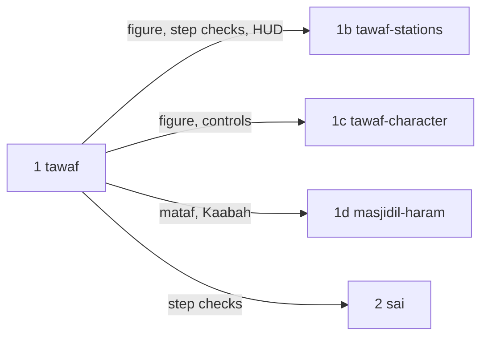
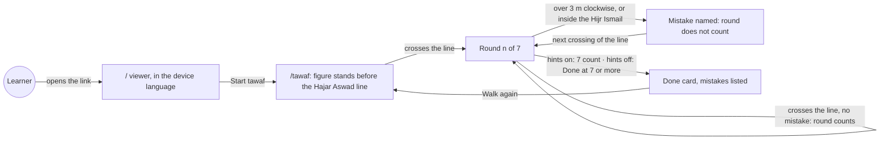
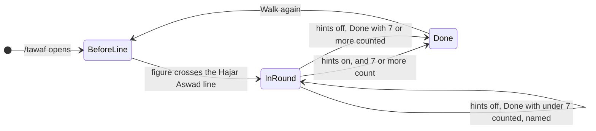
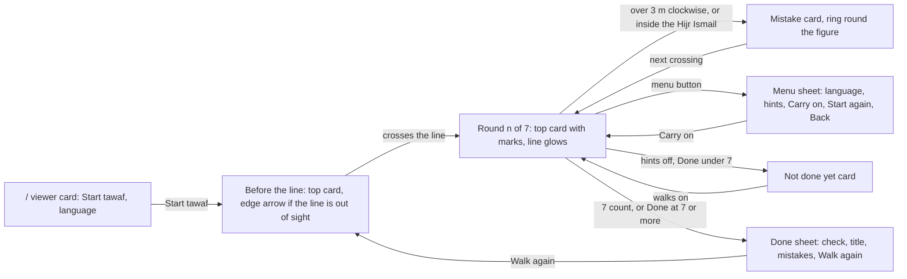
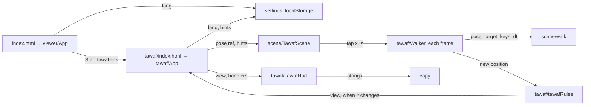
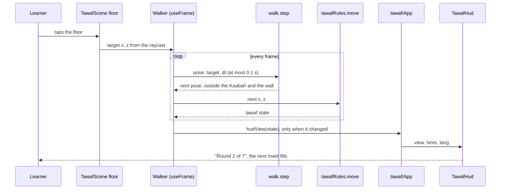
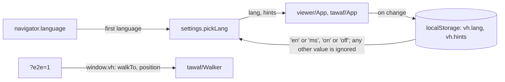

# tawaf

**Version:** v1 · **Status:** Built · **Type:** Feature · **Project type:** Web UI

**Shape doc:** docs/specs/virtual-hajj/shape.md
**Depends on:** walking-skeleton

A learner walks a man in ihram seven times round the Kaabah, anticlockwise from the Hajar Aswad line, and the app names each mistake when it happens. With the hints off, the learner counts the rounds alone. Tawaf is the first rite, so this slice builds the step checks and the walking figure that the later rites reuse.

## Problem

First-time pilgrims learn tawaf from talks, slides and one walk round a model Kaabah. In Makkah they start at the wrong place, walk the wrong way, walk through the Hijr Ismail, or lose count, and nobody tells them at the time. The shape's success test is a learner who walks a rite in the right order with the hints off. Tawaf is the first rite where a course can check that.

## Slice test

The full tawaf, as the shape and walking-skeleton describe it, failed the fit check: about 9 scenarios in 4 areas. It is split along what the learner can do (O2).

| Check                         | Result                                                                                                            |
| ----------------------------- | ----------------------------------------------------------------------------------------------------------------- |
| Cuts every layer it needs     | yes — the scene, the figure and its controls, the step checks, the HUD in two languages, the deploy               |
| One e2e test walks it         | yes — Playwright opens `/`, presses Start tawaf, walks seven rounds and reads the done card                       |
| Worth shipping alone          | yes — a learner can practise a whole tawaf, and a course can test it with real learners (D5)                      |
| Fits (≤5 scenarios, ≤2 areas) | yes, at the limit — 5 scenarios, 2 areas: the tawaf page, and the viewer's Start tawaf button and language switch |

**Path:** full — a new page, new rules, a walking figure and two languages.

**Sibling slices**, in order after this one:



| Slice             | What ships                                                                                                                                            |
| ----------------- | ----------------------------------------------------------------------------------------------------------------------------------------------------- |
| `tawaf-stations`  | The station sheet at the Hajar Aswad line with istilam, the doa between the Rukun Yamani and the Hajar Aswad, and two rakaat behind the Maqam Ibrahim |
| `tawaf-character` | The man or woman pick, idtiba' and raml for men, and the joystick switch in the menu                                                                  |
| `masjidil-haram`  | The mosque round the mataf, and a `/perf` re-run at full mosque size                                                                                  |

## User story

As a first-time pilgrim on a Tabung Haji course, I want to walk a whole tawaf on my phone and hear about each mistake when I make it, so that I start, turn and count right in Makkah.

## Flow



The learner opens the viewer, presses Start tawaf, and walks the figure to the line. Each clean crossing counts a round, a mistake voids the round, and the tawaf ends at seven.

## States



Before the line, nothing counts. A round counts only when it had no mistake. With hints on the app ends the tawaf; with hints off the learner does, with Done.

## Rules

The tawaf rules this slice checks, from the Shafi'i rulings (D1, D32, D33).

| Rule                                     | The app checks                                                                                                    | Then                                                                                                                                |
| ---------------------------------------- | ----------------------------------------------------------------------------------------------------------------- | ----------------------------------------------------------------------------------------------------------------------------------- |
| Tawaf starts at the Hajar Aswad line     | Nothing, before the figure first crosses the line                                                                 | Nothing counts and nothing is named                                                                                                 |
| A round runs anticlockwise, line to line | Each crossing of the line                                                                                         | The round counts if it had no mistake                                                                                               |
| The Kaabah stays on the left             | The figure goes back more than 3 m clockwise, along its circle, behind the furthest point it reached in the round | The app names it, and the round does not count. The round starts again at the next crossing                                         |
| The Hijr Ismail is part of the Kaabah    | The figure steps inside the Hijr Ismail wall                                                                      | The app names it, and the round does not count. The round starts again at the next crossing                                         |
| A tawaf has seven rounds                 | Hints on: the seventh round counts. Hints off: the learner taps Done                                              | Done with 7 counted is correct. Under 7: named, and the learner walks on. Over 7: named, the tawaf ends, and the done card lists it |

Done counts the rounds already complete. A part round walked after the last crossing does not change the count.

| On the screen               | Hints on              | Hints off              |
| --------------------------- | --------------------- | ---------------------- |
| Top card: round count, marks, one instruction | yes                   | no                     |
| The Hajar Aswad line                          | glows in the accent   | a plain marking        |
| Edge arrow to the line, before round 1        | yes, when out of sight | no                    |
| "Tap the floor to walk" chip                  | yes                   | no                     |
| Mistakes named                                | yes                   | yes                    |
| Done button                                   | no                    | yes                    |
| Who ends the tawaf                            | the app, when 7 count | the learner, with Done |

The hints switch works at any time and is kept on the device. Switching hints on when 7 or more rounds count ends the tawaf, as Done does.

## Acceptance criteria

```gherkin
Scenario Outline: A learner walks seven clean rounds with hints on
  Given <learner> opens https://virtualhajj.pages.dev in <browser>, whose language is set to <language>
  And presses "<start>" on the viewer
  When the figure walks to the Hajar Aswad line, then seven times round the Kaabah, anticlockwise and outside the Hijr Ismail wall, by <input>
  Then the top card says "<round 1>" when the figure first crosses the line
  And the Hajar Aswad line glows in the accent colour
  And in round 4, a 2 m step back clockwise to turn round names no mistake
  And when the seventh round reaches the line, the done card says "<done>" and "<none>", and offers "<again>"

  Examples:
    | learner | browser                        | language | start       | input                   | round 1               | done                           | none                             | again        |
    | Aisha   | Chrome on a laptop             | English  | Start tawaf | the arrow keys          | Round 1 of 7          | Tawaf done. Seven rounds.      | No mistakes on the way.          | Walk again   |
    | Omar    | Chrome on a Samsung Galaxy A35 | Malay    | Mula tawaf  | taps on the floor ahead | Pusingan 1 daripada 7 | Tawaf selesai. Tujuh pusingan. | Tiada kesilapan sepanjang tawaf. | Tawaf semula |

Scenario Outline: A mistake is named, and the round does not count
  Given Omar is in round 3 of 7 on https://virtualhajj.pages.dev/tawaf, with hints on
  When the figure <mistake>
  Then the top card says "This round does not count" and "<instruction>"
  And a ring in the mistake colour circles the figure
  And the top card says "Round 3 of 7" again when the figure next crosses the Hajar Aswad line
  And after the tawaf, the done card lists "<listed>"

  Examples:
    | mistake                                | instruction                                | listed                                             |
    | goes back 4 m clockwise                | Turn round, so the Kaabah is on your left. | Round 3: you walked with the Kaabah on your right. |
    | walks in through the Hijr Ismail's gap | Walk outside the Hijr Ismail wall.         | Round 3: you walked inside the Hijr Ismail.        |

Scenario Outline: With hints off, the learner counts the rounds and taps Done
  Given Aisha switched hints off on https://virtualhajj.pages.dev/tawaf yesterday, and opens it again today
  Then hints are still off: no top card shows, the Hajar Aswad line does not glow, and a "Done" button shows
  When she <action>
  Then <result>

  Examples:
    | action                                         | result                                                                                                                                   |
    | taps "Done" after 7 clean rounds               | the done card says "Tawaf done. Seven rounds." and lists no mistakes                                                                     |
    | taps "Done" after 6 clean rounds               | the top card says "Six rounds count. Tawaf has seven." and "Walk one more round, then press Done.", the tawaf goes on, and the done card later lists "You pressed Done after six rounds." |
    | taps "Done" after 8 clean rounds               | the done card says "Tawaf done. Seven rounds." and lists "You walked eight rounds. Tawaf has seven."                                      |
    | switches hints on after 3 clean rounds         | the top card says "Round 4 of 7", and the Hajar Aswad line glows                                                                         |
    | switches hints on after 8 clean rounds         | the tawaf ends, the same as when she taps "Done" after 8                                                                                 |

Scenario: A learner switches language in the middle of a tawaf
  Given Omar's browser language is English, and he is in round 2 of 7 on https://virtualhajj.pages.dev/tawaf
  When he opens the menu and picks "Bahasa Melayu"
  Then the top card says "Pusingan 2 daripada 7", and round 2 goes on
  And when he opens https://virtualhajj.pages.dev the next day, the viewer is in Malay

Scenario Outline: When the 3D view can't be shown, the message is in the learner's language
  Given Mak Som's browser language is <language>, and she opens https://virtualhajj.pages.dev/tawaf on <phone>
  When <event>
  Then the plain backdrop covers the scene
  And the top card says "<message>" and "<next step>", with <action>

  Examples:
    | language | phone                                     | event                                     | message                                       | next step                                               | action                               |
    | Malay    | a 2016 phone whose browser has no WebGL 2 | the page loads                            | Pelayar ini tidak dapat menunjukkan paparan 3D. | Buka pautan ini dalam Chrome atau Safari yang terkini. | no button                            |
    | English  | a Samsung Galaxy A35                      | the browser drops the 3D view in round 5  | The 3D view stopped.                          | Reload the page to start it again.                      | a Reload button that starts a new tawaf before the line |
```

Interface › Screens and copy holds every string in both languages.

## Scope

**In:**

- A page at `/tawaf` with a mataf floor, the Kaabah with its Hajar Aswad corner marked, the Hijr Ismail wall with its two gaps, and the Hajar Aswad line on the floor. All built in code (D31).
- A man in ihram, built in code, stylised with no face detail (D37), seen from behind and above as the brief sets.
- Walking by a tap or click on the floor, and by the arrow keys. One round close to the Kaabah takes about 25 s, so seven take about 3 minutes.
- The step checks in **Rules**.
- Hints on or off, as **Rules** sets. The setting is kept on the device (D35).
- The done card: the done line, each mistake on the way, Walk again, and Back to the Kaabah view.
- The menu sheet: language, hints, Carry on, Start tawaf again, and Back to the Kaabah view. Opening it pauses the walk.
- Malay and English on `/` and `/tawaf`. The page opens in the browser's language: Malay when it is set to Malay, else English. The language choice sits in the menu sheet on `/tawaf` and on the viewer's card on `/`, and it is kept on the device (D34, D35).
- A Start tawaf button on the viewer at `/` (D36).
- The plain messages of D27 on `/tawaf`, in both languages. A reload starts a new tawaf.
- The tawaf scene holds 30 FPS on the Galaxy A35 (D22). The reading goes into the slice's PR, so later scenes have a number to compare (walking-skeleton O25).
- One e2e test that walks seven rounds.

**Out:**

- The station sheet at the Hajar Aswad line, with istilam and its Arabic → `tawaf-stations`.
- The doa between the Rukun Yamani and the Hajar Aswad, the Maqam Ibrahim, and the two rakaat behind it → `tawaf-stations`.
- The man or woman pick, idtiba', and raml in the first three rounds → `tawaf-character`.
- The on-screen joystick and its switch in the menu → `tawaf-character`.
- The "Show me" button from the system's walking HUD → `tawaf-stations`, with "Show me how".
- A darker rim round the figure, as the brief asks → not doing (D39).
- The mosque round the mataf, and a `/perf` re-run at full mosque size → `masjidil-haram`.
- Badges, completion marks and the journey map → a later slice; the shape has none yet.
- Saving a tawaf in progress → not doing (shape). Only the language and hints settings are kept.
- Malay on `/perf` → not doing; it is a developer page (D26).
- Crowds → not doing (shape).

## Interface

Two pages, composed from the VirtualHajj design system (D15, D16): the tokens in `docs/design/design-system/`, and the parts its Claude Design canvas draws (https://claude.ai/artifact/EWyrXLHtQcxsn2gNoMvXLL). Nothing new went into the system. The scene colours go into the scene palette, outside it (D25).



The viewer's card leads into tawaf. Each crossing of the line updates the top card, a mistake swaps it for the mistake card, and the done sheet ends the tawaf.

```
+---------------------------+
| [Hints  [=] On]      [≡]  |  top bar, 8px in (16px on a laptop)
| +-----------------------+ |
| | Round 3 of 7  ■■▣□□□□ | |  top card under the bar, 448px wide on a laptop
| | Keep the Kaabah on    | |
| | your left.            | |
| | Round 4 starts at ... | |
| +-----------------------+ |
|  Kaabah ---- glowing line |  camera turned towards the Kaabah
|        (figure)  (tap)    |
|                           |  lower middle stays clear
| [Tap the floor to walk]   |  hints on: caption chip, bottom left
|                   [Done]  |  hints off: Done, bottom right
+---------------------------+
```

### Screens and copy

| Screen | English | Malay |
| ------ | ------- | ----- |
| Viewer card | "VirtualHajj" · "Drag to look round the Kaabah." · phone "Pinch to zoom in and out." · laptop "Scroll to zoom. With the keyboard, the arrow keys turn the view and + and − zoom." · primary "Start tawaf" · "Language" with the language choice | "Seret untuk melihat sekeliling Kaabah." · "Cubit untuk zum masuk dan keluar." · "Tatal untuk zum. Dengan papan kekunci, kekunci anak panah memusingkan pandangan, dan + serta − untuk zum." · "Mula tawaf" · "Bahasa" |
| Top bar | Hints switch "Hints", "On" / "Off" · menu button "Menu" | "Petunjuk", "Hidup" / "Mati" · "Menu" |
| Before the line | "Before you start" · "Walk to the Hajar Aswad line." · "Your first round starts there. Keep the Kaabah on your left." | "Sebelum mula" · "Berjalan ke garisan Hajar Aswad." · "Pusingan pertama anda bermula di situ. Pastikan Kaabah di sebelah kiri anda." |
| Edge arrow | "Hajar Aswad line", spoken "Turn to the Hajar Aswad line" | "Garisan Hajar Aswad", "Pusing ke garisan Hajar Aswad" |
| Round n | "Round 3 of 7" · "Keep the Kaabah on your left." · "Round 4 starts at the Hajar Aswad line, glowing ahead." Round 7: "Your tawaf ends at the Hajar Aswad line, glowing ahead." | "Pusingan 3 daripada 7" · "Pastikan Kaabah di sebelah kiri anda." · "Pusingan 4 bermula di garisan Hajar Aswad yang bercahaya di hadapan." Round 7: "Tawaf anda tamat di garisan Hajar Aswad yang bercahaya di hadapan." |
| Caption chip | phone "Tap the floor to walk" · laptop "Walk with the arrow keys, or click the floor" | "Ketik lantai untuk berjalan" · "Berjalan dengan kekunci anak panah, atau klik lantai" |
| Mistake: wrong way | "This round does not count" · "Turn round, so the Kaabah is on your left." · "Tawaf goes anticlockwise. Walk on to the Hajar Aswad line, and round 3 starts again there." | "Pusingan ini tidak dikira" · "Pusing balik, supaya Kaabah di sebelah kiri anda." · "Tawaf mengikut arah lawan jam. Teruskan ke garisan Hajar Aswad, dan pusingan 3 bermula semula di situ." |
| Mistake: Hijr Ismail | "This round does not count" · "Walk outside the Hijr Ismail wall." · "The Hijr Ismail is part of the Kaabah. Walk on to the Hajar Aswad line, and round 3 starts again there." | "Pusingan ini tidak dikira" · "Berjalan di luar tembok Hijir Ismail." · "Hijir Ismail ialah sebahagian daripada Kaabah. Teruskan ke garisan Hajar Aswad, dan pusingan 3 bermula semula di situ." |
| Mistake, hints off | The same, with "the round starts again there" for the round number, and no marks | "pusingan itu bermula semula di situ" |
| Hints off | No top card · primary "Done" | "Selesai" |
| Done under 7 | "Not done yet" · "Six rounds count. Tawaf has seven." · "Walk one more round, then press Done." | "Belum selesai" · "Enam pusingan dikira. Tawaf ada tujuh." · "Jalan satu pusingan lagi, kemudian tekan Selesai." |
| Done sheet | Check icon and "Tawaf done. Seven rounds." · "No mistakes on the way." or "On the way" and the list · primary "Walk again" · quiet "Back to the Kaabah view" | "Tawaf selesai. Tujuh pusingan." · "Tiada kesilapan sepanjang tawaf." or "Sepanjang tawaf" · "Tawaf semula" · "Kembali ke paparan Kaabah" |
| Done list | "Round 3: you walked with the Kaabah on your right." · "Round 5: you walked inside the Hijr Ismail." · "You pressed Done after six rounds." · "You walked eight rounds. Tawaf has seven." | "Pusingan 3: anda berjalan dengan Kaabah di sebelah kanan." · "Pusingan 5: anda berjalan di dalam Hijir Ismail." · "Anda menekan Selesai selepas enam pusingan." · "Anda berjalan lapan pusingan. Tawaf ada tujuh." |
| Menu sheet | "Tawaf" · "Round 2 of 7 · Paused", or "Paused" with hints off · "Language" · Hints switch · primary "Carry on" · quiet "Start tawaf again" · quiet "Back to the Kaabah view" · close "Close menu" | "Tawaf" · "Pusingan 2 daripada 7 · Dijeda" or "Dijeda" · "Bahasa" · "Teruskan" · "Mula tawaf semula" · "Kembali ke paparan Kaabah" · "Tutup menu" |
| Loading, no WebGL 2, stopped | "Tawaf" · "Loading the Kaabah…" · the D27 messages, as on `/` | "Memuatkan Kaabah…" · "Pelayar ini tidak dapat menunjukkan paparan 3D." · "Buka pautan ini dalam Chrome atau Safari yang terkini." · "Paparan 3D terhenti." · "Muat semula halaman untuk memulakannya semula." · "Muat semula" |

Counts use words from "no" to "ten", and digits above ten. Every string lives in `src/copy.ts`. The edge arrow shows only before round 1. During a round the line can sit behind the camera, and an arrow there would point the learner the wrong way.

### Scene

| Element | How it looks |
| ------- | ------------ |
| Hajar Aswad line, hints on | From the Hajar Aswad corner, 22 m across the floor: an `accent` band 1.4 m wide at 55%, with an `accent-ink` core 0.25 m wide, as the brief sets |
| Hajar Aswad line, hints off | A plain band 0.3 m wide in `lineMark` |
| Hajar Aswad frame | A silver ring at 1.5 m on the corner, in `stoneFrame` |
| Hijr Ismail wall | An arc 1.3 m high and 0.6 m thick, 6.5 m out from the Kaabah, with a gap of about 2.3 m at each end, in `hijrWall` |
| Pilgrim | A man in ihram: the izar from the waist to below the knee, the rida over both shoulders. `ihram`, `skin` and `hair`, no face. A ground shadow in `shadow` at 20%. The same 20 bones as the `/perf` figure |
| Tap ring | An `ink` ring and dot where the learner taps |
| Mistake ring | A `mistake` ring round the figure while the mistake card shows |
| Camera | Behind and above the figure, turned towards the Kaabah: 35° and 10 m back on a landscape screen, 62° and 14 m back on a portrait one. A camera straight behind the figure can't see the Kaabah on a portrait phone (O25) |

New scene palette entries, outside the UI system (D25):

| Name         | Day       | Night     |
| ------------ | --------- | --------- |
| `skin`       | `#A8754F` | `#A8754F` |
| `hair`       | `#3B2A20` | `#3B2A20` |
| `stoneFrame` | `#C9CDD2` | `#C9CDD2` |
| `hijrWall`   | `#F7F3EA` | `#5A6880` |
| `lineMark`   | `#BCA78A` | `#2F3B4E` |
| `shadow`     | `#2A1F14` | `#000000` |

**Motion tier:** 2.

- A new round, a mistake, or the not-done-yet message: the lead, the instruction and the note rise 12px into place and fade in over `dur-step` (480ms) with `ease-settle`.
- The mark for a round that counts fills from left to right over `dur-step`.
- The menu and the done sheet rise 12px and fade in over `dur-panel` (320ms), over a scrim that fades in. They leave with `ease-leave`.
- The switch thumb slides over `dur-micro`. Buttons change colour on hover over `dur-micro` and shrink to 98% on press over `dur-press`.
- The camera follows the figure with the settling ease.
- With reduced motion, nothing moves: the fades stay at `dur-micro`, the marks fill at once, and the camera cuts.
- Nothing moves on its own. The line's glow does not pulse.

**Components used:** from the system's canvas: top bar, hints switch, menu button, top card with progress marks and its mistake form, caption chip, edge arrow, bottom sheet with scrim, language choice, primary button, quiet button. Lucide `check`, `circle-alert`, `menu`, `x`, `arrow-left`, `arrow-right`. Tokens: `surface`, `sunken`, `ink`, `ink-muted`, `line`, `accent`, `accent-ink`, `accent-hover`, `accent-edge`, `on-accent`, `mistake`, `scrim`; `caption`, `body`, `label`, `lead`, `instruction`; `space-1` to `space-16`, `target`, `radius-mark`, `radius-inner`, `radius-control`, `radius-panel`; `dur-press`, `dur-micro`, `dur-panel`, `dur-step`, `ease-settle`, `ease-leave`, `move`.

**Preview:** the real components, in the repo. Run `pnpm dev` and open `http://localhost:5173/preview/`. Pick a state, a size and a language. The hints switch, the menu and the language choice work. `preview/` is not in the Vite build inputs, so it never deploys.

| Built for `/build` to keep | Path |
| -------------------------- | ---- |
| Every string, both languages | `src/copy.ts` |
| The HUD for /tawaf, drawn from a view model | `src/tawaf/TawafHud.tsx`, `src/tawaf/hudView.ts` |
| Hints switch, menu button, quiet button, language choice, progress marks, bottom sheet, icons | `src/ui/` |
| The mataf, the Hijr Ismail wall, the line, the rings, the camera | `src/scene/TawafScene.tsx`, `src/scene/mataf.ts` |
| The pilgrim | `src/scene/Pilgrim.tsx` |
| The HUD styles | `src/styles/app.css` |
| The preview pages | `preview/`, `src/preview/` |

**Checks:** the drift check passed over 18 files. It found no token file named `tokens*.css`, so every `--vh-` name in the new code was checked by hand against `docs/design/design-system/tokens/`; all exist. The HUD was checked in headless Chromium, in English and Malay, light and dark, on phone and laptop. The 3D scene was checked in Chrome on this machine, where WebGL works; headless Chromium here drops every WebGL context.

## Technical plan

### Approach

A third Vite entry, `tawaf/index.html`, mounts the tawaf page. It draws the pause 2 scene and HUD with the same Canvas setup as `/` and `/perf`. A `Walker` inside the Canvas moves the pilgrim each frame. It steps towards the tap target, or by the held arrow keys, keeps the pilgrim out of the Kaabah and off the Hijr Ismail wall, and feeds each new position to a pure rules module. React state changes only when the HUD's view changes, so the page does not re-render 60 times a second. Language and hints live in `localStorage`, shared by `/` and `/tawaf`. `/perf` swaps its old figure for the pilgrim and adds the tawaf parts, so its A35 run covers `/tawaf` (D22, D42).

Relies on: D1, D4, D15, D16, D17, D18, D19, D20, D21, D22, D25, D26, D27, D31, D32, D33, D34, D35, D36, D37, D38, D39, D40, D41, D42, D43, D44



The viewer links to the tawaf page. There, a tap goes from the scene to the `Walker`. The `Walker` moves the pilgrim with `walk`, and `tawafRules` turns each position into the view that the HUD draws.



Each frame the pilgrim steps towards the tap and the rules check the new spot. When the pilgrim crosses the line, the view changes once, and the top card updates.



Two things come from outside the code: the stored settings and the `?e2e=1` flag. A stored value that is not one of the expected two is ignored. The flag only lets a script move the learner's own pilgrim.

### Rules, as code

`tawafRules.ts` tracks the pilgrim's angle round the Kaabah unwrapped, so a full lap adds 2π. It counts the anticlockwise crossings of the line by index: k = floor((angle − line angle) / 2π).

- **Before the line:** the first upward step in k starts round 1. A clockwise approach to the line starts nothing.
- **A round:** the round counts when k reaches its start + 1, and the round had no mistake. A back-step under 3 m that recrosses the line does not count twice, because k must pass its start + 1.
- **Wrong way:** (furthest angle this round − angle) × radius > 3 m.
- **Hijr Ismail:** `insideHijr(x, z)`: past the Hijr face, and nearer its centre than the wall's inner face.
- **After a mistake:** the round is void. The next upward step in k starts it again.
- **Done, hints off:** under 7 counted, the app names it, lists it, and the walk goes on. At exactly 7, the tawaf ends. Over 7, the app lists it, and the tawaf ends.
- **Hints on:** the tawaf ends once 7 or more count. When hints come on with 8 counted, the done sheet lists the extra round.
- **The cards:** a mistake card or the not-done-yet card shows until the next crossing.

### Changes

| File | What changes | Why |
| ---- | ------------ | --- |
| `vite.config.ts:9` | Add `tawaf/index.html` to `rolldownOptions.input` | D36 |
| `tawaf/index.html` (new) | The Loading card as plain markup: "Tawaf", "Loading the Kaabah…". A plain script before the bundle, as in `index.html:34`: it picks the language (stored, else the browser's first language), sets `<html lang>`, puts the card text in that language, and shows the no-WebGL 2 message in it | Scenario 5 |
| `index.html:34` | The same language step in its plain script, so a Malay browser never sees English first | Scenarios 4, 5 |
| `src/settings.ts` + `.test.ts` (new) | `pickLang(stored, first)`: a stored `en` or `ms` wins, else `ms` when the browser's first language starts with "ms", else `en`. `pickHints(stored)`: `off` means off, anything else means on. `useLang` and `useHints` hooks over the keys `vh.lang` and `vh.hints`. Each read and write runs in try/catch, so a private window works with the defaults | D34, D35, scenarios 3, 4 |
| `src/scene/FirstFrame.tsx` (new) | `FirstFrame`, moved from `src/viewer/App.tsx:11` so both pages use it | Scenario 5 |
| `src/tawaf/main.tsx`, `src/tawaf/App.tsx` (new) | Mounts the page. Reuses `viewerState` (`src/viewer/viewerState.ts`) for loading, ready, no WebGL 2 and stopped, and `hasWebGL2`. Holds the tawaf state in a ref and the view in React state. The menu pauses the walk. Walk again and Start tawaf again reset to the start pose. Back to the Kaabah view goes to `/`. Arrow keys listen on the window, except while a sheet is open or a control has focus | Scenarios 1–5 |
| `src/tawaf/tawafRules.ts` + `.test.ts` (new) | Pure: `start()`, `move(state, x, z)`, `pressDone(state)`, `setHints(state, on)`, `hudView(state)`, as **Rules, as code** says | Rules, scenarios 1–3 |
| `src/tawaf/Walker.tsx` (new) | Inside the Canvas. Each frame: `walk.step`, then `tawafRules.move`, then the pose ref. Calls `onView` only when `hudView` changes. With `?e2e=1`: `window.vh.walkTo(x, z)` takes the same path as a tap, resolves on arrival, and walks 10 times faster; `window.vh.position()` gives x and z | Scenarios 1–3, D43 |
| `src/scene/walk.ts` + `.test.ts` (new) | Pure. `step(pose, input, dt)`: towards a target, or Up walks forward, Down walks back, Left and Right turn at 120° a second (D44). 3.4 m/s, so a round just outside the Hijr Ismail takes about 25 s (O17). dt is capped at 0.1 s, so a tab that comes back from the background does not jump. `collide` keeps the pilgrim 0.4 m out of the Kaabah, off the Hijr wall band (the gaps stay open), and within 30 m | The pilgrim never walks through the Kaabah or the wall |
| `src/scene/mataf.ts` | Add `insideHijr(x, z)` and the walking limits | Rules |
| `src/scene/TawafScene.tsx` | The floor takes taps (`onPointerDown` → `onTap(x, z)`). The pose comes from a ref, and the camera follows it each frame with damping, and cuts with reduced motion. Export `HijrWall` and `HajarAswadLine` for `/perf` | Scenario 1, D40, D42 |
| `src/scene/Pilgrim.tsx` | The pose comes from a ref. The legs swing in `useFrame` while the pilgrim moves, at a rate that matches its speed | Scenario 1, D42 |
| `src/tawaf/TawafHud.tsx`, `src/ui/Sheet.tsx` | Focus moves into a sheet when it opens. Escape closes the menu, and focus goes back to the menu button. Sheets leave with `ease-leave` over `dur-panel` | Floors |
| `src/viewer/App.tsx:70` | The Ready card's copy from `copy[lang]`. A "Start tawaf" link to `/tawaf/`, styled as the primary button. The language choice | Scenarios 1, 4 |
| `src/styles/app.css` | `.primary-button` works on a link: inline-flex, no underline. The sheet leave keyframes | Scenario 1 |
| `src/preview/*` | Pass a fixed pose ref, as `TawafScene` now takes one | Preview keeps working |
| `src/perf/App.tsx:120`, `src/perf/Figure.tsx` | `/perf` draws `Pilgrim`, walking round the Kaabah as `Figure` did, plus `HijrWall` and `HajarAswadLine` with hints on. `Figure.tsx` is deleted | D22, D42 |
| `e2e/tawaf.ts` (new) | Helpers: `walkTo`, `walkToLine`, `walkLaps(n)` (12 points a lap, at 16 m) | Test plan |
| `e2e/tawaf.spec.ts` (new) | The tests in **Test plan** | Scenarios 1–5 |
| `e2e/viewer.spec.ts` | "opens in Malay on a Malay browser", and Start tawaf leads to `/tawaf/` | Scenarios 1, 4 |
| `docs/ARCHITECTURE.md`, `OVERVIEW.md`, `CHANGELOG.md` | The tawaf page, the slice row, the entry | `/ship` |

Reusing: `viewerState`, `hasWebGL2`, `canvasConfig`, `BaseScene`, `useMediaQuery`, `useScenePalette`, `TopCard`, `PrimaryButton`, the `/perf` meter as it is, `lowerHalfColours` from `e2e/frame.ts`, and everything pause 2 built in `src/ui/`, `src/tawaf/`, `src/scene/` and `src/copy.ts`.

No new dependency.

### Data

No server data. Two `localStorage` keys on the site's origin, shared by `/` and `/tawaf`:

| Key | Values | Default when missing or unknown |
| --- | ------ | ------------------------------- |
| `vh.lang` | `en`, `ms` | The browser's first language: `ms` when it starts with "ms", else `en` |
| `vh.hints` | `on`, `off` | `on` |

**Reverse:** the walking-skeleton build ignores both keys, so a rollback needs nothing. A learner clears them by clearing the site's data. `settings.test.ts` checks that unknown values fall back to the defaults.

### Earn-it

| Added | Triggered by |
| ----- | ------------ |
| A third HTML entry, `tawaf/index.html` | D36: tawaf at `/tawaf`. The viewer never downloads the tawaf code |
| `tawafRules.ts` as a pure module | Scenarios 1–3: every rule tested without a browser |
| `walk.ts` as a pure module | Scenario 2 needs the Hijr gaps open and the wall closed; collision is tested without a browser |
| `Walker` writing a ref, with React state only on a view change | 60 React renders a second would cost the A35 frames (D22) |
| `settings.ts` | D34, D35; scenarios 3 and 4 need the settings back on the next visit |
| The `?e2e=1` hook | D43: the e2e test walks seven rounds in seconds |
| `FirstFrame` moved to `src/scene/` | Both pages need it; a second copy would drift |
| `Pilgrim`, the Hijr wall and the line in `/perf` | D42: one A35 run covers `/tawaf` |
| `preview/` kept | States that are slow to reach by walking (no WebGL 2, Done after eight) show in seconds. It is dev-only and never deploys |

### Non-functionals

|                      |                                                                               |
| -------------------- | ----------------------------------------------------------------------------- |
| **Load**             | A few visitors a day, from static files on Cloudflare's CDN. `/tawaf` shares the three.js chunk with `/`. The gzipped size of each page's JavaScript is measured at build and recorded in the PR. |
| **Breaks first**     | Nothing on a server: at 10 times the visitors, the CDN serves the same files. The phone's graphics chip breaks first, as the scenes grow. The `/perf` run with the tawaf parts is the guard (D22, D42). |
| **Security surface** | Anyone can open both pages. Input: taps, clicks, keys, the two `localStorage` values (checked against a fixed list), and `?e2e=1`, which only lets a script on the page move the learner's own pilgrim. No new secrets, cookies or outside requests. |
| **Proof it works**   | The `ci` run on `main` passes `e2e/tawaf.spec.ts` › "walks seven rounds with hints on" against https://virtualhajj.pages.dev after the production deploy. The PR carries the Galaxy A35 `/perf` screenshot reading "Pass", with its lowest FPS. |
| **Rollout**          | No flag: `/tawaf` is a new page, and the viewer's Start tawaf link is the only way in. Roll back with Cloudflare Pages › virtualhajj › Deployments › Rollback, or `git revert` and merge. |

### Test plan

| Scenario | Test | Command |
| -------- | ---- | ------- |
| 1. Seven clean rounds | `src/tawaf/tawafRules.test.ts`: nothing counts before the first anticlockwise crossing; a clockwise approach starts nothing; a clean lap counts; seven end the tawaf with no mistakes; a 2 m back-step names nothing and does not count twice. `src/scene/walk.test.ts`: speed, the dt cap, the keys, and collision with the Kaabah, the wall and the edge. `e2e/tawaf.spec.ts` › "walks seven rounds with hints on" › "starts in Malay on a Malay phone" › "a click on the floor walks the pilgrim there" | `pnpm test`, `pnpm e2e` |
| 2. A mistake voids the round | `tawafRules.test.ts`: 4 m back voids the round, and so does inside the Hijr Ismail; the round starts again at the next crossing; the done list names the round. `walk.test.ts`: the Hijr gaps are open. `e2e/tawaf.spec.ts` › "names the wrong way and the Hijr Ismail" | `pnpm test`, `pnpm e2e` |
| 3. Hints off | `tawafRules.test.ts`: Done at 6, 7 and 8, and hints on at 3 and at 8. `src/settings.test.ts`: `pickHints`. `e2e/tawaf.spec.ts` › "counts with hints off": hints stay off after a reload; Done after 6 is named; Done after 7 lists it | `pnpm test`, `pnpm e2e` |
| 4. Language | `settings.test.ts`: `pickLang`, with the first language only. `e2e/tawaf.spec.ts` › "switches to Malay in the middle of a tawaf". `e2e/viewer.spec.ts` › "opens in Malay on a Malay browser" | `pnpm test`, `pnpm e2e` |
| 5. No 3D view | `e2e/tawaf.spec.ts` › "says when the view stops on /tawaf": Reload starts a new tawaf before the line. In the `no-webgl` project, with the locale `ms-MY`: › "says when there is no WebGL 2 on /tawaf, in Malay", and the same with the bundle blocked | `pnpm e2e` |
| D22 | `e2e/perf.spec.ts` › "draws the full load" still reads at least 200,000 triangles in 100 draw calls. You run `/perf` on the Galaxy A35 for 5 minutes, and the screenshot goes into the PR | `pnpm e2e`, by hand |

**E2E:** `e2e/tawaf.spec.ts` › "walks seven rounds with hints on" walks the slice. It opens `/`, presses Start tawaf, and checks that the URL is `/tawaf/`. Then it opens `/tawaf/?e2e=1`, because the link has no hook (O33). It walks to the line and seven laps, reads "Round n of 7" after each, and ends on "Tawaf done. Seven rounds." and "No mistakes on the way."

The walking tests set a 120 s timeout. Locally, `pnpm e2e` fails on this machine, because its headless Chromium drops every WebGL context (walking-skeleton O12). CI is where the e2e tests must pass (O26).

### Chunks

Single chunk. The page, the rules and the viewer share `settings.ts`, `copy.ts` and the scene, and the first CI push has to answer O26 before the rest is worth building. `/build` works in this order:

1. The tawaf page shell: the entry, `App`, `Walker`, `walk`, `tawafRules` with its tests, the `?e2e=1` hook, and "walks seven rounds with hints on". Push. The CI run answers O26.
2. Mistakes, hints off and Done, the menu and the done sheet, focus handling, and their e2e tests.
3. `settings.ts`, the language rule, the viewer's Start tawaf link and language choice, the plain scripts in both HTML files, and their e2e tests.
4. `/perf` with the pilgrim and the tawaf parts.
5. You run `/perf` on the Galaxy A35 for 5 minutes, and paste the screenshot into the PR.

### Risks

| Risk | Mitigation |
| ---- | ---------- |
| CI draws too slowly to walk seven rounds in time (O26) | Step 1 pushes this first. Movement scales with frame time, and the hook walks 10 times faster. If the test still times out, `/build` stops with a blocker |
| Tapping on the far side of the Kaabah walks the pilgrim into a wall | `collide` slides it along the wall. `walk.test.ts` checks that a tap behind a corner still ends on the far side, or stops at the corner |
| The A35 fails `/perf` with the pilgrim | That is the check doing its job. The slice is not done. The first things to cut are the shadow and the transparent glow band |
| The turned camera feels odd to a learner (D40) | The first course to try tawaf (D5) says so. The camera turn is one constant in `TawafScene.tsx` |
| A token read for the scene runs before the CSS loads, and the glow has no colour | `app.css` is linked in `<head>`, before the bundle. `useToken` reads at render time, after load |
| The 3 m rule fires on a learner who turns round to look | 3 m is about four steps (O8). `tawafRules.test.ts` pins 2 m as safe |

## Decisions to record

Recorded as D31, D32, D33, D34, D35, D36, D37, D38, D39, D40, D41, D42, D43, D44.

## Review

2026-10-22 · 11 raw findings (7 after merging duplicates), 6 survived, 6 fixed.

- correctness · `src/tawaf/tawafRules.ts:72` · Done before the line names nothing · `4cc5bee`
- correctness · `src/tawaf/App.tsx:118` · the menu closes when switching hints on ends the tawaf · `cf3f62a`
- ui · `src/tawaf/TawafHud.tsx:73` · the HUD behind an open sheet is inert, so focus stays in the sheet · `4a83436`
- ui · `src/styles/app.css:617` · the hints switch thumb jumps with reduced motion · `de9f29c`
- coverage · `src/tawaf/TawafHud.tsx:105` · tests press Walk again, Start tawaf again, Back and the edge arrow · `08e2756`
- coverage · `src/tawaf/App.tsx:84` · a test walks the pilgrim forward with the arrow keys · `b35d9a8`

## Open items

| ID  | What                                                                                         | Type     | Raised at | Owner | Status   | Answer                                                                                                                                                      |
| --- | -------------------------------------------------------------------------------------------- | -------- | --------- | ----- | -------- | ----------------------------------------------------------------------------------------------------------------------------------------------------------- |
| O1  | Where do the 3D models come from: self-made, bought, or free with a licence? (from shape O7) | question | shape     | user  | Resolved | Built in code: the Kaabah, the Hijr Ismail wall and the figure. D31. 2026-10-22                                                                             |
| O2  | The full tawaf fails the fit check. Which cut ships first?                                   | question | spec p1   | user  | Resolved | The walk and the step checks, with hints and both languages. Then `tawaf-stations`, `tawaf-character` and `masjidil-haram`. 2026-10-22                      |
| O3  | Until the character pick ships, who walks?                                                   | question | spec p1   | user  | Resolved | A man in ihram, with no idtiba' or raml. Both are sunnah, so leaving them out teaches nothing wrong. D37. 2026-10-22                                        |
| O4  | What does the link open once tawaf ships?                                                    | question | spec p1   | user  | Resolved | The viewer stays at `/` with a Start tawaf button. Tawaf is at `/tawaf`. D36. 2026-10-22                                                                    |
| O5  | Which mistakes does the app check?                                                           | question | spec p1   | user  | Resolved | Wrong direction, walking inside the Hijr Ismail, and the wrong count with hints off. D32, D33. 2026-10-22                                                   |
| O6  | After a mistake, what happens to the round?                                                  | question | spec p1   | user  | Resolved | The app names it, and the round does not count. The round starts again at the next crossing of the Hajar Aswad line. D32. 2026-10-22                        |
| O7  | With hints off, does the round counter still show?                                           | question | spec p1   | user  | Resolved | No. The learner counts and taps Done. Hints off also hides the instruction and the glowing path. Mistakes are still named. D33. 2026-10-22                  |
| O8  | How far clockwise counts as the wrong-direction mistake?                                     | question | spec p1   | user  | Resolved | More than 3 m, about four steps, along the figure's circle. D32. 2026-10-22                                                                                 |
| O9  | How does the learner get Malay or English?                                                   | question | spec p1   | user  | Resolved | The browser's language, with a BM / EN switch in the top bar, kept on the device. D34, D35. 2026-10-22                                                      |
| O10 | With hints off, what does the app do with a wrong count at Done?                             | question | spec p1   | user  | Resolved | Only Done at seven is correct. Under seven: named, and the learner walks on. Over seven: named, the tawaf ends, and the done card lists it. D33. 2026-10-22 |
| O11 | Can the learner switch hints in the middle of a tawaf?                                       | question | spec p1   | user  | Resolved | Yes, at any time. D33. 2026-10-22                                                                                                                           |
| O12 | What does the learner see after the seventh round?                                           | question | spec p1   | user  | Resolved | The done card with the list of mistakes made on the way, and Walk again. D38. 2026-10-22                                                                    |
| O13 | Does the viewer at `/` follow the language rule too?                                         | question | spec p1   | user  | Resolved | Yes, with the same switch. `/perf` stays English (D26). D34. 2026-10-22                                                                                     |
| O14 | Before the figure first reaches the Hajar Aswad line, does the app check anything?           | question | spec p1   | user  | Resolved | No. Tawaf starts at the line, so nothing before it counts or is named. D32. 2026-10-22                                                                      |
| O15 | On a new visit, is the hints switch on again?                                                | question | spec p1   | user  | Resolved | No. The last setting is kept on the device. D35. 2026-10-22                                                                                                 |
| O16 | With hints off, a learner walks eight rounds, then switches hints on. What happens?          | question | spec p1   | user  | Resolved | The tawaf ends, the same as Done after eight, and the done card lists the extra round. D33. 2026-10-22                                                      |
| O17 | How long does one round take at the figure's walking pace?                                   | question | spec p1   | user  | Resolved | About 25 s, so seven rounds take about 3 minutes. 2026-10-22                                                                                                |
| O18 | Pause 1 put a BM / EN switch in the top bar. The design system puts language in the menu sheet, and its top bar holds only the hints switch and the menu. Where does it go? | question | spec p2 | user | Resolved | In the menu sheet, as the system draws it, and on the viewer's card on `/`. The menu sheet joins this slice without the joystick. Changes O9 and D34. 2026-10-22 |
| O19 | Pause 1 said the path ahead glows. The system glows the next target instead. Which? | question | spec p2 | user | Resolved | The Hajar Aswad line glows, with the system's edge arrow when it is out of sight. Changes O7 and scenarios 1 and 3. 2026-10-22 |
| O20 | The system's walking HUD has a "Show me" button. Is it in this slice? | question | spec p2 | user | Resolved | No. It goes to `tawaf-stations` with "Show me how". With hints off, Done takes its corner. 2026-10-22 |
| O21 | Which motion tier? | question | spec p2 | user | Resolved | Tier 2, as Interface sets. 2026-10-22 |
| O22 | With hints off, does the Hajar Aswad line still show? | question | spec p2 | user | Resolved | Yes, as a plain marking with no glow, so the learner has a fixed place to count from. D33. 2026-10-22 |
| O23 | Claude drafted the Malay copy, and nobody else checks it (shape O2). | flag | spec p2 | user | Resolved | You read the Malay states in the preview before you approve pause 2. Approval means the strings in Interface › Screens and copy stand. 2026-10-22 |
| O24 | The brief asks for a darker rim round the figure as well as the ground shadow. The preview has only the shadow. | question | spec p2 | user | Resolved | No rim. Skin, hair and the shadow set the white ihram off the marble. D39. 2026-10-22 |
| O25 | A camera straight behind the figure can't see the Kaabah on a portrait phone. The preview turns the camera towards the Kaabah. | question | spec p2 | user | Resolved | Keep the turned camera: 35° on landscape, 62° and further back on portrait. D40. 2026-10-22 |
| O26 | CI's headless Chromium draws the tawaf scene fast enough to walk seven rounds inside the test timeout. | unproven | spec p3 | user | Resolved | The first CI push in `/build` is the proof, as with walking-skeleton O12: step 1 pushes the page, the hook and the seven-round test first. Movement scales with frame time, and the hook walks 10 times faster. If the test still times out, `/build` stops with a blocker. 2026-10-22 Proven 2026-10-22: CI run 39724852215 passed all 17 e2e tests in Chromium; "walks seven rounds with hints on" took 38.2 s. |
| O27 | How do we check the tawaf scene against D22 on the A35? | question | spec p3 | user | Resolved | `/perf` draws the pilgrim, the Hijr Ismail wall and the glowing line. One `/perf` run covers `/tawaf`. D42. 2026-10-22 |
| O28 | D29 moves the UI components into the design-system package when tawaf adds more. Tawaf adds seven. | question | spec p3 | user | Resolved | They stay in `src/ui/`. D41 supersedes D29. 2026-10-22 |
| O29 | How does the e2e test steer the pilgrim for seven rounds? | question | spec p3 | user | Resolved | A `?e2e=1` hook: `window.vh.walkTo(x, z)`, 10 times faster. D43. 2026-10-22 |
| O30 | Which browser setting counts as "set to Malay"? | question | spec p3 | user | Resolved | The first language only. D34. 2026-10-22 |
| O31 | How do the arrow keys walk the pilgrim? | question | spec p3 | user | Resolved | Up walks forward, Down walks back, Left and Right turn. D44. 2026-10-22 |
| O32 | Chunks step 1 says: push the page, the hook and the seven-round test first, so the CI run answers O26. | flag | build | user | Decided alone | Chose: build all five steps before any push, because a push needs your go-ahead. The walking e2e tests ran in headless Firefox on this machine, where Chromium drops WebGL; all 13 pass there, and the 4 no-WebGL tests pass in Chromium. O26 stays an accepted risk until CI passes in Chromium. Other: push after step 1. Undo: push the branch now. 2026-10-22 |
| O33 | The E2E line said the test opens `/`, presses Start tawaf, and walks. The Start tawaf link goes to `/tawaf/` with no `?e2e=1`, so the walking hook is not there. | flag | build | user | Decided alone | Chose: press Start tawaf, check the URL is `/tawaf/`, then open `/tawaf/?e2e=1` and walk. Other: the link carries the page's query string to `/tawaf/`. Undo: make the link `"/tawaf/" + location.search` in `src/viewer/App.tsx`, and drop the second `goto` in `e2e/tawaf.spec.ts`. 2026-10-22 |
| O34 | Interface › Screens and copy has no Malay for the viewer's 3D view label, which a screen reader reads. | flag | build | user | Decided alone | Chose: add `viewerLabel` to `src/copy.ts`, with "Paparan 3D Kaabah. Seret, atau guna kekunci anak panah, untuk memusingkannya." Nobody has checked this Malay (as O23). Other: keep the label in English. Undo: change `ms.viewerLabel` in `src/copy.ts`. 2026-10-22 |
| O35 | The edge arrow says "Turn to the Hajar Aswad line". The spec sets no turn. Facing the line point straight on faces the Kaabah from the far side, and the turned camera (D40) then shows the same view as before. | flag | build | user | Decided alone | Chose: the arrow turns the pilgrim anticlockwise along its circle, with the Kaabah on the left. The arrow hides while the camera sees any of five points along the line, even when the Kaabah hides them. Other: face the line point. Undo: in `turnToLine` in `src/tawaf/App.tsx`, face `onLine(x, z)`. 2026-10-22 |

_Never delete this section or its rows. See references/ledger.md._

## Glossary

- **Tawaf** — seven anticlockwise rounds of the Kaabah, starting at the Hajar Aswad.
- **Kaabah** — the cube-shaped building at the centre of the Masjidil Haram.
- **Hajar Aswad** — the Black Stone in one corner of the Kaabah; each round of tawaf starts and ends in line with it.
- **Hajar Aswad line** — a line on the floor from the Hajar Aswad corner, where the app counts each round.
- **Hijr Ismail** — the semicircle area beside the Kaabah, inside a low wall. It counts as part of the Kaabah, so a round walked through it does not count.
- **Mataf** — the open floor round the Kaabah where tawaf is walked.
- **Ihram** — the state a pilgrim enters for Hajj or Umrah, and the two plain white cloths men wear in it.
- **Idtiba'** — wearing the ihram cloth under the right arm and over the left shoulder, for men in tawaf.
- **Raml** — walking briskly in the first three rounds of tawaf, for men.
- **Istilam** — saluting the Hajar Aswad with the right hand at the start of each round.
- **Rukun Yamani** — the Kaabah corner before the Hajar Aswad corner, in the direction of tawaf.
- **Maqam Ibrahim** — the station of Ibrahim, a small enclosure near the Kaabah.
- **Rakaat** — units of the prayer; two are prayed behind the Maqam Ibrahim after tawaf.
- **Doa** — a supplication.
- **Sunnah** — a recommended act; leaving it out does not void the rite.
- **Shafi'i** — one of the four Sunni schools of Islamic law, the one followed in Malaysia.
- **Tabung Haji** — Malaysia's pilgrims' fund, which runs the national Hajj courses.
- **BM** — Bahasa Melayu, the Malay language.
- **HUD** — heads-up display: the game UI drawn over the scene.
- **Top card** — the HUD panel at the top of the screen that holds the one instruction.
- **Third person** — the camera follows behind and above the figure, so the learner sees their own figure.
- **e2e** — end to end: one test that walks the whole slice as a user would.
- **Scenario Outline** — one Gherkin scenario run once for each row of its Examples table.
- **WebGL 2** — the browser feature that draws 3D graphics; old browsers lack it.
- **FPS** — frames per second; 30 is the floor where walking still looks smooth.
- **Izar** — the ihram cloth wrapped round the waist, down to below the knee.
- **Rida** — the ihram cloth over the shoulders.
- **Scrim** — the see-through dark layer behind a sheet, so the sheet stands out from the scene.
- **Lucide** — a free set of line icons.
- **Token** — a named design value, such as `accent` or `space-4`, that every screen uses instead of a raw number.
- **Motion tier** — how much movement a slice's UI uses, from 0 (none) to 3 (a showpiece).
- **Drift check** — a script that fails when new UI code uses a raw colour or a value outside the design system.
- **Headless** — a browser running with no window, as on CI.
- **Vite** — the build tool and dev server.
- **Unwrapped angle** — an angle that keeps counting past 360°, so seven laps read as 7 × 360°.
- **Raycast** — finding the point on the floor under a tap, by tracing a line from the camera.
- **useFrame** — React Three Fiber's hook that runs once per drawn frame.
- **Ref** — a value React keeps between renders without redrawing the page when it changes.
- **localStorage** — a small store in the browser for one site, kept between visits on that device.
- **dt** — the time between two frames.
- **Damping** — easing the camera towards where it should be, instead of jumping there.
- **CDN** — copies of the site kept in many cities, so a phone downloads from one nearby.
- **Supersede** — replace an old decision with a new entry that says so.
