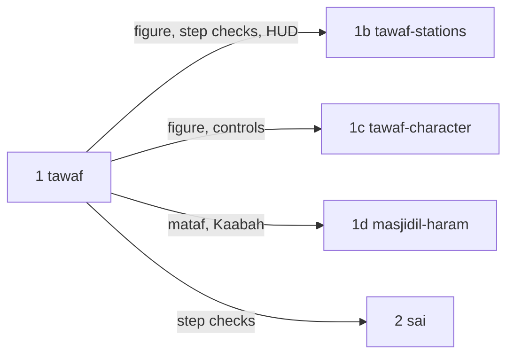
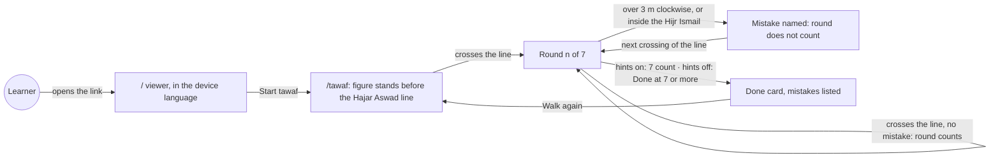
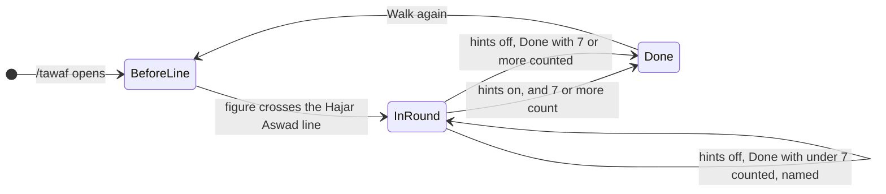
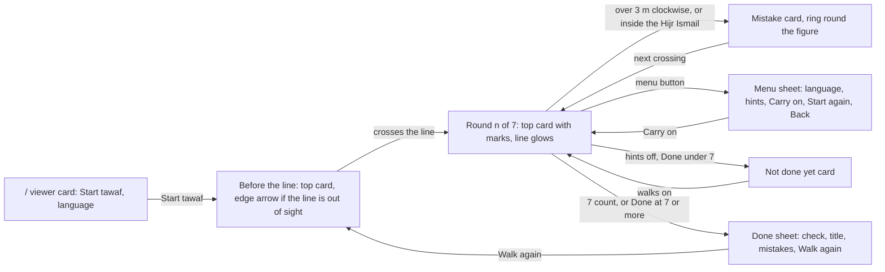

# tawaf

**Version:** v1 · **Status:** Draft · **Type:** Feature · **Project type:** Web UI

**Shape doc:** docs/specs/virtual-hajj/shape.md
**Depends on:** walking-skeleton

A learner walks a man in ihram seven times round the Kaabah, anticlockwise from the Hajar Aswad line, and the app names each mistake when it happens. With the hints off, the learner counts the rounds alone. Tawaf is the first rite, so this slice builds the step checks and the walking figure that the later rites reuse.

## Problem

First-time pilgrims learn tawaf from talks, slides and one walk round a model Kaabah. In Makkah they start at the wrong place, walk the wrong way, walk through the Hijr Ismail, or lose count, and nobody tells them at the time. The shape's success test is a learner who walks a rite in the right order with the hints off. Tawaf is the first rite where a course can check that.

## Slice test

The full tawaf, as the shape and walking-skeleton describe it, failed the fit check: about 9 scenarios in 4 areas. It is split along what the learner can do (O2).

| Check                         | Result                                                                                                            |
| ----------------------------- | ----------------------------------------------------------------------------------------------------------------- |
| Cuts every layer it needs     | yes — the scene, the figure and its controls, the step checks, the HUD in two languages, the deploy               |
| One e2e test walks it         | yes — Playwright opens `/`, presses Start tawaf, walks seven rounds and reads the done card                       |
| Worth shipping alone          | yes — a learner can practise a whole tawaf, and a course can test it with real learners (D5)                      |
| Fits (≤5 scenarios, ≤2 areas) | yes, at the limit — 5 scenarios, 2 areas: the tawaf page, and the viewer's Start tawaf button and language switch |

**Path:** full — a new page, new rules, a walking figure and two languages.

**Sibling slices**, in order after this one:



| Slice             | What ships                                                                                                                                            |
| ----------------- | ----------------------------------------------------------------------------------------------------------------------------------------------------- |
| `tawaf-stations`  | The station sheet at the Hajar Aswad line with istilam, the doa between the Rukun Yamani and the Hajar Aswad, and two rakaat behind the Maqam Ibrahim |
| `tawaf-character` | The man or woman pick, idtiba' and raml for men, and the joystick switch in the menu                                                                  |
| `masjidil-haram`  | The mosque round the mataf, and a `/perf` re-run at full mosque size                                                                                  |

## User story

As a first-time pilgrim on a Tabung Haji course, I want to walk a whole tawaf on my phone and hear about each mistake when I make it, so that I start, turn and count right in Makkah.

## Flow



The learner opens the viewer, presses Start tawaf, and walks the figure to the line. Each clean crossing counts a round, a mistake voids the round, and the tawaf ends at seven.

## States



Before the line, nothing counts. A round counts only when it had no mistake. With hints on the app ends the tawaf; with hints off the learner does, with Done.

## Rules

The tawaf rules this slice checks, from the Shafi'i rulings (D1, D32, D33).

| Rule                                     | The app checks                                                                                                    | Then                                                                                                                                |
| ---------------------------------------- | ----------------------------------------------------------------------------------------------------------------- | ----------------------------------------------------------------------------------------------------------------------------------- |
| Tawaf starts at the Hajar Aswad line     | Nothing, before the figure first crosses the line                                                                 | Nothing counts and nothing is named                                                                                                 |
| A round runs anticlockwise, line to line | Each crossing of the line                                                                                         | The round counts if it had no mistake                                                                                               |
| The Kaabah stays on the left             | The figure goes back more than 3 m clockwise, along its circle, behind the furthest point it reached in the round | The app names it, and the round does not count. The round starts again at the next crossing                                         |
| The Hijr Ismail is part of the Kaabah    | The figure steps inside the Hijr Ismail wall                                                                      | The app names it, and the round does not count. The round starts again at the next crossing                                         |
| A tawaf has seven rounds                 | Hints on: the seventh round counts. Hints off: the learner taps Done                                              | Done with 7 counted is correct. Under 7: named, and the learner walks on. Over 7: named, the tawaf ends, and the done card lists it |

Done counts the rounds already complete. A part round walked after the last crossing does not change the count.

| On the screen               | Hints on              | Hints off              |
| --------------------------- | --------------------- | ---------------------- |
| Top card: round count, marks, one instruction | yes                   | no                     |
| The Hajar Aswad line                          | glows in the accent   | a plain marking        |
| Edge arrow to the line, before round 1        | yes, when out of sight | no                    |
| "Tap the floor to walk" chip                  | yes                   | no                     |
| Mistakes named                                | yes                   | yes                    |
| Done button                                   | no                    | yes                    |
| Who ends the tawaf                            | the app, when 7 count | the learner, with Done |

The hints switch works at any time and is kept on the device. Switching hints on when 7 or more rounds count ends the tawaf, as Done does.

## Acceptance criteria

```gherkin
Scenario Outline: A learner walks seven clean rounds with hints on
  Given <learner> opens https://virtualhajj.pages.dev in <browser>, whose language is set to <language>
  And presses "<start>" on the viewer
  When the figure walks to the Hajar Aswad line, then seven times round the Kaabah, anticlockwise and outside the Hijr Ismail wall, by <input>
  Then the top card says "<round 1>" when the figure first crosses the line
  And the Hajar Aswad line glows in the accent colour
  And in round 4, a 2 m step back clockwise to turn round names no mistake
  And when the seventh round reaches the line, the done card says "<done>" and "<none>", and offers "<again>"

  Examples:
    | learner | browser                        | language | start       | input                   | round 1               | done                           | none                             | again        |
    | Aisha   | Chrome on a laptop             | English  | Start tawaf | the arrow keys          | Round 1 of 7          | Tawaf done. Seven rounds.      | No mistakes on the way.          | Walk again   |
    | Omar    | Chrome on a Samsung Galaxy A35 | Malay    | Mula tawaf  | taps on the floor ahead | Pusingan 1 daripada 7 | Tawaf selesai. Tujuh pusingan. | Tiada kesilapan sepanjang tawaf. | Tawaf semula |

Scenario Outline: A mistake is named, and the round does not count
  Given Omar is in round 3 of 7 on https://virtualhajj.pages.dev/tawaf, with hints on
  When the figure <mistake>
  Then the top card says "This round does not count" and "<instruction>"
  And a ring in the mistake colour circles the figure
  And the top card says "Round 3 of 7" again when the figure next crosses the Hajar Aswad line
  And after the tawaf, the done card lists "<listed>"

  Examples:
    | mistake                                | instruction                                | listed                                             |
    | goes back 4 m clockwise                | Turn round, so the Kaabah is on your left. | Round 3: you walked with the Kaabah on your right. |
    | walks in through the Hijr Ismail's gap | Walk outside the Hijr Ismail wall.         | Round 3: you walked inside the Hijr Ismail.        |

Scenario Outline: With hints off, the learner counts the rounds and taps Done
  Given Aisha switched hints off on https://virtualhajj.pages.dev/tawaf yesterday, and opens it again today
  Then hints are still off: no top card shows, the Hajar Aswad line does not glow, and a "Done" button shows
  When she <action>
  Then <result>

  Examples:
    | action                                         | result                                                                                                                                   |
    | taps "Done" after 7 clean rounds               | the done card says "Tawaf done. Seven rounds." and lists no mistakes                                                                     |
    | taps "Done" after 6 clean rounds               | the top card says "Six rounds count. Tawaf has seven." and "Walk one more round, then press Done.", the tawaf goes on, and the done card later lists "You pressed Done after six rounds." |
    | taps "Done" after 8 clean rounds               | the done card says "Tawaf done. Seven rounds." and lists "You walked eight rounds. Tawaf has seven."                                      |
    | switches hints on after 3 clean rounds         | the top card says "Round 4 of 7", and the Hajar Aswad line glows                                                                         |
    | switches hints on after 8 clean rounds         | the tawaf ends, the same as when she taps "Done" after 8                                                                                 |

Scenario: A learner switches language in the middle of a tawaf
  Given Omar's browser language is English, and he is in round 2 of 7 on https://virtualhajj.pages.dev/tawaf
  When he opens the menu and picks "Bahasa Melayu"
  Then the top card says "Pusingan 2 daripada 7", and round 2 goes on
  And when he opens https://virtualhajj.pages.dev the next day, the viewer is in Malay

Scenario Outline: When the 3D view can't be shown, the message is in the learner's language
  Given Mak Som's browser language is <language>, and she opens https://virtualhajj.pages.dev/tawaf on <phone>
  When <event>
  Then the plain backdrop covers the scene
  And the top card says "<message>" and "<next step>", with <action>

  Examples:
    | language | phone                                     | event                                     | message                                       | next step                                               | action                               |
    | Malay    | a 2016 phone whose browser has no WebGL 2 | the page loads                            | Pelayar ini tidak dapat menunjukkan paparan 3D. | Buka pautan ini dalam Chrome atau Safari yang terkini. | no button                            |
    | English  | a Samsung Galaxy A35                      | the browser drops the 3D view in round 5  | The 3D view stopped.                          | Reload the page to start it again.                      | a Reload button that starts a new tawaf before the line |
```

Interface › Screens and copy holds every string in both languages.

## Scope

**In:**

- A page at `/tawaf` with a mataf floor, the Kaabah with its Hajar Aswad corner marked, the Hijr Ismail wall with its two gaps, and the Hajar Aswad line on the floor. All built in code (D31).
- A man in ihram, built in code, stylised with no face detail (D37), seen from behind and above as the brief sets.
- Walking by a tap or click on the floor, and by the arrow keys. One round close to the Kaabah takes about 25 s, so seven take about 3 minutes.
- The step checks in **Rules**.
- Hints on or off, as **Rules** sets. The setting is kept on the device (D35).
- The done card: the done line, each mistake on the way, Walk again, and Back to the Kaabah view.
- The menu sheet: language, hints, Carry on, Start tawaf again, and Back to the Kaabah view. Opening it pauses the walk.
- Malay and English on `/` and `/tawaf`. The page opens in the browser's language: Malay when it is set to Malay, else English. The language choice sits in the menu sheet on `/tawaf` and on the viewer's card on `/`, and it is kept on the device (D34, D35).
- A Start tawaf button on the viewer at `/` (D36).
- The plain messages of D27 on `/tawaf`, in both languages. A reload starts a new tawaf.
- The tawaf scene holds 30 FPS on the Galaxy A35 (D22). The reading goes into the slice's PR, so later scenes have a number to compare (walking-skeleton O25).
- One e2e test that walks seven rounds.

**Out:**

- The station sheet at the Hajar Aswad line, with istilam and its Arabic → `tawaf-stations`.
- The doa between the Rukun Yamani and the Hajar Aswad, the Maqam Ibrahim, and the two rakaat behind it → `tawaf-stations`.
- The man or woman pick, idtiba', and raml in the first three rounds → `tawaf-character`.
- The on-screen joystick and its switch in the menu → `tawaf-character`.
- The "Show me" button from the system's walking HUD → `tawaf-stations`, with "Show me how".
- A darker rim round the figure, as the brief asks → O24.
- The mosque round the mataf, and a `/perf` re-run at full mosque size → `masjidil-haram`.
- Badges, completion marks and the journey map → a later slice; the shape has none yet.
- Saving a tawaf in progress → not doing (shape). Only the language and hints settings are kept.
- Malay on `/perf` → not doing; it is a developer page (D26).
- Crowds → not doing (shape).

## Interface

Two pages, composed from the VirtualHajj design system (D15, D16): the tokens in `docs/design/design-system/`, and the parts its Claude Design canvas draws (https://claude.ai/artifact/EWyrXLHtQcxsn2gNoMvXLL). Nothing new went into the system. The scene colours go into the scene palette, outside it (D25).



The viewer's card leads into tawaf. Each crossing of the line updates the top card, a mistake swaps it for the mistake card, and the done sheet ends the tawaf.

```
+---------------------------+
| [Hints  [=] On]      [≡]  |  top bar, 8px in (16px on a laptop)
| +-----------------------+ |
| | Round 3 of 7  ■■▣□□□□ | |  top card under the bar, 448px wide on a laptop
| | Keep the Kaabah on    | |
| | your left.            | |
| | Round 4 starts at ... | |
| +-----------------------+ |
|  Kaabah ---- glowing line |  camera turned towards the Kaabah
|        (figure)  (tap)    |
|                           |  lower middle stays clear
| [Tap the floor to walk]   |  hints on: caption chip, bottom left
|                   [Done]  |  hints off: Done, bottom right
+---------------------------+
```

### Screens and copy

| Screen | English | Malay |
| ------ | ------- | ----- |
| Viewer card | "VirtualHajj" · "Drag to look round the Kaabah." · phone "Pinch to zoom in and out." · laptop "Scroll to zoom. With the keyboard, the arrow keys turn the view and + and − zoom." · primary "Start tawaf" · "Language" with the language choice | "Seret untuk melihat sekeliling Kaabah." · "Cubit untuk zum masuk dan keluar." · "Tatal untuk zum. Dengan papan kekunci, kekunci anak panah memusingkan pandangan, dan + serta − untuk zum." · "Mula tawaf" · "Bahasa" |
| Top bar | Hints switch "Hints", "On" / "Off" · menu button "Menu" | "Petunjuk", "Hidup" / "Mati" · "Menu" |
| Before the line | "Before you start" · "Walk to the Hajar Aswad line." · "Your first round starts there. Keep the Kaabah on your left." | "Sebelum mula" · "Berjalan ke garisan Hajar Aswad." · "Pusingan pertama anda bermula di situ. Pastikan Kaabah di sebelah kiri anda." |
| Edge arrow | "Hajar Aswad line", spoken "Turn to the Hajar Aswad line" | "Garisan Hajar Aswad", "Pusing ke garisan Hajar Aswad" |
| Round n | "Round 3 of 7" · "Keep the Kaabah on your left." · "Round 4 starts at the Hajar Aswad line, glowing ahead." Round 7: "Your tawaf ends at the Hajar Aswad line, glowing ahead." | "Pusingan 3 daripada 7" · "Pastikan Kaabah di sebelah kiri anda." · "Pusingan 4 bermula di garisan Hajar Aswad yang bercahaya di hadapan." Round 7: "Tawaf anda tamat di garisan Hajar Aswad yang bercahaya di hadapan." |
| Caption chip | phone "Tap the floor to walk" · laptop "Walk with the arrow keys, or click the floor" | "Ketik lantai untuk berjalan" · "Berjalan dengan kekunci anak panah, atau klik lantai" |
| Mistake: wrong way | "This round does not count" · "Turn round, so the Kaabah is on your left." · "Tawaf goes anticlockwise. Walk on to the Hajar Aswad line, and round 3 starts again there." | "Pusingan ini tidak dikira" · "Pusing balik, supaya Kaabah di sebelah kiri anda." · "Tawaf mengikut arah lawan jam. Teruskan ke garisan Hajar Aswad, dan pusingan 3 bermula semula di situ." |
| Mistake: Hijr Ismail | "This round does not count" · "Walk outside the Hijr Ismail wall." · "The Hijr Ismail is part of the Kaabah. Walk on to the Hajar Aswad line, and round 3 starts again there." | "Pusingan ini tidak dikira" · "Berjalan di luar tembok Hijir Ismail." · "Hijir Ismail ialah sebahagian daripada Kaabah. Teruskan ke garisan Hajar Aswad, dan pusingan 3 bermula semula di situ." |
| Mistake, hints off | The same, with "the round starts again there" for the round number, and no marks | "pusingan itu bermula semula di situ" |
| Hints off | No top card · primary "Done" | "Selesai" |
| Done under 7 | "Not done yet" · "Six rounds count. Tawaf has seven." · "Walk one more round, then press Done." | "Belum selesai" · "Enam pusingan dikira. Tawaf ada tujuh." · "Jalan satu pusingan lagi, kemudian tekan Selesai." |
| Done sheet | Check icon and "Tawaf done. Seven rounds." · "No mistakes on the way." or "On the way" and the list · primary "Walk again" · quiet "Back to the Kaabah view" | "Tawaf selesai. Tujuh pusingan." · "Tiada kesilapan sepanjang tawaf." or "Sepanjang tawaf" · "Tawaf semula" · "Kembali ke paparan Kaabah" |
| Done list | "Round 3: you walked with the Kaabah on your right." · "Round 5: you walked inside the Hijr Ismail." · "You pressed Done after six rounds." · "You walked eight rounds. Tawaf has seven." | "Pusingan 3: anda berjalan dengan Kaabah di sebelah kanan." · "Pusingan 5: anda berjalan di dalam Hijir Ismail." · "Anda menekan Selesai selepas enam pusingan." · "Anda berjalan lapan pusingan. Tawaf ada tujuh." |
| Menu sheet | "Tawaf" · "Round 2 of 7 · Paused", or "Paused" with hints off · "Language" · Hints switch · primary "Carry on" · quiet "Start tawaf again" · quiet "Back to the Kaabah view" · close "Close menu" | "Tawaf" · "Pusingan 2 daripada 7 · Dijeda" or "Dijeda" · "Bahasa" · "Teruskan" · "Mula tawaf semula" · "Kembali ke paparan Kaabah" · "Tutup menu" |
| Loading, no WebGL 2, stopped | "Tawaf" · "Loading the Kaabah…" · the D27 messages, as on `/` | "Memuatkan Kaabah…" · "Pelayar ini tidak dapat menunjukkan paparan 3D." · "Buka pautan ini dalam Chrome atau Safari yang terkini." · "Paparan 3D terhenti." · "Muat semula halaman untuk memulakannya semula." · "Muat semula" |

Counts use words from "no" to "ten", and digits above ten. Every string lives in `src/copy.ts`. The edge arrow shows only before round 1. During a round the line can sit behind the camera, and an arrow there would point the learner the wrong way.

### Scene

| Element | How it looks |
| ------- | ------------ |
| Hajar Aswad line, hints on | From the Hajar Aswad corner, 22 m across the floor: an `accent` band 1.4 m wide at 55%, with an `accent-ink` core 0.25 m wide, as the brief sets |
| Hajar Aswad line, hints off | A plain band 0.3 m wide in `lineMark` |
| Hajar Aswad frame | A silver ring at 1.5 m on the corner, in `stoneFrame` |
| Hijr Ismail wall | An arc 1.3 m high and 0.6 m thick, 6.5 m out from the Kaabah, with a gap of about 2.3 m at each end, in `hijrWall` |
| Pilgrim | A man in ihram: the izar from the waist to below the knee, the rida over both shoulders. `ihram`, `skin` and `hair`, no face. A ground shadow in `shadow` at 20%. The same 20 bones as the `/perf` figure |
| Tap ring | An `ink` ring and dot where the learner taps |
| Mistake ring | A `mistake` ring round the figure while the mistake card shows |
| Camera | Behind and above the figure, turned towards the Kaabah: 35° and 10 m back on a landscape screen, 62° and 14 m back on a portrait one. A camera straight behind the figure can't see the Kaabah on a portrait phone (O25) |

New scene palette entries, outside the UI system (D25):

| Name         | Day       | Night     |
| ------------ | --------- | --------- |
| `skin`       | `#A8754F` | `#A8754F` |
| `hair`       | `#3B2A20` | `#3B2A20` |
| `stoneFrame` | `#C9CDD2` | `#C9CDD2` |
| `hijrWall`   | `#F7F3EA` | `#5A6880` |
| `lineMark`   | `#BCA78A` | `#2F3B4E` |
| `shadow`     | `#2A1F14` | `#000000` |

**Motion tier:** 2.

- A new round, a mistake, or the not-done-yet message: the lead, the instruction and the note rise 12px into place and fade in over `dur-step` (480ms) with `ease-settle`.
- The mark for a round that counts fills from left to right over `dur-step`.
- The menu and the done sheet rise 12px and fade in over `dur-panel` (320ms), over a scrim that fades in. They leave with `ease-leave`.
- The switch thumb slides over `dur-micro`. Buttons change colour on hover over `dur-micro` and shrink to 98% on press over `dur-press`.
- The camera follows the figure with the settling ease.
- With reduced motion, nothing moves: the fades stay at `dur-micro`, the marks fill at once, and the camera cuts.
- Nothing moves on its own. The line's glow does not pulse.

**Components used:** from the system's canvas: top bar, hints switch, menu button, top card with progress marks and its mistake form, caption chip, edge arrow, bottom sheet with scrim, language choice, primary button, quiet button. Lucide `check`, `circle-alert`, `menu`, `x`, `arrow-left`, `arrow-right`. Tokens: `surface`, `sunken`, `ink`, `ink-muted`, `line`, `accent`, `accent-ink`, `accent-hover`, `accent-edge`, `on-accent`, `mistake`, `scrim`; `caption`, `body`, `label`, `lead`, `instruction`; `space-1` to `space-16`, `target`, `radius-mark`, `radius-inner`, `radius-control`, `radius-panel`; `dur-press`, `dur-micro`, `dur-panel`, `dur-step`, `ease-settle`, `ease-leave`, `move`.

**Preview:** the real components, in the repo. Run `pnpm dev` and open `http://localhost:5173/preview/`. Pick a state, a size and a language. The hints switch, the menu and the language choice work. `preview/` is not in the Vite build inputs, so it never deploys.

| Built for `/build` to keep | Path |
| -------------------------- | ---- |
| Every string, both languages | `src/copy.ts` |
| The HUD for /tawaf, drawn from a view model | `src/tawaf/TawafHud.tsx`, `src/tawaf/hudView.ts` |
| Hints switch, menu button, quiet button, language choice, progress marks, bottom sheet, icons | `src/ui/` |
| The mataf, the Hijr Ismail wall, the line, the rings, the camera | `src/scene/TawafScene.tsx`, `src/scene/mataf.ts` |
| The pilgrim | `src/scene/Pilgrim.tsx` |
| The HUD styles | `src/styles/app.css` |
| The preview pages | `preview/`, `src/preview/` |

**Checks:** the drift check passed over 18 files. It found no token file named `tokens*.css`, so every `--vh-` name in the new code was checked by hand against `docs/design/design-system/tokens/`; all exist. The HUD was checked in headless Chromium, in English and Malay, light and dark, on phone and laptop. The 3D scene was checked in Chrome on this machine, where WebGL works; headless Chromium here drops every WebGL context.

## Decisions to record

Drafted at pause 1. `/build` appends them to `DECISIONS.md` exactly as below.

```markdown
## D31 · 2026-10-22 · Build the tawaf scene and figure in code

Why: the brief asks for stylised figures with no face detail, and shapes built in code need no licence, no credit and no model download on a phone. The `/perf` figure is already built in code, at about 5,000 triangles (D22).
Rejected: free models with a licence (each licence needs a check, and some ban commercial use), bought models (they cost money, and the look may not match the brief).
Source: docs/specs/tawaf.md
Status: active

## D32 · 2026-10-22 · A tawaf round counts from the Hajar Aswad line, with the Kaabah on the left, outside the Hijr Ismail

Why: these are conditions of a valid round in the Shafi'i rulings (D1). A round counts when the figure crosses the line with no mistake. If the figure goes more than 3 m back clockwise, or steps inside the Hijr Ismail wall, the app names it and the round does not count. The round starts again at the next crossing. Before the first crossing, nothing counts and nothing is named, because tawaf has not started.
Rejected: the tawaf starts over after a mistake (stricter than the ruling), any step clockwise (small wobbles from tap-to-walk would count), a quarter round (a long wrong walk would pass unnamed), a direction check before the line (it is not tawaf yet).
Source: docs/specs/tawaf.md
Status: active

## D33 · 2026-10-22 · With hints off, the learner counts the rounds and taps Done

Why: a pilgrim must count seven rounds in Makkah, and the shape's success test is a rite walked with the hints off. Hints off hides the top card and the line's glow, and mistakes are still named. Only Done at seven is correct. Done under seven is named, and the learner walks on. Done over seven is named, ends the tawaf, and goes on the done card's list, since an eighth round does not void a Shafi'i tawaf. The switch works at any time. Hints on with seven or more counted ends the tawaf, as Done does.
Rejected: the counter stays with hints off (the learner never practises the count), a switch that locks once round 1 starts (the app is a learning tool, not a test), any wrong count starts the tawaf over (an eighth round does not void the tawaf).
Source: docs/specs/tawaf.md
Status: active

## D34 · 2026-10-22 · Learner pages open in the browser's language, with a language choice to change it

Why: Tabung Haji courses teach in Malay, and other learners need English (D4). A browser set to Malay opens `/` and `/tawaf` in Malay, and any other language opens them in English. The design system's language choice sits in the menu sheet on `/tawaf` and on the viewer's card on `/`. `/perf` stays in English, because it is a developer page (D26).
Rejected: Malay first on every visit (an English learner must find the choice each time), a language choice on a start card at every visit (one more tap before every lesson), English only on `/` (a Malay learner's first screen would be English), a compact BM / EN control in the top bar (the system has none, and the top bar is full on a 390px phone).
Source: docs/specs/tawaf.md
Status: active

## D35 · 2026-10-22 · Keep the language and hints settings on the device

Why: a learner who picked BM, or who practises with hints off, gets the same setting back on the next visit. Only these two settings are kept. No tawaf in progress is saved, so a reload or a new visit starts a new tawaf.
Rejected: hints on at every visit (a learner who practises with hints off must switch them off each time).
Source: docs/specs/tawaf.md
Status: active

## D36 · 2026-10-22 · Tawaf lives at /tawaf, and the viewer at / links to it

Why: each rite gets its own address that a course can send, and the viewer stays as the first screen, with a Start tawaf button.
Rejected: tawaf at `/` in place of the viewer (the viewer would go, and a later rite would need a new front page anyway).
Source: docs/specs/tawaf.md
Status: active

## D37 · 2026-10-22 · A man in ihram walks until the character pick ships

Why: the white ihram reads as a pilgrim on the mataf. Idtiba' and raml are sunnah, so a figure without them teaches nothing wrong. `tawaf-character` adds the pick and both rules.
Rejected: a woman (she comes with the pick in `tawaf-character`), a figure with no clothing detail (it does not read as a pilgrim).
Source: docs/specs/tawaf.md
Status: active

## D38 · 2026-10-22 · The done card lists each mistake made on the way

Why: after a tawaf with hints off, the list tells the learner what to practise. It states facts and gives no score, so the no-score rule holds (D15).
Rejected: a done card with no list (a learner may forget a mistake from round 2 by round 7).
Source: docs/specs/tawaf.md
Status: active
```

## Open items

| ID  | What                                                                                         | Type     | Raised at | Owner | Status   | Answer                                                                                                                                                      |
| --- | -------------------------------------------------------------------------------------------- | -------- | --------- | ----- | -------- | ----------------------------------------------------------------------------------------------------------------------------------------------------------- |
| O1  | Where do the 3D models come from: self-made, bought, or free with a licence? (from shape O7) | question | shape     | user  | Resolved | Built in code: the Kaabah, the Hijr Ismail wall and the figure. D31. 2026-10-22                                                                             |
| O2  | The full tawaf fails the fit check. Which cut ships first?                                   | question | spec p1   | user  | Resolved | The walk and the step checks, with hints and both languages. Then `tawaf-stations`, `tawaf-character` and `masjidil-haram`. 2026-10-22                      |
| O3  | Until the character pick ships, who walks?                                                   | question | spec p1   | user  | Resolved | A man in ihram, with no idtiba' or raml. Both are sunnah, so leaving them out teaches nothing wrong. D37. 2026-10-22                                        |
| O4  | What does the link open once tawaf ships?                                                    | question | spec p1   | user  | Resolved | The viewer stays at `/` with a Start tawaf button. Tawaf is at `/tawaf`. D36. 2026-10-22                                                                    |
| O5  | Which mistakes does the app check?                                                           | question | spec p1   | user  | Resolved | Wrong direction, walking inside the Hijr Ismail, and the wrong count with hints off. D32, D33. 2026-10-22                                                   |
| O6  | After a mistake, what happens to the round?                                                  | question | spec p1   | user  | Resolved | The app names it, and the round does not count. The round starts again at the next crossing of the Hajar Aswad line. D32. 2026-10-22                        |
| O7  | With hints off, does the round counter still show?                                           | question | spec p1   | user  | Resolved | No. The learner counts and taps Done. Hints off also hides the instruction and the glowing path. Mistakes are still named. D33. 2026-10-22                  |
| O8  | How far clockwise counts as the wrong-direction mistake?                                     | question | spec p1   | user  | Resolved | More than 3 m, about four steps, along the figure's circle. D32. 2026-10-22                                                                                 |
| O9  | How does the learner get Malay or English?                                                   | question | spec p1   | user  | Resolved | The browser's language, with a BM / EN switch in the top bar, kept on the device. D34, D35. 2026-10-22                                                      |
| O10 | With hints off, what does the app do with a wrong count at Done?                             | question | spec p1   | user  | Resolved | Only Done at seven is correct. Under seven: named, and the learner walks on. Over seven: named, the tawaf ends, and the done card lists it. D33. 2026-10-22 |
| O11 | Can the learner switch hints in the middle of a tawaf?                                       | question | spec p1   | user  | Resolved | Yes, at any time. D33. 2026-10-22                                                                                                                           |
| O12 | What does the learner see after the seventh round?                                           | question | spec p1   | user  | Resolved | The done card with the list of mistakes made on the way, and Walk again. D38. 2026-10-22                                                                    |
| O13 | Does the viewer at `/` follow the language rule too?                                         | question | spec p1   | user  | Resolved | Yes, with the same switch. `/perf` stays English (D26). D34. 2026-10-22                                                                                     |
| O14 | Before the figure first reaches the Hajar Aswad line, does the app check anything?           | question | spec p1   | user  | Resolved | No. Tawaf starts at the line, so nothing before it counts or is named. D32. 2026-10-22                                                                      |
| O15 | On a new visit, is the hints switch on again?                                                | question | spec p1   | user  | Resolved | No. The last setting is kept on the device. D35. 2026-10-22                                                                                                 |
| O16 | With hints off, a learner walks eight rounds, then switches hints on. What happens?          | question | spec p1   | user  | Resolved | The tawaf ends, the same as Done after eight, and the done card lists the extra round. D33. 2026-10-22                                                      |
| O17 | How long does one round take at the figure's walking pace?                                   | question | spec p1   | user  | Resolved | About 25 s, so seven rounds take about 3 minutes. 2026-10-22                                                                                                |
| O18 | Pause 1 put a BM / EN switch in the top bar. The design system puts language in the menu sheet, and its top bar holds only the hints switch and the menu. Where does it go? | question | spec p2 | user | Resolved | In the menu sheet, as the system draws it, and on the viewer's card on `/`. The menu sheet joins this slice without the joystick. Changes O9 and D34. 2026-10-22 |
| O19 | Pause 1 said the path ahead glows. The system glows the next target instead. Which? | question | spec p2 | user | Resolved | The Hajar Aswad line glows, with the system's edge arrow when it is out of sight. Changes O7 and scenarios 1 and 3. 2026-10-22 |
| O20 | The system's walking HUD has a "Show me" button. Is it in this slice? | question | spec p2 | user | Resolved | No. It goes to `tawaf-stations` with "Show me how". With hints off, Done takes its corner. 2026-10-22 |
| O21 | Which motion tier? | question | spec p2 | user | Resolved | Tier 2, as Interface sets. 2026-10-22 |
| O22 | With hints off, does the Hajar Aswad line still show? | question | spec p2 | user | Open | — |
| O23 | Claude drafted the Malay copy, and nobody else checks it (shape O2). | flag | spec p2 | user | Open | — |
| O24 | The brief asks for a darker rim round the figure as well as the ground shadow. The preview has only the shadow. | question | spec p2 | user | Open | — |
| O25 | A camera straight behind the figure can't see the Kaabah on a portrait phone. The preview turns the camera towards the Kaabah. | question | spec p2 | user | Open | — |

_Never delete this section or its rows. See references/ledger.md._

## Glossary

- **Tawaf** — seven anticlockwise rounds of the Kaabah, starting at the Hajar Aswad.
- **Kaabah** — the cube-shaped building at the centre of the Masjidil Haram.
- **Hajar Aswad** — the Black Stone in one corner of the Kaabah; each round of tawaf starts and ends in line with it.
- **Hajar Aswad line** — a line on the floor from the Hajar Aswad corner, where the app counts each round.
- **Hijr Ismail** — the semicircle area beside the Kaabah, inside a low wall. It counts as part of the Kaabah, so a round walked through it does not count.
- **Mataf** — the open floor round the Kaabah where tawaf is walked.
- **Ihram** — the state a pilgrim enters for Hajj or Umrah, and the two plain white cloths men wear in it.
- **Idtiba'** — wearing the ihram cloth under the right arm and over the left shoulder, for men in tawaf.
- **Raml** — walking briskly in the first three rounds of tawaf, for men.
- **Istilam** — saluting the Hajar Aswad with the right hand at the start of each round.
- **Rukun Yamani** — the Kaabah corner before the Hajar Aswad corner, in the direction of tawaf.
- **Maqam Ibrahim** — the station of Ibrahim, a small enclosure near the Kaabah.
- **Rakaat** — units of the prayer; two are prayed behind the Maqam Ibrahim after tawaf.
- **Doa** — a supplication.
- **Sunnah** — a recommended act; leaving it out does not void the rite.
- **Shafi'i** — one of the four Sunni schools of Islamic law, the one followed in Malaysia.
- **Tabung Haji** — Malaysia's pilgrims' fund, which runs the national Hajj courses.
- **BM** — Bahasa Melayu, the Malay language.
- **HUD** — heads-up display: the game UI drawn over the scene.
- **Top card** — the HUD panel at the top of the screen that holds the one instruction.
- **Third person** — the camera follows behind and above the figure, so the learner sees their own figure.
- **e2e** — end to end: one test that walks the whole slice as a user would.
- **Scenario Outline** — one Gherkin scenario run once for each row of its Examples table.
- **WebGL 2** — the browser feature that draws 3D graphics; old browsers lack it.
- **FPS** — frames per second; 30 is the floor where walking still looks smooth.
- **Izar** — the ihram cloth wrapped round the waist, down to below the knee.
- **Rida** — the ihram cloth over the shoulders.
- **Scrim** — the see-through dark layer behind a sheet, so the sheet stands out from the scene.
- **Lucide** — a free set of line icons.
- **Token** — a named design value, such as `accent` or `space-4`, that every screen uses instead of a raw number.
- **Motion tier** — how much movement a slice's UI uses, from 0 (none) to 3 (a showpiece).
- **Drift check** — a script that fails when new UI code uses a raw colour or a value outside the design system.
- **Headless** — a browser running with no window, as on CI.
- **Vite** — the build tool and dev server.
