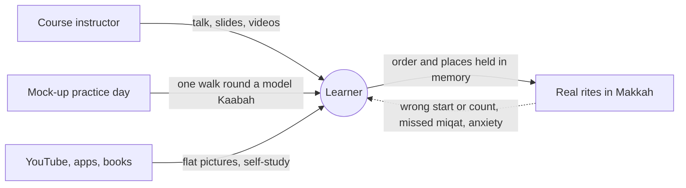
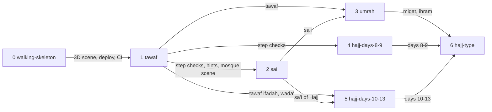

# Virtual Hajj

**Project type:** web UI · **Status:** Shaped

## Problem

First-time Hajj pilgrims and students cannot picture where each rite happens or in what order from talks, slides, videos and one mock-up practice.
So they make mistakes in the real rites and arrive anxious, and instructors repeat the same basics every course.

**Works when:** a learner walks a rite in the right order with the hints off.

## Today

Every source gives the learner a flat picture, and the first time they walk the real place is the rite itself.

## Slices

Tawaf builds the step checks and the mosque scene, and every later rite reuses them; `hajj-type` joins all the rites into one journey.

| # | Slice | What ships | Why this order |
|---|-------|-----------|----------------|
| 0 | `walking-skeleton` | A learner opens a link on a phone or laptop and turns the camera round a plain Kaabah. One e2e test runs in CI, and the site is live. | The repo is empty. This slice proves the 3D, deploy and test rails, and the phone speed (O8). |
| 1 | `tawaf` | A learner walks seven anticlockwise rounds from the Hajar Aswad line, with hints on or off. The app names each mistake. Malay and English. | It builds the step checks and the Masjidil Haram scene that slices 2 to 5 reuse. |
| 2 | `sai` | A learner walks seven legs from Safa to Marwah, with the green-light zone, hints on or off. | It reuses the step checks and the mosque scene from `tawaf`. |
| 3 | `umrah` | A learner makes niyyah and puts on ihram before the miqat, then does tawaf, sa'i and tahallul in order. | It needs `tawaf` and `sai`. It completes the Umrah part of tamattu'. |
| 4 | `hajj-days-8-9` | A learner goes to Mina on the 8th, does wuquf at Arafah on the 9th, and spends the night at Muzdalifah. | It is the first of the Hajj days. It needs only the step checks from `tawaf`. |
| 5 | `hajj-days-10-13` | A learner stones the jamarat in order, does hady, shaving, tawaf ifadah and the nights at Mina, then tawaf wada'. | It reuses `tawaf` and `sai`. It may split at `/spec`. |
| 6 | `hajj-type` | A learner picks tamattu', ifrad or qiran and walks the whole Hajj in that type's order. | It joins slices 3 to 5. Until it ships, slices 3 to 5 teach the tamattu' order. |

## Not doing

- **VR headset support.** Few learners own a headset, and the browser covers phone and laptop.
- **Installed mobile app.** A link opens with no install.
- **Crowd simulation.** It is heavy on phones, and a learner does not need it to learn the order of the rites.
- **Accounts and saved progress.** There is no login, and each visit starts fresh.
- **Instructor class mode.** Instructors show the learner view on a projector.
- **Separate child version.** One plain version serves all ages (O6).

## Open items

| ID | What | Type | Raised at | Owner | Status | Answer |
| -- | ---- | ---- | --------- | ----- | ------ | ------ |
| O1 | Whose rulings does the content follow? | question | shape | user | Resolved | Shafi'i, as taught in Tabung Haji courses. 2026-10-21 |
| O2 | Who reviews each rite before it ships? | question | shape | user | Accepted risk | No ustaz review. Content follows Tabung Haji course material (O1). Risk: a copy error teaches a real mistake. User's call, 2026-10-21 |
| O3 | Which types of Hajj does it teach? | question | shape | user | Resolved | All three. Slices 3 to 5 teach the tamattu' order, and `hajj-type` adds ifrad and qiran. 2026-10-21 |
| O4 | Release each slice, or only the full Hajj? | question | shape | user | Resolved | Release each slice when it is done. 2026-10-21 |
| O5 | Which language does the app use? | question | shape | user | Resolved | Malay and English, from `tawaf` on. 2026-10-21 |
| O6 | Does one content version serve adults and children? | question | shape | user | Resolved | Yes. One version, in plain words that a 10-year-old can follow. 2026-10-21 |
| O7 | Where do the 3D models come from: self-made, bought, or free with a licence? | question | shape | user | Handed to tawaf | — |
| O8 | A mid-range phone browser draws the Masjidil Haram scene smoothly. | unproven | shape | user | Handed to walking-skeleton | — |

## Glossary

- **Tawaf** — seven anticlockwise rounds of the Kaabah, starting at the Hajar Aswad.
- **Hajar Aswad** — the Black Stone in one corner of the Kaabah, where each round of tawaf starts.
- **Sa'i** — seven walks between the hills of Safa and Marwah, inside the Mas'a.
- **Mas'a** — the long hall in the Masjidil Haram where sa'i is done.
- **Miqat** — the boundary that a pilgrim must not cross without ihram.
- **Ihram** — the state a pilgrim enters with niyyah, and the plain cloth men wear in it.
- **Niyyah** — the intention, said in the heart, to do Umrah or Hajj.
- **Tahallul** — cutting or shaving the hair to leave ihram.
- **Dam** — a penalty, usually an animal sacrifice, for a missed or broken rule.
- **Hady** — the animal sacrifice that tamattu' and qiran pilgrims must give.
- **Wuquf** — standing at Arafah on 9 Dhul Hijjah, the core rite of Hajj.
- **Mina, Arafah, Muzdalifah** — the three sites outside Makkah where pilgrims stay on 8 to 13 Dhul Hijjah.
- **Jamarat** — the three stone pillars at Mina that pilgrims stone in a fixed order.
- **Tawaf ifadah** — the tawaf after Arafah that every Hajj needs.
- **Tawaf wada'** — the farewell tawaf before a pilgrim leaves Makkah.
- **Tamattu', ifrad, qiran** — the three types of Hajj, which differ in when Umrah is done and whether hady is due.
- **Shafi'i** — one of the four Sunni schools of Islamic law, the one followed in Malaysia.
- **Tabung Haji** — Malaysia's pilgrims' fund, which runs the national Hajj courses.
- **Ustaz** — a religious teacher.
- **Walking skeleton** — the thinnest working app, deployed end to end, that later slices grow on.
- **Step checks** — the rules that tell a learner when a step is wrong, such as the wrong direction or count.
- **e2e** — end to end: an e2e test is an automated test that drives the real app in a browser from start to finish.
- **CI** — continuous integration: a server that runs the tests on every push.
