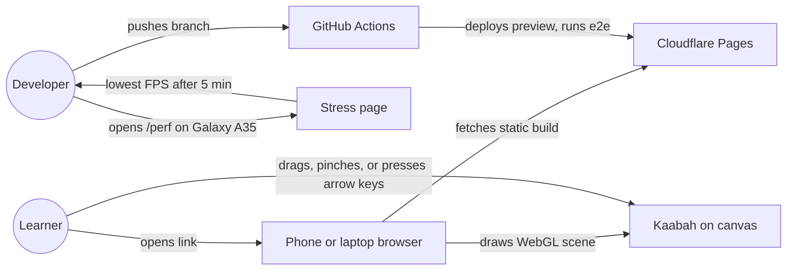
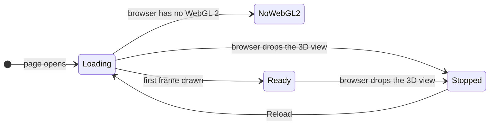
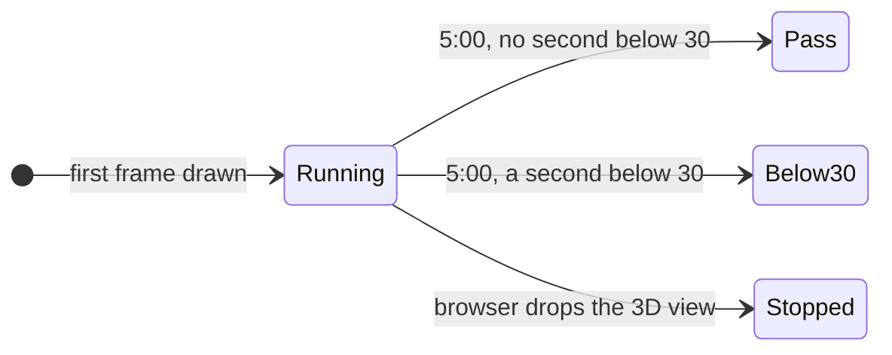
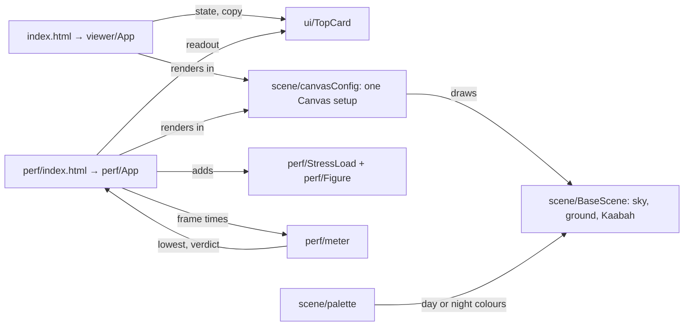
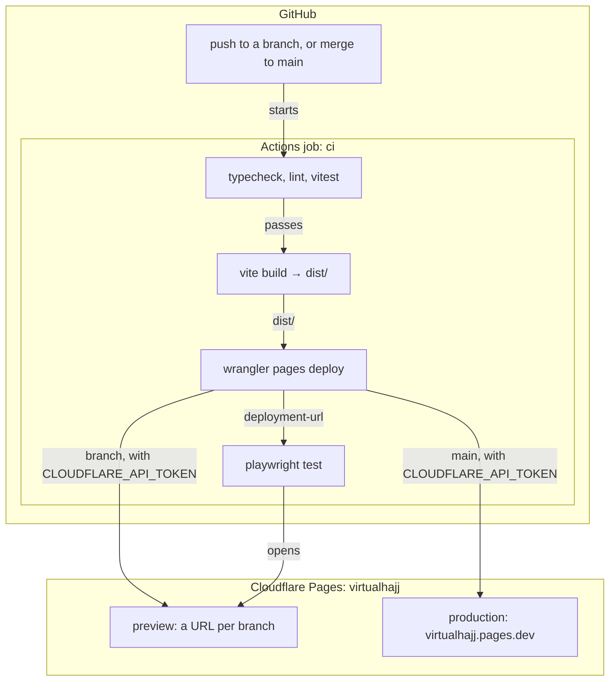
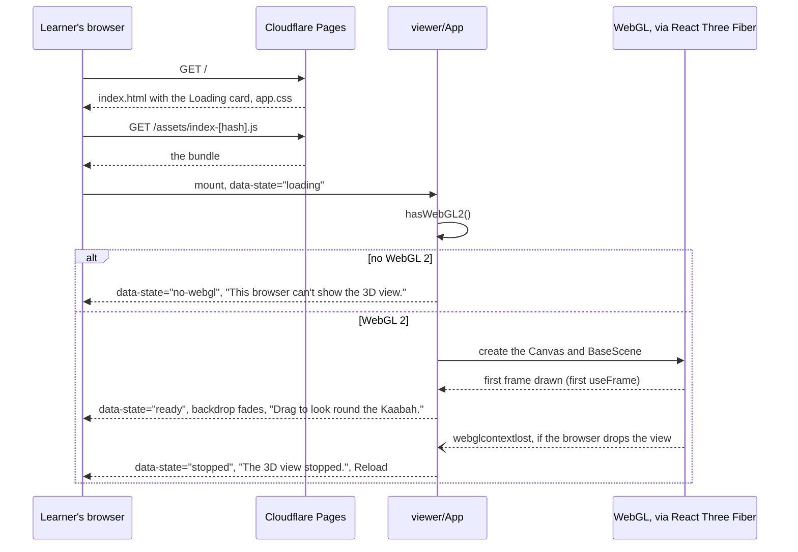

# walking-skeleton

**Version:** v1 · **Status:** Built · **Type:** Skeleton · **Project type:** Web UI

**Shape doc:** docs/specs/virtual-hajj/shape.md
**Depends on:** None

A learner opens a link on a phone or laptop and turns the camera round a plain Kaabah. The site is live, one e2e test runs in CI on every push, and a stress page proves a Samsung Galaxy A35 can draw a mosque-sized scene and a walking figure at 30 FPS, so every later rite is built on rails that already work.

## Problem

The repo is empty. Before `tawaf` or any later rite can be built, the project needs 3D rendering that works in the browser, a deploy to a public URL, a CI that runs the tests, and proof that a mid-range phone can draw the Masjidil Haram scene smoothly (shape O8). If any one of those breaks, every later slice stalls, and a slow phone found only after the mosque scene is built means rework across slices 1 to 5.

## Slice test

| Check                         | Result                                                                                         |
| ----------------------------- | ---------------------------------------------------------------------------------------------- |
| Cuts every layer it needs     | yes — 3D scene, static hosting, CI, e2e test, phone perf check                                 |
| One e2e test walks it         | yes — Playwright opens the preview URL, waits for the canvas, and checks for a non-blank frame |
| Worth shipping alone          | yes — a live link that draws the Kaabah on phone and laptop, plus the answer to shape O8       |
| Fits (≤5 scenarios, ≤2 areas) | yes — 5 scenarios, 2 areas (viewer page, stress page)                                          |

**Path:** full — a greenfield walking skeleton sets the stack for the whole project, so every pause earns its keep.

## Stack

The decision record for the whole project. Each row cites the entry drafted below in **Decisions to record**.

| Layer           | Choice                                                                  | Entry    |
| --------------- | ----------------------------------------------------------------------- | -------- |
| UI and 3D       | React, React Three Fiber, drei, TypeScript, Vite                        | D17      |
| Database        | None — no accounts or saved progress (shape › Not doing)                | —        |
| Host            | Cloudflare Pages: production on `main`, a preview per PR, `*.pages.dev` | D18, D24 |
| CI              | GitHub Actions, on a public repo under a personal GitHub account        | D21, D23 |
| Tests           | Vitest for unit tests, Playwright for the e2e test                      | D19      |
| Package manager | pnpm                                                                    | D20      |
| Phone bar       | 30 FPS on a Samsung Galaxy A35, held for 5 minutes                      | D22      |
| UI              | The VirtualHajj design system, `docs/design/design-system/`             | D15, D16 |
| Scene colours   | One scene palette, outside the UI system                                | D25      |

## User story

As a learner curious about the app, I want to open the link and look at the Kaabah from every angle, so that I trust it works on my phone before I come back for `tawaf`.

## Flow



The learner opens the link, the browser fetches the static build from Cloudflare, and dragging, pinching or the arrow keys turn the camera round the Kaabah; separately, the developer runs the stress page on the Galaxy A35, and every push runs CI, which deploys a preview and tests it.

## Acceptance criteria

```gherkin
Scenario: A laptop user opens the link and turns the Kaabah
  Given Aisha opens https://virtualhajj.pages.dev in Chrome on a laptop
  When the page finishes loading
  Then the screen shows a textured Kaabah cube on a ground plane
  And dragging across the canvas orbits the camera round the Kaabah
  And scrolling the mouse wheel zooms the camera in and out
  And with the canvas focused from the keyboard, the arrow keys orbit the camera and + and − zoom

Scenario: A phone user opens the link and turns the Kaabah
  Given Omar opens https://virtualhajj.pages.dev in Chrome on a Samsung Galaxy A35
  When the page finishes loading
  Then the screen shows the same Kaabah scene
  And dragging one finger orbits the camera
  And pinching two fingers zooms the camera

Scenario: The stress page holds 30 FPS on a Galaxy A35 for 5 minutes
  Given Omar opens https://virtualhajj.pages.dev/perf in Chrome on a Samsung Galaxy A35
  And the page draws 200,000 triangles in 100 draw calls, plus one walking figure of about 5,000 triangles and 20 bones
  When the page runs for 5 minutes
  Then the readout's lowest one-second reading after the first frame is 30 FPS or more
  And the readout says "Pass. No second dropped below 30 FPS."
  And a screenshot of that readout is pasted into the slice's PR
  But if the browser drops the 3D view during the run, the readout says "Stopped" and the run is a fail

Scenario: Every push runs the checks and the e2e test on a preview URL
  Given a developer pushes the branch feat/walking-skeleton to the GitHub repo
  When GitHub Actions runs the workflow
  Then it installs with pnpm, type-checks, runs the Vitest tests, builds, and deploys a Cloudflare Pages preview
  And Playwright opens the preview URL, waits for the canvas, and checks the frame is not one flat colour
  And when any step fails, the PR cannot be merged

Scenario Outline: When the 3D view can't be shown, the learner gets a plain message, not a blank or frozen screen
  Given Mak Som has https://virtualhajj.pages.dev open on <phone>
  When <event>
  Then the plain backdrop covers the scene
  And the top card says "<message>" and "<next step>"
  And the card offers <action>

  Examples:
    | phone                                     | event                                         | message                              | next step                                         | action                                |
    | a 2016 phone whose browser has no WebGL 2 | the page loads                                | This browser can't show the 3D view. | Open this link in an up-to-date Chrome or Safari. | no button                             |
    | a Samsung Galaxy A35                      | the browser drops the 3D view while it is open | The 3D view stopped.                 | Reload the page to start it again.                | a Reload button that reloads the page |
```

## Scope

**In:**

- A page at `/` that draws a textured Kaabah cube on a ground plane, with orbit controls: drag to orbit, pinch or wheel to zoom, and the arrow keys and + and − from the keyboard.
- A page at `/perf` that draws 200,000 triangles in 100 draw calls and one code-built walking figure, with culling off so the load never changes with the camera angle, and a readout of the lowest one-second FPS, the time, and the triangle and draw-call counts read from the renderer. It stays in the repo so later slices can run the same check.
- A plain message instead of the canvas when the browser has no WebGL 2, and a message with a Reload button when the browser drops the 3D view.
- English-only copy, exactly as the Interface section lists it.
- A static Vite build on Cloudflare Pages: production on `main`, a preview per PR, on the free `*.pages.dev` domain.
- A GitHub Actions workflow: install, type-check, Vitest, build, deploy, then Playwright on the preview URL.
- One Playwright test that opens the preview, waits for the canvas, and checks the frame is not one flat colour.
- The 5-minute `/perf` run on a Galaxy A35, with its screenshot in the PR.
- Repo setup: a public repo on a personal GitHub account, pnpm, TypeScript, React, React Three Fiber, drei, Vitest, Playwright, ESLint, Prettier, the lockfile, and the run commands in `README.md` and `OVERVIEW.md`.

**Out:**

- A real Kaabah model with the kiswah band → `tawaf`, once shape O7 settles where models come from.
- The character, the third-person camera, tap to walk, and the joystick → `tawaf`. Slice 0 keeps an orbit camera and a stand-in figure on `/perf` only.
- The Masjidil Haram scene: floor, maqam, the mosque round the mataf → `tawaf`.
- Step checks, hints, and naming mistakes → `tawaf`.
- Malay copy and the language toggle → `tawaf` (D4 starts both languages at the first rite).
- Bringing a dropped 3D view back without a reload → a later slice, if reloads prove a nuisance.
- Measuring phone FPS automatically in CI → a later slice, if the manual check turns out unreliable.
- A custom domain → whenever one is wanted; it needs no code change.
- Accounts, saved progress, analytics → not doing (shape).

## Interface

Two pages and their states, put together from the VirtualHajj design system (`docs/design/design-system/`, D15 and D16). The system has no coded components yet, so the screens use its tokens and the two patterns its guidelines define: the top card from the walking HUD guideline, and the primary button from the colour guideline.





The viewer loads behind a plain backdrop and fades into the scene. Whether WebGL 2 is missing or the view drops later, the backdrop comes back with words. `/perf` gives its verdict at 5:00, unless the view drops first, which is a fail.

### Screens and copy

| Page    | State      | Top card                                                                                                                                                                     | Behind the card                   |
| ------- | ---------- | ---------------------------------------------------------------------------------------------------------------------------------------------------------------------------- | --------------------------------- |
| `/`     | Loading    | "VirtualHajj" · "Loading the Kaabah…"                                                                                                                                        | plain `surface` backdrop          |
| `/`     | Ready      | "VirtualHajj" · "Drag to look round the Kaabah." · phone: "Pinch to zoom in and out." · laptop: "Scroll to zoom. With the keyboard, the arrow keys turn the view and + and − zoom." | the scene                         |
| `/`     | No WebGL 2 | "VirtualHajj" · "This browser can't show the 3D view." · "Open this link in an up-to-date Chrome or Safari."                                                                 | plain backdrop                    |
| `/`     | Stopped    | "VirtualHajj" · "The 3D view stopped." · "Reload the page to start it again." · primary button "Reload"                                                                      | plain backdrop over the frozen scene |
| `/perf` | Running    | "Stress test" · the lowest FPS since the first frame, at `title` size · Now "56 FPS" · Time "2:14 of 5:00" · Drawn, the triangle and draw-call counts read from the renderer each second | the stress scene                  |
| `/perf` | Pass       | as Running, plus a Lucide `check` and "Pass. No second dropped below 30 FPS." in `ink`                                                                                       | the stress scene                  |
| `/perf` | Below 30   | as Running, plus a Lucide `circle-alert` and "Below 30. The lowest second was 24 FPS." in `mistake`                                                                          | the stress scene                  |
| `/perf` | Stopped    | as Running, with Now "–", plus a Lucide `circle-alert` and "Stopped. The browser dropped the 3D view at 2:14." in `mistake`                                                   | the frozen stress scene           |

`/perf` with no WebGL 2 shows the same message as `/`. The top card sits at the top of the screen, 8px in from the edges on a phone and 448px wide on a laptop, where the walking HUD will put it in `tawaf`. All copy is on the card, never on the scene. While loading, the instruction line keeps its place, so nothing moves when the text changes.

### Controls

| Input                    | Does                                                           |
| ------------------------ | -------------------------------------------------------------- |
| Drag, or one finger      | Orbits the camera round the Kaabah                             |
| Mouse wheel, or pinch    | Zooms, from 16 m to 70 m from the Kaabah                       |
| Tab                      | Focuses the scene; the focus ring is `accent-ink`, inset 4px   |
| Arrow keys               | Orbit the camera while the scene has focus                     |
| + and −                  | Zoom while the scene has focus                                 |
| Reload button            | Reloads the page                                               |

The camera does not pan, so the Kaabah stays in the middle. It stays at least 5° above the ground. It starts at a three-quarter view from above.

### Scene palette

Outside the UI system (D25). The app keeps these in one scene palette file. The sky and ground follow the device's light or dark setting. The kiswah and ihram colours stay the same in both.

| Name           | Day       | Night     | Used for                                |
| -------------- | --------- | --------- | --------------------------------------- |
| `sky`          | `#BFE3F5` | `#2E405A` | Scene background                        |
| `ground`       | `#ECE6DC` | `#46546A` | Floor, and the `/perf` columns          |
| `kiswah`       | `#171513` | `#171513` | The Kaabah's cloth                      |
| `kiswah-band`  | `#C9A24A` | `#C9A24A` | The band two-thirds of the way up each side |
| `ihram`        | `#F7F5F0` | `#F7F5F0` | The `/perf` walking figure              |

**Motion tier:** 1. The backdrop fades out over `dur-panel` (320ms) with `ease-leave` once the first frame is drawn. The card text crossfades over `dur-micro` (180ms). After a drag, the camera glides to a stop. The button changes colour on hover over `dur-micro` and shrinks to 98% on press over `dur-press`. With reduced motion turned on, the camera stops at once, the press does not shrink the button, and the fades stay at `dur-micro`.

**Components used:** top card (walking HUD guideline), primary button (colour guideline), Lucide `check` and `circle-alert`. Tokens: `surface`, `ink`, `ink-muted`, `line`, `accent`, `accent-hover`, `accent-ink`, `accent-edge`, `on-accent`, `mistake`; `lead`, `instruction`, `title`, `body`, `label`, `caption`; `space-1` to `space-16`, `target`, `radius-control`, `radius-panel`; `dur-press`, `dur-micro`, `dur-panel`, `ease-settle`, `ease-leave`.

**Preview:** `docs/design/walking-skeleton/preview.html`. Open it in a browser. All the scenes share one live WebGL canvas, so each one can be turned.

**Checks:** the drift check passed. It could not verify token names, because it looks for `tokens*.css` and this system names its files `tokens/colors.css` and so on, so the names were checked by hand: every token the preview uses exists. The 3D scenes could not be seen on the machine that built the preview, because its browser drops every WebGL context (O12). Only the cards, states and the dropped-view path were checked there.

## Technical plan

### Approach

A static Vite build with two HTML entries, `index.html` for `/` and `perf/index.html` for `/perf`. Each mounts its own React app. Both render through one shared React Three Fiber `Canvas` setup, so `/perf` measures exactly what `/` draws (D22). Each HTML file carries its loading card as plain markup, so the card shows while the JavaScript is still downloading on a phone. GitHub Actions checks, builds and deploys every push to Cloudflare Pages, then runs Playwright against the URL that deploy returns.

Relies on: D2, D4, D15, D16, D17, D18, D19, D20, D21, D22, D23, D24, D25, D26, D27, D28, D29, D30



Both pages share the canvas setup and the base scene. `/perf` adds the load and the figure, and feeds every frame time to a pure meter that gives back the lowest reading and the verdict.



A push runs the checks and builds `dist/`. Wrangler uploads it with the token from GitHub's secret store, and Playwright opens the URL the deploy returns. Fork PRs stop after the build (D30).



The page shows its loading card before any JavaScript runs. The app then checks for WebGL 2 and either says it can't draw, or draws and fades the backdrop. If the browser later drops the view, the app covers it and offers a reload.

### Changes

Every file is new except the docs at the bottom. Versions are the current releases checked on 2026-10-21, pinned by the lockfile: three 0.186, @react-three/fiber 9.8, @react-three/drei 10.7, react and react-dom 19.3, vite 8.3, @vitejs/plugin-react 6.1, vitest 5.0, @playwright/test 1.64, typescript 6.0 (D28), typescript-eslint 8.72, wrangler 4.151, pngjs 7.0, pnpm 12.14, Node 24.

| File | What changes | Why |
| ---- | ------------ | --- |
| `package.json` | Scripts `dev`, `build` (`tsc -b && vite build`), `preview`, `test` (`vitest run`), `e2e` (`playwright test`), `lint`, `typecheck`, `format`. `packageManager: pnpm@12.14.0`, `engines.node: 24`. The dependencies above | D17–D21, D28 |
| `pnpm-lock.yaml` | The lockfile | D20 |
| `pnpm-workspace.yaml` | `allowBuilds` denies the esbuild and workerd install scripts, which pnpm blocks; neither is needed to build or deploy | D20 |
| `.nvmrc` | `24` | CI and local use the same Node |
| `tsconfig.json` | Strict; `src/`, `e2e/`, config files | Type-check step |
| `vite.config.ts` | React plugin; `appType: "mpa"`, so the local preview has no SPA fallback; `build.rolldownOptions.input` with `index.html` and `perf/index.html` | Two pages |
| `eslint.config.js`, `.prettierrc` | typescript-eslint recommended rules; Prettier defaults | Scope |
| `index.html` | The Loading card as plain markup inside `#root`, `<link>` to `src/styles/app.css`, `<title>VirtualHajj</title>` | Loading shows before the bundle arrives |
| `perf/index.html` | The same, with the "Stress test" card | `/perf` |
| `src/styles/app.css` | `@import` of `../../docs/design/design-system/styles.css`, then the app's layout: backdrop, top card, primary button, focus ring. Ported from the preview's CSS | Interface |
| `src/ui/TopCard.tsx` | The top card: name, instruction line, optional hint, body and action | Interface, D29 |
| `src/ui/PrimaryButton.tsx` | The system's primary button | Scenario 5, D29 |
| `src/scene/palette.ts` | The scene palette, day and night | D25 |
| `src/scene/useMediaQuery.ts` | One `matchMedia` hook that follows changes, used for the light or dark setting and for reduced motion | Night scene, tier 1 rules |
| `src/scene/canvasConfig.ts` | One Canvas setup: `dpr [1, 2]`, antialias on, no tone mapping (as the preview), camera fov 50, start position. The sky is the scene background | D22: `/perf` proves what `/` uses |
| `src/scene/BaseScene.tsx` | Sky, hemisphere and sun lights, ground disc, the 11 × 13 × 12 m Kaabah with the kiswah `CanvasTexture`. Ported from the preview | Scenarios 1–3 |
| `src/scene/OrbitCamera.tsx` | drei `OrbitControls`: no pan, 16–70 m, at least 5° above the ground, damping off with reduced motion; keyboard through `orbitStep` | Scenario 1 |
| `src/scene/orbitStep.ts` + `.test.ts` | A pure function: camera position, target, key and limits in, new position out. Ported from the preview's `keyOrbit` | Scenario 1 |
| `src/scene/hasWebGL2.ts` | `canvas.getContext('webgl2') !== null` | Scenario 5 |
| `src/viewer/main.tsx`, `src/viewer/App.tsx` | Mounts the app. Sets `data-state` on the root. Listens for `webglcontextlost` on `gl.domElement` from `onCreated`. Reload calls `location.reload()` | Scenarios 1, 2, 5 |
| `src/viewer/viewerState.ts` + `.test.ts` | A pure reducer: `loading → ready \| no-webgl`, `loading \| ready → stopped` | Scenario 5 |
| `src/perf/main.tsx`, `src/perf/App.tsx` | The stress scene and its readout. Reads `gl.info.render` each second for Drawn | Scenario 3 |
| `src/perf/meter.ts` + `.test.ts` | A pure meter: frame times in; one-second windows, the lowest reading after the first frame, the time, and the verdict out: running, pass, below 30 or stopped | Scenario 3, D22 |
| `src/perf/StressLoad.tsx` | 100 columns sharing one `CylinderGeometry(0.6, 0.6, 8, 90, 10)`, 1,980 triangles each, `frustumCulled = false` | D22 |
| `src/perf/Figure.tsx` | A code-built `SkinnedMesh`: about 5,000 triangles, 20 bones (hips, spine, chest, neck, head; each side shoulder, upper arm, forearm, hand, thigh, shin, foot; a root), each part's vertices weighted to its bone, walking anticlockwise round the Kaabah | O10, D22 |
| `e2e/frame.ts` | Decodes a Playwright screenshot with pngjs and counts distinct colours | Scenario 4 |
| `e2e/viewer.spec.ts` | "draws the Kaabah", "says when the view stops", "says when there is no WebGL 2" | Scenarios 1, 4, 5 |
| `e2e/perf.spec.ts` | "draws the full load" | Scenario 3 |
| `playwright.config.ts` | `baseURL` from `BASE_URL`, or a local `pnpm build && pnpm preview` server when it is unset. Projects: `chromium`, and `no-webgl` launched with `--disable-3d-apis`, which runs only the no-WebGL test | Scenarios 4, 5 |
| `.github/workflows/ci.yml` | On push and pull_request: pnpm install with cache, typecheck, lint, test, build. Then, for branches of this repo only: `cloudflare/wrangler-action` pinned to a commit SHA (`pages deploy dist --project-name=virtualhajj --branch=<branch>`), then a `curl` that retries until the deployment answers, `playwright install --with-deps chromium`, and `pnpm e2e` with `BASE_URL` set to the action's `deployment-url`. The Playwright report is uploaded when a step fails. No `pull_request_target` | Scenario 4, D30 |
| `README.md`, `OVERVIEW.md` | The Run it table: `pnpm install`, `pnpm dev`, `pnpm test`, `pnpm e2e`, `pnpm lint` | Scope |
| `docs/ARCHITECTURE.md` | Components and deployment, from the diagrams above | Project docs |
| `CHANGELOG.md` | The slice 0 entry | `/ship` |

Reusing: the design system's `styles.css` and tokens, imported as they are, and the preview's CSS, scene, `keyOrbit` and readout logic from `docs/design/walking-skeleton/preview.html`, ported to TypeScript.

**Setup before the first push** (O14, O15). `/build` asks before each `gh` step. You do the Cloudflare steps:

1. You: create the Pages project `virtualhajj` with production branch `main`. Use Direct Upload, not Git integration.
2. You: create an API token with only Account › Cloudflare Pages › Edit, and note the account ID.
3. `/build`: commit nothing to main. Run `gh repo create dzaffren/VirtualHajj --public --source . --remote origin`, then `git push origin docs/design-system:main`.
4. You: run `! gh secret set CLOUDFLARE_API_TOKEN` and `! gh secret set CLOUDFLARE_ACCOUNT_ID`, so the token never passes through Claude.
5. `/build`: branch `feat/walking-skeleton` off `main`. After the first CI run, protect `main` so the `ci` check must pass, with `gh api -X PUT repos/dzaffren/VirtualHajj/branches/main/protection`.

### Earn-it

| Added | Triggered by |
| ----- | ------------ |
| three, React Three Fiber, drei, React, Vite, plugin-react | D17 |
| TypeScript 6.0, ESLint, typescript-eslint, Prettier | Pause 1 scope, D28 |
| Vitest, Playwright | D19, scenarios 1–5 |
| pngjs, dev only | Scenario 4: "checks the frame is not one flat colour" |
| wrangler, dev only, and wrangler-action | D18, scenario 4: deploy, and the URL the e2e test opens |
| A second HTML entry, `perf/index.html` | Scenario 3; the viewer never downloads the stress code |
| `scene/canvasConfig.ts` | D22: the proof only counts if both pages draw with the same settings |
| `perf/meter.ts`, `viewerState.ts`, `orbitStep.ts` as pure modules | Scenarios 3, 5 and 1: boundaries tested without a browser |
| `data-state` on the app root | Scenario 4: Playwright counts an `opacity: 0` element as visible, so the e2e test waits on state, not text |
| The `no-webgl` Playwright project | Scenario 5 |

### Non-functionals

|                      |                                                                               |
| -------------------- | ----------------------------------------------------------------------------- |
| **Load**             | A few visitors a day: you and the people you send the link to. Static files from Cloudflare's CDN. The gzipped JavaScript size of each page is measured at build and recorded in the PR. |
| **Breaks first**     | Nothing on a server; at 10× the visitors the CDN serves the same files. What breaks first is the phone's graphics chip as later scenes grow. `/perf`, re-run by every scene slice, is the guard (D22). |
| **Security surface** | Anyone can open both pages. They take no input, set no cookies and store nothing. The only outside request is Google Fonts; three.js is bundled. Secrets: `CLOUDFLARE_API_TOKEN` (Pages edit, one account) and `CLOUDFLARE_ACCOUNT_ID`, held in GitHub's secret store, never in the repo or the bundle. CI never runs fork code with secrets (D30), and third-party actions are pinned to a commit SHA. |
| **Proof it works**   | The `ci` run on `main` passes `e2e/viewer.spec.ts` against https://virtualhajj.pages.dev after the production deploy. The PR carries the Galaxy A35 `/perf` screenshot reading "Pass". |
| **Rollout**          | No flag: a new site with nothing live to protect. Roll back with Cloudflare Pages › virtualhajj › Deployments › Rollback on the previous production deployment, or `git revert` and merge. The first deploy has nothing to roll back to. |

### Test plan

| Scenario | Test | Command |
| -------- | ---- | ------- |
| 1. Laptop | `e2e/viewer.spec.ts` › "draws the Kaabah": waits for `data-state="ready"`, then checks the lower half of the canvas is not one flat colour. `src/scene/orbitStep.test.ts`: the arrow keys orbit, + and − zoom, and the distance and angle limits hold. Drag and wheel are not automated | `pnpm e2e`, `pnpm test` |
| 2. Phone | Drag and pinch by hand on the Galaxy A35, noted in the PR | By hand |
| 3. Stress page | `src/perf/meter.test.ts`: 30 FPS passes and 29 fails, the verdict lands at exactly 5:00, the first frame is left out, and a dropped view is a fail. `e2e/perf.spec.ts` › "draws the full load": Drawn reads at least 200,000 triangles in at least 100 draw calls. The 5-minute run on the Galaxy A35, with a screenshot in the PR | `pnpm test`, `pnpm e2e`, by hand |
| 4. CI | The `ci` workflow on the PR, and branch protection on `main` | GitHub |
| 5. No view | `src/viewer/viewerState.test.ts`. `e2e/viewer.spec.ts` › "says when the view stops": calls `WEBGL_lose_context.loseContext()` and expects `data-state="stopped"`, the copy and Reload. › "says when there is no WebGL 2", in the `no-webgl` project | `pnpm test`, `pnpm e2e` |

**E2E:** `e2e/viewer.spec.ts` › "draws the Kaabah" walks the slice: it opens the deployed URL, waits for the scene, and proves a real frame was drawn.

There is no e2e harness yet; setting one up is the first step of the build. Local `pnpm e2e` fails on the machine that built the preview, because its headless Chromium drops every WebGL context (O12). CI is the place the e2e test must pass.

### Chunks

Single chunk. The pages share `scene/` and `ui/`, and the first CI run has to answer O12 before anything else is worth building, so `/build` works in this order:

1. The setup steps above.
2. Scaffold, CI, the e2e harness and a bare viewer (the Kaabah and the orbit camera). Push. The first Actions run answers O12: it passes, or `/build` tries the flags in O12's answer and stops with a blocker if none work.
3. The viewer states: loading, no WebGL 2, stopped, the keyboard, and the night scene.
4. `/perf`: the load, the figure, the meter, the readout and `e2e/perf.spec.ts`.
5. You run `/perf` on the Galaxy A35 for 5 minutes and paste the screenshot into the PR.

### Risks

| Risk | Mitigation |
| ---- | ---------- |
| Headless Chromium on the runner can't draw WebGL, so the e2e test can never pass (O12) | It's the first thing built and pushed. Flags to try, then a blocker. Nothing else is built on an unproven rail |
| The A35 fails the 5-minute run | That's the test doing its job. Slice 0 is not done; we lower the load in D22, or pick another approach, before `tawaf` builds the mosque |
| 200,000 triangles is a guess at the mosque | `tawaf` runs `/perf` again with the real scene. D22 says the number is an estimate |
| A code-built figure costs less than the real character | Same answer: `tawaf` runs `/perf` again with the real character |
| Cloudflare's preview URL answers a moment after the deploy step returns | CI's `curl` retries the URL every 5 s, 12 times, before Playwright starts |
| Google Fonts is slow or blocked | `fonts.css` falls back to `system-ui`; the page still works |
| pnpm blocks a package's install script | Allow or deny it by name in `allowBuilds` in `pnpm-workspace.yaml` |

## Decisions to record

Recorded as D17 to D30.

## Open items

| ID  | What                                                                                     | Type     | Raised at | Owner | Status        | Answer                                                                                                                                                                                                                       |
| --- | ---------------------------------------------------------------------------------------- | -------- | --------- | ----- | ------------- | ---------------------------------------------------------------------------------------------------------------------------------------------------------------------------------------------------------------------------- |
| O1  | A mid-range phone draws a scene the size of the Masjidil Haram at 30 FPS (from shape O8) | unproven | shape     | user  | Resolved      | Proven inside this slice. A `/perf` page draws 200,000 triangles in 100 draw calls, an estimate of the mosque scene, with an FPS readout. It stays in the repo for later slices. Scenario 3 is the proof; if it fails, slice 0 is not done. 2026-10-21 |
| O2  | Which phone counts as mid-range for the manual check?                                    | question | spec p1   | user  | Resolved      | Samsung Galaxy A35, in Chrome. 2026-10-21                                                                                                                                                                                    |
| O3  | Where does the GitHub repo live?                                                         | question | spec p1   | user  | Resolved      | Public repo on a personal GitHub account. 2026-10-21                                                                                                                                                                         |
| O4  | Which domain does production use?                                                        | question | spec p1   | user  | Resolved      | The free `*.pages.dev` domain. If `virtualhajj` is taken, Cloudflare adds a suffix. 2026-10-21                                                                                                                               |
| O5  | How long does the `/perf` run last, and what is a pass?                                  | question | spec p1   | user  | Resolved      | 5 minutes. Fails if any one-second reading after the first frame is below 30 FPS. 2026-10-21                                                                                                                                 |
| O6  | What does a learner see when the browser has no WebGL 2?                                 | question | spec p1   | user  | Resolved      | A plain message: "This browser can't show the 3D view. Open this link in an up-to-date Chrome or Safari." Scenario 5. 2026-10-21                                                                                             |
| O7  | The design system covers only the UI over the scene. Where do scene colours come from?   | question | spec p2   | user  | Resolved      | One scene palette in scene code, outside the UI system: day sky `#BFE3F5`, night sky in dark mode, a marble-cream ground, kiswah black and gold. D25. 2026-10-21                                                             |
| O8  | Which motion tier does slice 0 use?                                                      | question | spec p2   | user  | Resolved      | Tier 1: the loading backdrop fades out, the camera glides to a stop after a drag, and reduced motion keeps only the fades. 2026-10-21                                                                                         |
| O9  | The system bans timers, but `/perf` needs to show its progress. Is `/perf` exempt?       | question | spec p2   | user  | Resolved      | Exempt: it is a developer page that nothing links to. It shows "2:14 of 5:00". D26. 2026-10-21                                                                                                                               |
| O10 | The brief ties D22 to the scene and the character. Does the `/perf` load include a figure? | question | spec p2   | user  | Resolved      | Yes: one code-built figure, about 5,000 triangles and 20 bones, looping a walk. No model file, so shape O7 stays with `tawaf`. Scenario 3 and D22 changed. 2026-10-21                                                         |
| O11 | What does the learner see on `/` when the browser drops the 3D view?                    | question | spec p2   | user  | Resolved      | The plain backdrop, "The 3D view stopped." and "Reload the page to start it again.", and a Reload button. Folded into scenario 5. On `/perf` a dropped view is a fail. D27. 2026-10-21                                       |
| O12 | Headless Chromium draws a WebGL frame on GitHub Actions, so the e2e test can check it    | unproven | spec p2   | poc   | Resolved      | Proven 2026-10-21: run 39598209944 (attempt 3) passed all four e2e tests against the preview with Playwright's default Chromium and no extra flags. Settled at pause 3: the first CI run is the proof. `/build` pushes the CI workflow, the e2e harness and a bare viewer before anything else. If the frame is blank, it tries, in order, `--use-angle=swiftshader --enable-unsafe-swiftshader`, then `--use-angle=vulkan --use-vulkan=swiftshader --enable-unsafe-swiftshader --enable-features=Vulkan` (on this machine the second made a context but was never seen drawing), then a headed run under `xvfb-run`. If none draws, it sets the spec back to Draft with a blocker. Locally, on the machine that built the preview, headless Chromium drops every WebGL context, even for a bare cube. Rejected: a throwaway `/poc` first, since it would build the same harness and throw it away. 2026-10-21 |
| O13 | Where do the top card and the primary button components live?                            | question | spec p3   | user  | Resolved      | In the app, `src/ui/`. The design-system package stays tokens-only. D29. 2026-10-21                                                                                                                                         |
| O14 | There is no `main` branch yet. How does it come to exist?                                | question | spec p3   | user  | Resolved      | The untracked shape docs, spec and preview are committed on `docs/design-system`, and that branch is pushed to GitHub as `main` at the start of `/build`, with your go-ahead. `/build` branches `walking-skeleton` off it. 2026-10-21 |
| O15 | Who sets up the GitHub repo, the Cloudflare project, the token, secrets and branch protection? | question | spec p3   | user  | Resolved      | `/build` runs `gh` for the repo, the push and branch protection, asking before each. You create the Cloudflare project and token, and set both secrets with `! gh secret set`. Steps in Technical plan › Changes. 2026-10-21 |
| O16 | Fork PRs get no secrets. What runs for them?                                             | flag     | spec p3   | user  | Resolved      | The build and unit tests only. Deploy and e2e are skipped, and fork PRs are reviewed by hand before merging. D30. 2026-10-21                                                                                                  |
| O17 | typescript-eslint supports TypeScript below 6.1, and the latest is 7.0. Which do we use? | question | spec p3   | user  | Resolved      | Pin TypeScript 6.0. D28. 2026-10-21                                                                                                                                                                                          |
| O18 | Scenario 4 said "Given a developer pushes the branch walking-skeleton to the GitHub repo". | flag | build | user | Decided alone | Chose: the branch is `feat/walking-skeleton`, the `{type}/{slice}` form from zuko's git naming. Scenario 4 and setup step 5 now say so. Other: a bare `walking-skeleton` branch. Undo: push the work to `walking-skeleton` and edit scenario 4 back. 2026-10-21 |
| O19 | The viewer state diagram had no path from Loading to Stopped. If the browser drops the view before the first frame, the learner waits on "Loading the Kaabah…" for ever. | flag | build | user | Decided alone | Chose: `loading → stopped` on a dropped view, with the same message and Reload button (D27). The diagram and the reducer row now say so. Other: Stopped only from Ready. Undo: remove the `loading` case from `context-lost` in `src/viewer/viewerState.ts` and its test. 2026-10-21 |
| O20 | The plan named `useColorScheme.ts` and `useReducedMotion.ts`. They differ only in the media query. | flag | build | user | Decided alone | Chose: one `src/scene/useMediaQuery.ts`, called with each query; `useScenePalette()` in `palette.ts` wraps the dark-mode one. Other: two hook files with the same body. Undo: split the hook into the two named files. 2026-10-21 |
| O21 | pnpm 12 blocked the install scripts of esbuild (from Vite) and workerd (from wrangler), and fails the install until each is allowed or denied. The plan said to allow them. | flag | build | user | Decided alone | Chose: deny both in `pnpm-workspace.yaml` `allowBuilds`. The build, the local preview and the unit tests work without them. Wrangler needs workerd only for `wrangler dev`. Other: allow both. Undo: set both to `true` in `allowBuilds`. 2026-10-21 |
| O22 | The plan said the e2e test's first `goto` retries until the preview answers. | flag | build | user | Decided alone | Chose: a `curl --retry 12 --retry-delay 5` step in CI before Playwright, so the tests stay plain. Other: a retrying `goto` helper in `e2e/`. Undo: drop the CI step, and add the helper to both spec files. 2026-10-21 |
| O23 | GitHub has no `CLOUDFLARE_API_TOKEN` or `CLOUDFLARE_ACCOUNT_ID` secret, so CI cannot deploy. The e2e tests have not run on CI, and O12 is still unproven. Runs 39596834395 and 39598209944 failed at the deploy step. | question | build | user | Resolved | You set both secrets and created the Pages project `virtualhajj` with wrangler, at `virtualhajj.pages.dev`. Run 39598209944, attempt 3, deployed and passed the e2e tests. 2026-10-21 |

_Never delete this section or its rows. See references/ledger.md._

## Glossary

- **Walking skeleton** — the thinnest working app, deployed end to end, that later slices grow on
- **React Three Fiber** — a React wrapper round Three.js, for building 3D scenes out of components
- **drei** — a helpers library for React Three Fiber; it gives the orbit controls
- **Vite** — the build tool and dev server
- **WebGL 2** — the browser feature that draws 3D graphics; old browsers lack it
- **WebGL context** — the page's link to the graphics chip; when the browser drops it, the 3D view freezes
- **pnpm** — a fast, strict package manager; its lockfile is `pnpm-lock.yaml`
- **Lockfile** — the file that pins the exact version of every dependency
- **Cloudflare Pages** — a host for static sites, served from Cloudflare's servers worldwide
- **Edge server, CDN** — copies of the site kept in many cities, so a phone downloads from one nearby
- **Preview URL** — a Cloudflare Pages URL made for one PR, so the real build can be checked before merge
- **PR** — pull request: a proposed change on GitHub, reviewed and tested before it merges
- **Type-check** — TypeScript's check that the code's types fit together, run without executing it
- **Vitest** — the unit test runner, built on Vite
- **Playwright** — the e2e test tool that drives a real browser from a script
- **e2e** — end to end: one test that walks the whole slice as a user would
- **Headless** — a browser running with no window, as it does on CI
- **SwiftShader, llvmpipe** — software stand-ins for a graphics chip, which headless browsers on servers use to draw WebGL
- **xvfb-run** — runs a normal, windowed browser on a server by giving it a fake screen
- **wrangler** — Cloudflare's command-line tool; it uploads `dist/` to Pages
- **Direct Upload** — a Pages project that receives files from wrangler, instead of building from the repo itself
- **Branch protection** — a GitHub rule that blocks merging into `main` until named checks pass
- **`pull_request_target`** — a GitHub Actions trigger that runs with the repo's secrets even for fork PRs; unsafe here
- **Pinned to a commit SHA** — naming an exact commit of a third-party action, so its code can't change under us
- **typescript-eslint** — the ESLint plugin that lets lint rules read TypeScript types
- **DPR** — device pixel ratio: how many screen pixels one CSS pixel covers; capped at 2 here
- **useFrame** — React Three Fiber's hook that runs once per drawn frame
- **CanvasTexture** — a three.js texture painted in code on a 2D canvas, used here for the kiswah
- **SkinnedMesh** — a three.js mesh that bends with a skeleton of bones
- **Reducer** — a pure function that takes a state and an event and returns the next state
- **pngjs** — a small library that reads PNG images, used to check the e2e screenshot's pixels
- **FPS** — frames per second; 30 is the floor where turning the camera still feels smooth
- **Draw call** — one instruction from the app to the phone's graphics chip to draw a batch of shapes; too many slow the phone down
- **Culling** — skipping shapes the camera can't see; `/perf` turns it off so its load stays the same
- **Bones** — the inner skeleton that bends a 3D figure's mesh as it walks
- **HUD** — heads-up display: the game UI drawn over the scene
- **Top card** — the HUD panel at the top of the screen that holds the one instruction
- **Motion tier** — how much movement a slice's UI uses, from 0 (none) to 3 (a showpiece)
- **Lucide** — a free set of line icons
- **Scenario Outline** — one Gherkin scenario run once for each row of its Examples table
- **Kiswah** — the black cloth that covers the Kaabah, with a gold band of writing
- **Ihram** — the plain white cloth men wear on Hajj and Umrah
- **Mataf** — the open floor round the Kaabah where tawaf is walked
- **Maqam Ibrahim** — the station of Ibrahim, a small enclosure near the Kaabah
